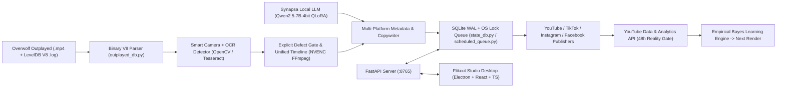
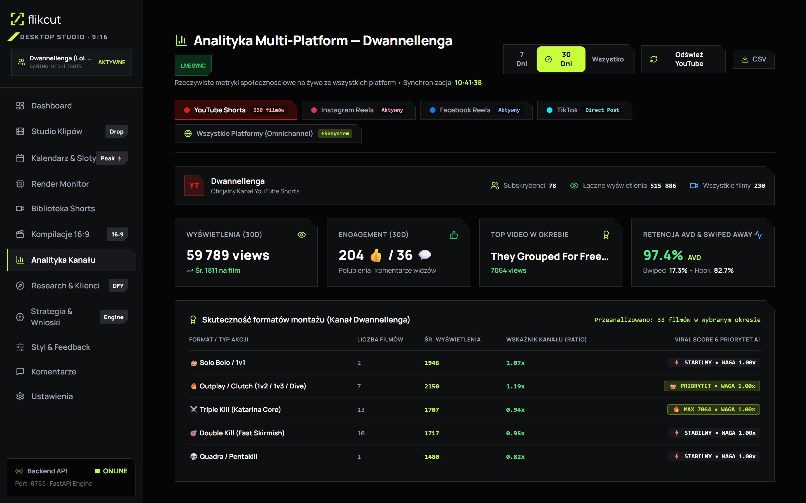
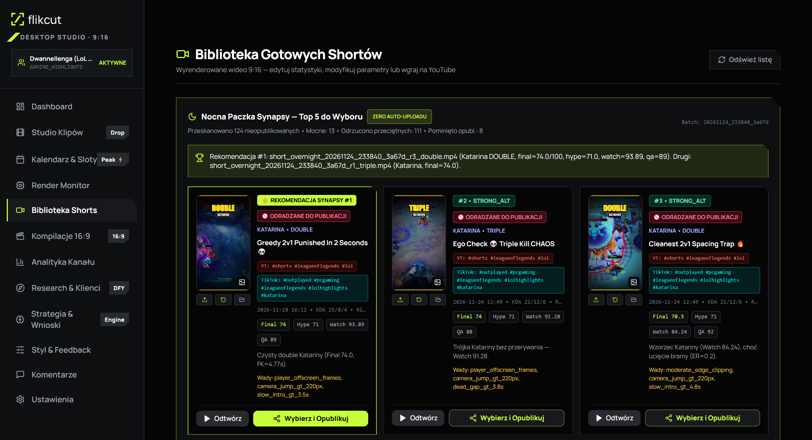
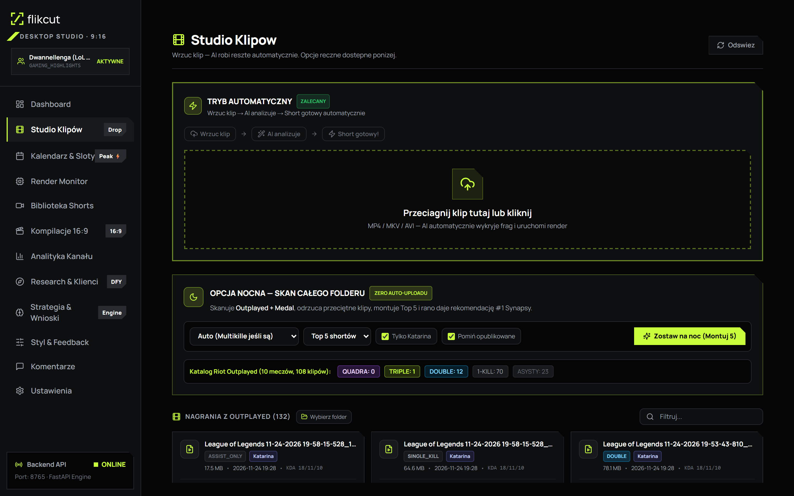
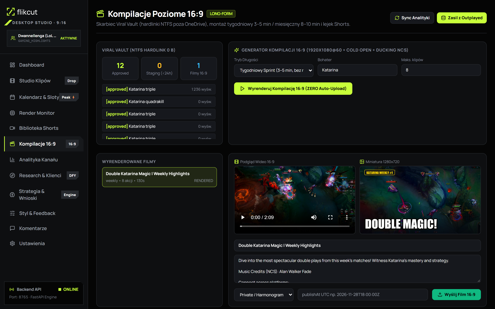
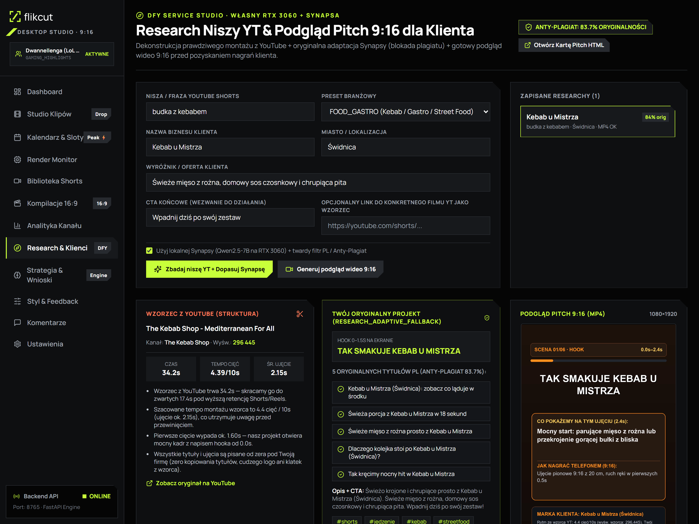

# Flikcut Studio (Shortsyt) — Autonomous Local-GPU Video & Multi-Platform Publishing Engine

[](https://github.com/BATTLEMETAL/Shortsyt/actions/workflows/ci.yml)
[-brightgreen)](.)
[-8A2BE2)](.)
[](.)
[](.)
[](.)
[-FF0000)](https://www.youtube.com/@dwannellenga471/shorts)

> **End-to-end autonomous 9:16 & 16:9 video engineering, local LLM inference, and multi-platform distribution system.** Designed to run 100% locally on consumer GPU hardware (RTX 3060 12 GB VRAM) with zero paid cloud API dependency in the core generation path.

---

## 📊 Verified Production Telemetry

| Metric | Production Result |
|---|---|
| **Production Channel** | [Dwannellenga (@dwannellenga471)](https://www.youtube.com/@dwannellenga471/shorts) |
| **Scale & Reach** | **230+ Published Shorts** · **515K+ Total Views** |
| **30-Day Retention (YT Analytics API)** | **97.4% Average Percentage Viewed** · **17.3% Swiped Away** |
| **48h Post-Publish Reality Gate** | **213 Audited Videos** (`66.2%` `FIT_CONFIRMED` via RWI composite score) |
| **Automated Test Suite** | **430 Passing `pytest` Tests** (`117` engine + `313` backend & integration) |
| **Inference & Render Cost** | **$0 Cloud API Cost** (`Qwen2.5-7B-4bit QLoRA v2` + `FFmpeg NVENC`) |

---

## 🧠 Core Engineering Systems

### 1. Local AI Inference & Fine-Tuning (`Synapsa Qwen2.5-7B-4bit QLoRA v2`)
- **Zero-Cloud Copywriting & Classification (`lol_agent/synapsa_engine.py`, `synapsa_title_trainer.py`):** Offloads hook/title generation, pinned comments, comment replies, and multi-platform descriptions (`YouTube Shorts`, `TikTok`, `Instagram Reels`, `Facebook Reels`) to a locally served 4-bit quantized **Qwen2.5-7B** model with LoRA adapters trained on empirical channel telemetry.
- **Anti-Slop & Regression Guards (`lol_agent/synapsa_conversation_learner.py`):** Programmatic rejection of LLM clichés, strict ground-truth binding to HUD telemetry, and automated watchability comparison checks against historical before/after parameter deltas.

### 2. Binary Overwolf / Outplayed LevelDB V8 Parser (`lol_agent/outplayed_db.py`)
- **Zero-Dependency Chromium IndexedDB `.log` Decoder:** Parses binary Chromium LevelDB/IndexedDB V8 wire records directly from disk using custom varint/zigzag/IEEE-754 decoding without launching Electron or LevelDB native bindings.
- **Accurate Event Anchoring:** Extracts exact kill timestamps (`kill`, `doublekill`, `triple`, `quadrakill`, `pentakill`), K/D/A stats, match outcome, and champion identity while filtering deleted/`.Trash` artifacts and misaligned clips.

### 3. Computer Vision Smart Camera & Unified FFmpeg Timeline (`lol_agent/smart_camera.py`, `lol_agent/lol_timeline.py`, `lol_agent/lol_editor.py`)
- **1080p HP-Bar Tracking & Kinematic Smoothing:** Color-space isolation of player health bars with dynamic dash/teleport snapping, combat-centroid fallback during occlusion, and kill-banner stabilization for crisp `1080x1920 @ 60fps` vertical crops.
- **Unified Timeline Engine & Pre-Flight Quality Validator (`lol_agent/lol_quality_validator.py`):** Replaces naive scalar quality heuristics with explicit failure assertions (`center_blocked_kills`, `camera_peak_step > 220px`, `intro_too_long`, OCR kill visibility, `11–15s` pacing bounds) and hardware-accelerated NVENC encoding.
- **16:9 Long-Form Compilations (`lol_agent/lol_longform_montage.py`, `lol_agent/commercial_montage.py`):** Automated multi-clip highlight compilations with chapter markers, hero thumbnails, and beat-aligned transitions.

### 4. 48h Reality Gate & Empirical Bayes Learning (`lol_agent/lol_performance_tracker.py`, `lol_agent/learning_engine.py`)
- **Closed-Loop YouTube Analytics Calibration:** Automatically reconciles published uploads with live YouTube Data API & Analytics API telemetry (`views`, `engaged_view_rate_pct`, `avg_view_pct`, `swiped_away_pct`) into an atomic JSONL performance log and Real Watchability Index (`RWI`).
- **Shrinkage-Regularized Format Weighting:** Computes median-shrunk action weights, duration buckets (`short` / `balanced` / `cinematic`), and `Viral Vault` promotion (`lol_agent/viral_vault.py`, zero-byte NTFS hardlinks).

### 5. Concurrent Multi-Platform Publisher & Storage Reliability (`lol_agent/state_db.py`, `lol_agent/scheduled_queue.py`)
- **SQLite WAL & Cross-Platform OS File Locking:** Stores scheduled posts, publication fingerprints, and slot queues in `SQLite` (`WAL` mode, busy timeouts) guarded by OS-level locks (`msvcrt` on Windows / `fcntl` on POSIX) to eliminate duplicate uploads under concurrent workers.
- **Multi-Network Distribution:** Automated publishing and OAuth2/PKCE lifecycle across YouTube Data API v3, TikTok Direct Post, Instagram Graph API, and Facebook Reels (`lol_agent/multi_publisher.py`, `tiktok_publisher.py`, `facebook_publisher.py`).

### 6. Autonomous DFY Niche Research & Anti-Plagiarism Engine (`lol_agent/niche_research_engine.py`, `lol_agent/api/routers/research.py`)
- **Multi-Source Reference Intelligence:** Searches high-performing vertical references, analyzes hook cadence and visual pacing, and outputs HTML pitch decks & production storyboards while enforcing originality/anti-plagiarism similarity thresholds (`<= 0.35`) and fallback adaptation when LoRA adapters differ from domain context.

---

## 🏗️ System Architecture



---

## 🖥️ Flikcut Studio — Live Production UI

| Live YouTube & Multi-Platform Telemetry | Explicit Overnight Defect Gate |
|---|---|
|  |  |
| *Live YouTube Data & Analytics API dashboard (`230` videos, `59.8K` / 30d views, top hit `7,064` views, format ratios, `97.4%` AVD).* | *Overnight selector replacing opaque 0–100 scores with explicit defect assertions (`offscreen`, `camera_jump`, `slow_intro`) before upload.* |

| Binary Outplayed LevelDB / V8 Ingest | 16:9 Long-Form Compilations & Viral Vault |
|---|---|
|  |  |
| *Zero-dependency Chromium IndexedDB `.log` decoder extracting exact kill tiers and K/D/A across 108 clips / 10 matches.* | *Zero-byte NTFS hardlink `Viral Vault` + NVENC 1080p60 weekly highlight compiler with 1280x720 thumbnail generation.* |

### Autonomous DFY Niche Research & Anti-Plagiarism Engine (`RTX 3060 + Synapsa`)

*Deconstructs viral niche pacing patterns (`296K+` reference views) into original storyboards with strict anti-plagiarism similarity gating (`83.7%` originality).*

---

## 📂 Repository Layout

```text
├── lol_agent/                  # Core Python AI, CV, rendering & learning engine
│   ├── api/                    # FastAPI server, JWT auth, modular APIRouters & job runner
│   ├── autonomous/             # Clip watcher & autonomous pre-render evaluator
│   ├── engine_tests/           # 117 standalone engine, watchability & learning unit tests
│   ├── game_profiles/          # Modular game & commercial-ad detection profiles
│   ├── metadata_profiles/      # Channel-specific SEO & narrative copy profiles
│   ├── outplayed_db.py         # Chromium IndexedDB V8 binary log decoder
│   ├── synapsa_engine.py       # Local Qwen2.5-7B 4-bit inference bridge
│   ├── smart_camera.py         # 1080p HP-bar tracking & 9:16 trajectory engine
│   ├── lol_timeline.py         # Unified audio/video/speed-ramp timeline builder
│   ├── learning_engine.py      # Empirical Bayes tuning & 48h Reality Gate analytics
│   ├── niche_research_engine.py# DFY niche discovery, anti-plagiarism & pitch generator
│   └── state_db.py             # SQLite WAL + OS file-locking persistence layer
├── shortsyt-desktop/           # Electron 32 + React 18 + TypeScript Studio UI
│   ├── electron/               # Main process & preload bridge
│   └── src/                    # Analytics, Clip Browser, Compilations, Niche Research & Calendar
├── scripts/                    # CLI telemetry reports & OAuth helpers
├── tests/                      # 313 pytest unit & FastAPI integration tests
├── docs/                       # Static showcase & OAuth verification pages
├── .github/workflows/ci.yml    # GitHub Actions pytest & coverage workflow
├── pyproject.toml              # Package metadata, ruff & pytest configuration
└── requirements.txt            # Python production & test dependencies
```

---

## 💻 Quick Start

### 1. Backend & Test Suite
```powershell
python -m venv venv313
.\venv313\Scripts\Activate.ps1
pip install -r requirements.txt

# Run full automated test suites (430 tests total)
python -m pytest lol_agent/engine_tests/ --noconftest -q
python -m pytest tests/ -q

# Launch FastAPI server (port 8765)
uvicorn lol_agent.api.main:app --host 0.0.0.0 --port 8765
```

### 2. Electron Desktop Studio (`shortsyt-desktop/`)
```powershell
cd shortsyt-desktop
npm install
npm run build     # TypeScript check + Vite bundle
npm run dev       # Launch Electron + Vite UI
```

---

## 🔒 Security & Data Hygiene
- Credentials, OAuth tokens (`accounts/`, `client_secret*.json`, `*.pickle`), local databases (`*.db`, `*.jsonl`), learned internal model state, and machine-specific paths are excluded from version control via `.gitignore` and environment configuration (`.env.example`).
