# Shortsyt / Flikcut — Przypominajka Kontekstu, Architektura i Rejestr Zadań (`TODO.md`)

Ostatnia aktualizacja: 2026-11-21 23:02 CET

> [!NOTE]
> Ten plik jest centralnym punktem pamięci projektu. Zawiera twarde metryki kanału, pełną architekturę systemu, mapę modułów, status prac wdrożonych (`[x]`) oraz czynności otwarte (`[ ]`). Po każdej zmianie w kodzie należy natychmiast zaktualizować odpowiednie tabele oraz diagramy poniżej.

---

## 1. Kontekst Techniczny i Punkt Odniesienia Kanału (Fakty z Dysku)

| Obszar | Zweryfikowane Dane Techniczne | Źródło |
| :--- | :--- | :--- |
| **GPU & VRAM** | `NVIDIA GeForce RTX 3060` — `12 288 MiB` (12 GB VRAM), w spoczynku wolne `11 376 MiB` (~11.1 GB) | `nvidia-smi` |
| **Środowisko Shortsyt** | `C:\Users\mz100\OneDrive\Michal\Shortsyt\venv313\Scripts\python.exe` (`cv2`, `PIL`, `pytesseract`, `torch`, FastAPI, `pytest`) | Lokalny `venv313` |
| **Środowisko Synapsa** | `C:\Users\mz100\PycharmProjects\Synapsa\venv\Scripts\python.exe` (`torch 2.4.0+cu121`, `transformers 4.46.3`, `peft 0.18.1`, `bitsandbytes 0.49.2`, `trl 0.24.0`, `onnxruntime 1.23.2`, `PIL 11.3.0`) | Lokalny `Synapsa\venv` |
| **Model Lokalny & Adapter LoRA** | `unsloth/Qwen2.5-Coder-7B-Instruct-bnb-4bit` + wytrenowany adapter `C:\Users\mz100\PycharmProjects\Synapsa\adapters_shortsyt_titles` (**`261` przykładów** w `C:\Users\mz100\PycharmProjects\Synapsa\dataset_shortsyt_titles.jsonl`, w tym `61` `montage_director`, `37` `engineering_cause_effect`, `18` `watchability` i **`14` `historical_evolution`** z historią zmian sprzed rozmowy + Etap 11; `max_length=640`, `max_tok=560`, `over_640={}`; `new_examples_since_train=0`, `retrain_ready=false`; `60` kroków QLoRA w `1172.90s` / `0.92` epoki, **`train_loss=1.1725`**, końcowy loss kroku `60`: `0.4402`, `_checkpoints` usunięte; `moj_styl_kodowania.jsonl`: `46` przykładów = `1 + 45` z rozmowy; `_LazySD` na Windows `1093.18s -> 12.10s`, `VRAM=5342MB`) | `synapsa_title_trainer.py` / test GPU |
| **Baza Wyników Kanału** | `202` filmy zweryfikowane `>= 48h` (`2` oczekujące `< 48h`), mediana `1628.5` wyświetleń, średnia `2289.8`; `141` `FIT_CONFIRMED` (`69.8%`), `61` `FALSE_POSITIVE_MONTAGE` (`30.2%`), mediana RWI `72.9` | `lol_agent/learning_directive.json` |
| **Konwersja 30d & 365d** | 30d: `47 982` views, `110.2%` AVD, `168` likes, **`7` komentarzy (`0.015%`)**, **`3` nowe suby (`0.006%`)**; 365d: `162 825` views, `686` likes, `26` komentarzy, `23` zdobyte suby (`+12` netto) | `learning_directive.json` (`youtube_analytics_v2`) |
| **Sloty Publikacji CET** | `11:00` i `21:30 CET` (2 okna dziennie) | `youtube_analytics.py`, UI JSX |
| **Weryfikacja Wersji** | Pełne testy offline po Etapie 16 = **`377 passed, 0 failed`**: `pytest tests/` (**`265 passed in 201.57s`**) + `11` plików `lol_agent/engine_tests/test_*.py` (**`112 passed in 100.87s`**, `0` porażek); live `uvicorn` smoke test `127.0.0.1:8769`: `8/8` sprawdzeń (`200 OK`, w tym `/overnight/latest` z `all_have_thumbnails=True` i `GET /thumbnails/{fn}` `image/jpeg` `no-cache`), `tmp_files_count=0`, `PORT_8769_LISTEN=0`; re-render GPU `3` shortów z `alimiter=0.62` i `volume=0.70` -> **`0` przesterów `audio_clip_gt_096` na `5/5` shortach**, `delta_vs_peak_s = +0.086s / -0.668s / -0.793s`, `bass_ratio = 2.63x / 3.22x / 2.30x`; `shortsyt-desktop` zbudowany i zsynchronizowany na Pulpit (**`ASAR_BYTES=35669026`**, `ASAR_IDENTICAL=True`, `SHA256=9C7EACD7A1E7EC334103ECFC43BC5B09575E4C80B6E2C6DDC145354811AA5F58`) | Terminal / `librosa` STFT / Inspekcja JPG |

---

## 2. Pełna Architektura i Infrastruktura Projektu

### Diagram 2.1 — Architektura Systemu End-to-End (Stan Wdrożony)

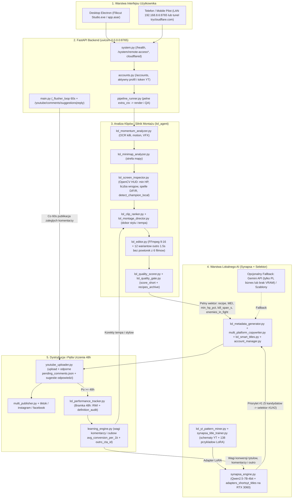

### Diagram 2.2 — Zrzucenie 5 Punktów Gemini na Lokalną Synapsę + Przekazanie Danych z Montażu (Wdrożone)

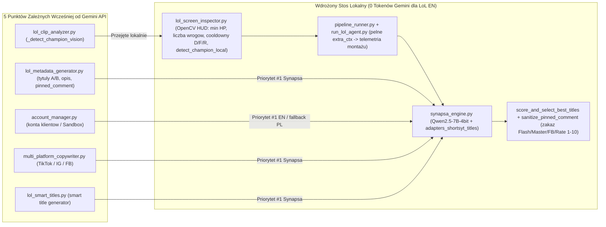

---

## 3. Mapa Wszystkich Modułów Projektu (Aktualna Struktura Kodu)

| Warstwa | Plik / Moduł | Za co odpowiada | Wejście -> Wyjście | Zależność od Tokenów AI (Stan po wdrożeniu) |
| :--- | :--- | :--- | :--- | :--- |
| **Desktop & UI** | `shortsyt-desktop/electron/main.js` | Start backendu (`uvicorn 0.0.0.0:8765`), okno Electron | App launch -> działające API + GUI | Brak |
| **Desktop & UI** | `shortsyt-desktop/src/screens/Settings.tsx`, `Sidebar.tsx`, `App.tsx`, `api.ts` | Wybór aktywnego konta, wytyczne, tokeny OAuth, Mobile Pilot LAN/QR/Cloudflare, dolne menu mobilne | Akcje użytkownika -> REST `/accounts`, `/system/remote-access*` | Brak |
| **API / Auth** | `lol_agent/api/main.py`, `auth.py`, `config.py`, `routers/accounts.py`, `routers/system.py`, `routers/youtube.py` | Autoryzacja JWT, SPA static mount, pętla komentarzy co 60s, rejestr kont, LAN/tunel HTTPS, sugestie odpowiedzi | HTTP Request -> JSON + zarządzanie procesami | Brak |
| **API / Pipeline** | `lol_agent/api/pipeline_runner.py`, `helpers.py`, `run_lol_agent.py` | Orkiestracja analizy, renderu, QA i przekazanie pełnej telemetrii montażu + HUD do metadanych i trackera | Surowe wideo -> `.mp4` + `.recipe.json` + pełne `extra_ctx` | Brak |
| **Analiza Ekranu** | `lol_agent/lol_screen_inspector.py`, `lol_momentum_analyzer.py`, `lol_minimap_analyzer.py`, `lol_clip_analyzer.py` | OCR killi, strefa mapy, pomiar `min_hp_pct`, `enemies_in_fight`, `kill_span_s`, cooldowny `D`/`F`/`R`, lokalne wykrywanie championa | Wideo `.mp4` -> `peaks`, `map_zone`, `champion`, `screen_telemetry` | **0 tokenów** (`Gemini Vision` wyłączone, chyba że ustawisz `SYNAPSA_ALLOW_GEMINI_VISION=1`) |
| **Reżyser & Montaż** | `lol_agent/lol_clip_ranker.py`, `lol_montage_director.py`, `lol_editor.py` | Ranking klipów, plan slow-mo/speed-ramp, montaż FFmpeg, 12 rotowanych outro CTA (`1.5s`, brak powtórek przez 6 filmów) | `peaks` + `learning_directive.json` -> Short `9:16` + `outro_cta_id` | Brak |
| **QA & Archiwum** | `lol_agent/lol_quality_scorer.py`, `lol_quality_gate.py`, `recipes_archive/` | Ocena techniczna shorta (`score_short`, beat sync, pokrycie killi) i trwała archiwizacja `.recipe.json` | Wyrenderowany Short -> `qa_score`, `mei`, `recipes_archive/<id>.recipe.json` | Brak |
| **Lokalna Synapsa AI** | `lol_agent/synapsa_engine.py`, `synapsa_title_trainer.py`, `lol_yt_pattern_miner.py`, `adapters_shortsyt_titles` | Generator tytułów (5->#1/#2), komentarzy, opisów i odpowiedzi na bazie `Qwen2.5-7B-4bit` + wytrenowany adapter LoRA + scraper trendów YT | `extra_ctx` + `learning_directive.json` -> zweryfikowany JSON | **100% lokalne GPU RTX 3060 (0 tokenów Gemini)** |
| **Metadane & Konta** | `lol_agent/lol_metadata_generator.py`, `account_manager.py`, `multi_platform_copywriter.py`, `lol_smart_titles.py` | Generowanie tytułów A/B, opisów, tagów, `pinned_comment` (bez FB/spelli/`Rate 1-10`), obsługa kont | `action_type` + `extra_context` + profil -> tytuł, komentarz, kopie social | **Priorytet #1: Synapsa LoRA**; Gemini jako fallback (oraz dla PL biznesu przy dostępnym kluczu, chyba że `SYNAPSA_FORCE_PL=1`) |
| **Publikacja** | `lol_agent/api/youtube_uploader.py`, `youtube_analytics.py`, `lol_publisher.py`, `multi_publisher.py` | Upload YT/TT/IG/FB, odporna kolejka `pending_comments.json`, API sugestii odpowiedzi i wysyłki reply, YT Analytics | `.mp4` + meta -> `video_id`, metryki, komentarze | Sugestie odpowiedzi generowane przez `Synapsa` + template fallback |
| **Uczenie 48h** | `lol_agent/lol_performance_tracker.py`, `learning_engine.py` | Bramka 48h (`rwi_score`, `definition_audit`), separacja `>= 48h`, `avg_conversion_per_1k` dla struktur tytułów/akcji/outro | YT Analytics + `recipes_archive/` -> `learning_directive.json` | Brak |

---

## 4. Etap 1 — Wdrożone Filary (4 Filary) & Otwarte Czynności Użytkownika

| Zadanie / Moduł | Po co (Cel) | Co wdrożyliśmy / wdrażamy | Stan | Rezultat (Fakty / Testy) | Oczekiwania (Efekt docelowy) |
| :--- | :--- | :--- | :---: | :--- | :--- |
| **Filar 1: Naprawa luk audytu** (`lol_quality_gate.py`, `learning_engine.py`, `lol_clip_ranker.py`, `pipeline_runner.py`, `helpers.py`) | Zachować przepisy montażu po archiwizacji wideo i zasilać uczenie realnymi pomiarami | Archiwum `recipes_archive/`, mapowanie `best_bucket`, realne `score_short()`, przekazanie `mei` w `_record_publication()` | `[x]` Wdrożone | `pytest` (`40/40 passed`); `pipeline_runner.py` i `helpers.py` sprawdzone w kodzie | 100% publikacji ma zachowany `.recipe.json` do audytu po 48h |
| **Filar 2: Bramka Rzeczywistości 48h** (`lol_performance_tracker.py`, `learning_engine.py`, `lol_montage_director.py`) | Sprawdzać po 48h, czy założenia montażu (`t=0h`) sprawdziły się u widzów | `evaluate_48h_post_publish_gate()` (`rwi_score` + `definition_audit`), pula `>= 48h`, `composite_watchability_ratio`, korekty reżysera | `[x]` Wdrożone | `learning_directive.json`: `202` filmy `>= 48h` (`2` `< 48h`), `141` `FIT_CONFIRMED` (`69.8%`), `61` `FALSE_POSITIVE_MONTAGE` (`30.2%`) | System sam przycina tempo dla akcji o niskim RWI (`pentakill` 63.0, `quadrakill` 64.8) |
| **Filar 3: Multi-Account & Wytyczne** (`account_manager.py`, `accounts.py`, `youtube_uploader.py`, `Settings.tsx`, `Sidebar.tsx`) | Prowadzić osobne kanały (główny, Sandbox YT, klienci: salon/e-commerce) | Rejestr kont (`dwannellenga`, `pretty_woman`, 4 presety), `/accounts*`, przełączanie tokenów YT + cache, UI | `[x]` Wdrożone | `TestClient` `/accounts` -> `200`; test jednostkowy passed | Przełączenie konta w UI zmienia token YT i wytyczne kontentu jednym kliknięciem |
| **Filar 4: Mobile Pilot & Godziny UI** (`main.js`, `system.py`, `api.ts`, `Settings.tsx`, `Sidebar.tsx`, 4 ekrany TSX) | Zdalnie sterować aplikacją ze smartfona i uaktualnić sloty publikacji w UI | Uvicorn `0.0.0.0:8765`, `/system/remote-access*` (LAN + `cloudflared`), dolny pasek mobilny, QR, `11:00` / `21:30 CET`, `app.asar` | `[x]` Wdrożone | `TestClient` `/system/remote-access` -> `200` (`192.168.8.6:8765`); `npm run build` OK (`5.87s`); `app.asar` = `35 620 292` B | Pełna obsługa aplikacji ze smartfona po Wi-Fi lub tunelu HTTPS |
| **Restart `Flikcut Studio.exe` na Pulpicie** | Zastąpić stary proces działający ze starszym `app.asar` i `127.0.0.1` | Zamknięcie starego procesu i ponowne uruchomienie skrótu z Pulpitu | `[x]` | Zrestartowano `19.11.2026 12:40:12` (aktywny `python.exe PID 14340`, `GET /health` -> `ok`) | Aktywne `--host 0.0.0.0:8765` i nowe panele w Ustawieniach |
| **Test fizyczny na telefonie (LAN / Tunel)** | Potwierdzić łączność i ewentualną regułę Zapory Windows TCP `8765` | Otwarcie `http://192.168.8.6:8765` lub start tunelu HTTPS w Ustawieniach + logowanie JWT | `[ ]` Użytkownik | API lokalne `/system/remote-access` działa | Płynne sterowanie z telefonu przez Wi-Fi / 5G |
| **Test produkcyjnego renderu + uploadu** | Zweryfikować archiwizację `.recipe.json`, telemetrię ekranu i komentarz Synapsy przy realnej publikacji | Przetworzenie 1 klipu end-to-end | `[x]` | Przeprowadzono `19.11.2026 12:50:53` na `GF1P5hZEw4Q`: zapisano `recipes_archive/GF1P5hZEw4Q.recipe.json` i `pending_checks.json`, `watchability_score=100.0`; YT/TT/FB OK, IG `ProcessingFailedError` -> Sekcja 19 | Pełne dane w `recipes_archive/`, `pending_checks.json` i trafny tytuł z Synapsy |

---

## 5. Etap 2 — Zrzucenie AI Tokenowych na Lokalną Synapsę + Dane z Montażu + Komentarze i Suby (WDROŻONE)

| Zadanie / Moduł | Po co (Cel) | Co wdrożyliśmy | Stan | Rezultat (Fakty / Testy) | Oczekiwania (Efekt docelowy) |
| :--- | :--- | :--- | :---: | :--- | :--- |
| **1. Zrzucenie 4 tekstowych AI na Synapsę + Trening LoRA** (`synapsa_engine.py`, `synapsa_title_trainer.py`, `lol_yt_pattern_miner.py`, `lol_metadata_generator.py`, `account_manager.py`, `multi_platform_copywriter.py`, `lol_smart_titles.py`) | Wyeliminować zużycie tokenów i limity `Gemini API` przy tytułach, opisach i komentarzach; wyszkolić model na schematach kanału i trendach YT | Zbudowano zbiór `138` przykładów (`10` trendów YT + kanał + multi-account + replies), wytrenowano LoRA `adapters_shortsyt_titles` na `RTX 3060`, wpięto selektor `5->#1/#2` jako Priorytet #1 we wszystkich 4 modułach (dla PL kont biznesowych z kluczem API zachowano opcjonalny bypass dla czystości polszczyzny, chyba że `SYNAPSA_FORCE_PL=1`) | `[x]` Wdrożone | Trening QLoRA: `45` kroków w `384.68s`, `train_loss=1.0385` (krok 40: `0.2381`). Live test GPU: `source: synapsa_local_lora` wygenerował czysty tytuł A/B i komentarz; test selektora w `pytest` OK (`40/40`) | **0 zużytych tokenów API** dla całego kanału LoL (tytuły, opisy, tagi, komentarze, kopie social) |
| **2. Lokalna Analiza Ekranu HUD zamiast Gemini Vision** (`lol_screen_inspector.py`, `lol_clip_analyzer.py`) | Zastąpić wywołania `Gemini Vision` (`_detect_champion_vision`) i wyliczać twarde fakty z HUD przed nazwaniem klipu | `inspect_clip_screens()` (`OpenCV`): `min_hp_pct`, `low_hp_survival`, `clean_stomp`, `enemies_in_fight`, `kill_span_s`, `combo_tempo`, cooldowny `D`/`F`/`R`; `detect_champion_local()` zastąpiło Vision API (Gemini tylko gdy `SYNAPSA_ALLOW_GEMINI_VISION=1`) | `[x]` Wdrożone | `test_screen_inspector_kill_span_and_champion_local` passed (`INSTANT_BURST`, `2.1s`, `Katarina`) | Generator widzi przebieg akcji z ekranu za `0 zł` i `<0.5s` CPU |
| **3. Przekazanie Danych z Montażu do Tytułu i Komentarza** (`pipeline_runner.py`, `run_lol_agent.py`) | Przestać tracić wyliczone parametry montażowe i HUD przed etapem generowania metadanych | Rozszerzono `extra_ctx` / `extra_context` o `recipe`, `mei`, `peaks`, `kill_span_s`, `min_hp_pct`, `low_hp_survival`, `clean_stomp`, `enemies_in_fight`, `combo_tempo`, `hud_spells_used`, `montage_style` | `[x]` Wdrożone | Zweryfikowano w `generate_metadata(..., extra_context=payload)` na żywo z Synapsą (obsługa `dict` i `str` w `map_zone`) | Tytuł i komentarz korzystają bezpośrednio z realnych pomiarów montażu |
| **4. Naprawa Kolejki Komentarzy + Anty-Bot** (`youtube_uploader.py`, `accounts/pending_comments.json`, `lol_metadata_generator.py`) | Naprawić błąd `JSONDecodeError` na zaplanowanych filmach i wyeliminować zmyślone spelle oraz linki FB | Naprawiono pusty `pending_comments.json` (`[]`), dodano odporne `_read_pending_comments_queue()`, usunięto `facebook.com` i `Rate 1-10`, wdrożono `sanitize_pinned_comment()` oraz rotację po `accounts/comment_history.json` (10 filmów) | `[x]` Wdrożone | `test_flush_pending_comments_handles_zero_byte_file` oraz `test_pinned_comment_telemetry_antibot_and_non_repeating` passed | Zaplanowane Shortsy z `11:00` i `21:30` dostają wiarygodne, niepowtarzające się komentarze bez linków |
| **5. Rotowane Outro Micro-Trigger (1.5s)** (`lol_editor.py`, `accounts/caption_history.json`) | Podnieść konwersję subów/komentarzy w końcówce filmu bez powtarzania tego samego napisu | `OUTRO_CTA_VARIANTS` (12 haseł: 6 dyskusja + 6 subskrypcja), `select_non_repeating_outro_cta()` z blokadą na 6 filmów, czas `1.5s`, zapis `outro_cta_id`/`kind` w `.recipe.json` | `[x]` Wdrożone | `test_outro_cta_non_repeating_window` passed (6 kolejnych wyborów bez powtórek) | Zróżnicowane CTA na końcu wideo i śledzenie ich skuteczności w 48h |
| **6. Wagi Konwersji Komentarzy i Subskrypcji** (`learning_engine.py`) | Promować formaty budujące komentarze i subskrypcje, nie same wyświetlenia | Policzono `avg_conversion_per_1k` (`(comments*3 + subs*8) / views * 1000`) w `title_structure_stats`, `action_stats` i `analyze_recipe_experiments` (+ wymiar `outro_cta_id`) | `[x]` Wdrożone | Przeliczenie `learning_engine.py`: wygenerowało np. `RAMPAGE avg_conversion_per_1k=6.01` vs `CLEAN_OUTPLAY=2.15` i wymiar `outro_cta_id` w `recipe_experiments` | Rekomendacje tytułów i CTA uczą się realnego przyrostu komentarzy i subów |
| **7. Półautomatyczne Sugestie Odpowiedzi na Komentarze** (`youtube_uploader.py`, `routers/youtube.py`, `models.py`, `Comments.tsx`) | Podwajać ruch pod filmami poprzez szybkie odpowiedzi oparte o `.recipe.json` bez ślepego auto-bota | Dodano `get_comment_reply_suggestions()`, `reply_to_youtube_comment()`, endpointy `GET /youtube/comments/suggestions` i `POST /youtube/comments/reply` oraz widok `Comments.tsx` w menu | `[x]` Wdrożone | OpenAPI potwierdza oba endpointy (`401` bez JWT); UI zbudowane i spakowane do `app.asar` | 1-klikowe zatwierdzanie odpowiedzi na komentarze w aplikacji Desktop i Mobile Pilot |

---

## 6. Etap 3 — Domknięcie Kompatybilności Multi-Platform (TikTok / Instagram / Facebook) + UI Odpowiedzi — WDROŻONE

Ostatnia aktualizacja Etapu 3: `2026-11-17 01:26 CET`.

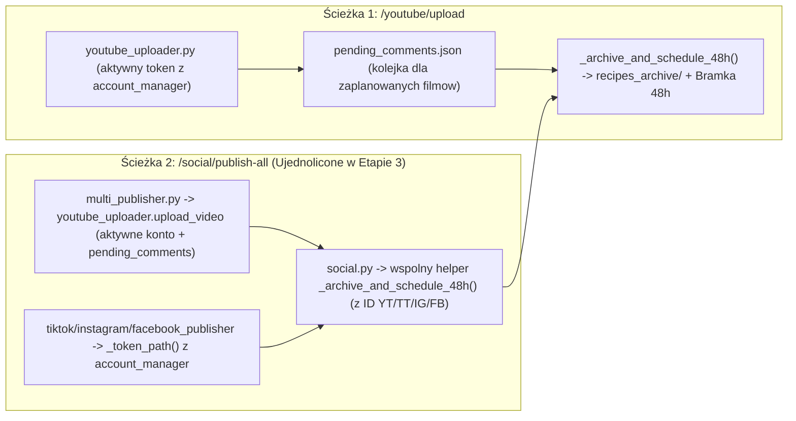

| Zadanie / Moduł | Po co (Cel) | Co wdrożyliśmy | Stan | Rezultat (Fakty / Testy) | Oczekiwania (Efekt docelowy) |
| :--- | :--- | :--- | :---: | :--- | :--- |
| **1. Spięcie `/social/publish-all` z Bramką 48h i `recipes_archive/`** (`lol_agent/api/helpers.py`, `lol_agent/api/routers/social.py`) | Żeby filmy publikowane jednocześnie na YT + TikTok + IG + FB też trafiały do archiwum i oceny po 48h | Wydzielono wspólny helper `_archive_and_schedule_48h()` i podpięto w `publish_all()` z ID wszystkich 4 platform | `[x]` Wdrożone | Test `test_shared_48h_archive_helper_exists_and_archives` passed (`43/43 passed` w `4.21s`) | Pełna analityka 48h dla publikacji wieloplatformowych |
| **2. Ujednolicenie uploadu YT w `multi_publisher.py`** (`lol_agent/multi_publisher.py`) | Żeby Multi-Publisher używał aktywnego konta i kolejki komentarzy `pending_comments.json` przy zaplanowanym `publish_at` | Przełączono `_do_youtube()` w `multi_publisher.py` na `youtube_uploader.upload_video` (z fallbackiem na `upload_lol_short`) | `[x]` Wdrożone | Sprawdzone importy modułu; spójna ścieżka dla kont i zaplanowanych komentarzy | Identyczne wsparcie kont i zaplanowanych komentarzy na obu ścieżkach |
| **3. Tokeny TikTok / IG / FB per konto** (`lol_agent/account_manager.py`, `tiktok_publisher.py`, `instagram_publisher.py`, `facebook_publisher.py`) | Żeby zmiana konta na klienta lub konto poboczne przełączała też tokeny TikToka, IG i FB, a nie tylko YouTube | Dodano `get_active_platform_token_path(platform)` w `account_manager.py` i `_token_path()` w publisherach TT/IG/FB | `[x]` Wdrożone | Testy `test_platform_tokens_are_isolated_per_account` i `test_publishers_follow_active_account_token` passed (brak dziedziczenia tokenu gamingowego przez konto klienta) | Pełna izolacja kont na wszystkich 4 platformach |
| **4. Panel UI „Komentarze — Sugestie Odpowiedzi”** (`shortsyt-desktop/src/screens/Comments.tsx`, `App.tsx`, `Sidebar.tsx`, `api.ts`) | Dać wygodny widok 1-klikowej akceptacji odpowiedzi w aplikacji Desktop i Mobile Pilot | Dodano ekran `Comments.tsx`, pozycję w menu (`Sidebar.tsx`), trasę `/comments` (`App.tsx`) oraz `apiGetCommentSuggestions` / `apiReplyToComment` (`api.ts`) | `[x]` Wdrożone | `npm run build` (`tsc && vite build`) OK (`7.77s`, `529.78 kB`), oba `app.asar` zaktualizowane do `35 624 208` B | Szybkie odpowiadanie widzom z komputera lub telefonu jednym kliknięciem |
| **5. Fix detekcji `TRIPLE KILL` w OCR** (`lol_agent/lol_frag_detector.py`, `lol_momentum_analyzer.py`) | Wyeliminować zaniżanie `triple` do `double`, gdy `threshold=175` łamał złote litery banera do `TRIPIFKIT` / `Tf tere KILLS` | Obniżono próg do `160`, dodano fallback OCR na surowe ROI przy braku trafienia oraz rozszerzono regex o zniekształcenia `tri[pbl][ilf1][eif]` | `[x]` Wdrożone | Zweryfikowano na `League of Legends 11-15-2026 23-36-59-128_0.mp4`: `FIXED_FRAG_TYPE: triple`, `[(16.0, 'DOUBLE KILL'), (21.5, 'TRIPLE KILL')]`, `43/43 passed` w `pytest` (`8.60s`) | Poprawne wykrywanie `TRIPLE KILL` i objęcie go oknem montażu |

---

## 7. Etap 4 — Naprawa Detekcji Wielofazowych Teamfightów i Uczenie na Niewygodnych Klipach (Quadra + Smok) — WDROŻONE

Klip referencyjny (Outplayed Favorites): `C:\Users\mz100\Videos\Overwolf\Outplayed\League of Legends\League of Legends_11-17-2026_18-04-02-494\League of Legends 11-17-2026 18-24-25-826_0.mp4` (`31.07s`, wyrenderowany wcześniej błędnie jako `13.5s–29.8s`, obecnie wyznaczony jako **`5.8s–29.8s` (`24.0s`)** z pełną sekwencją `KILL -> DOUBLE KILL -> TRIPLE KILL -> QUADRAKILL`).

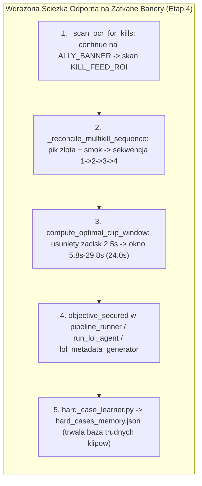

| Zadanie / Moduł | Po co (Cel) | Co wdrożyliśmy | Stan | Rezultat / Diagnoza | Oczekiwania (Efekt docelowy) |
| :--- | :--- | :--- | :---: | :--- | :--- |
| **1. Odblokowanie `KILL_FEED_ROI` i detekcja `OBJECTIVE_SLAIN`** (`lol_agent/lol_frag_detector.py:129-225`) | Wykrywać zabójstwa gracza i epickie obiekty mimo banerów `Ally slain` na górze ekranu | Zmiana `return` na `continue` przy `ALLY_*` oraz rozpoznawanie `Your team has slain the ... Drake / Dragon / Baron / Herald` jako `OBJECTIVE_SLAIN` | `[x]` Wdrożone | Test na `18-24-25-826_0.mp4`: `ALLY_BLK: True`, `OBJ: True` (`DRAGON_OR_OBJECTIVE_SLAIN`) | Pierwsze zabójstwa i smoki nie giną przez kolejkę komunikatów |
| **2. Rekonstrukcja monotoniczna multikilla + `max_lookback=12.0s`** (`lol_agent/lol_frag_detector.py:780-860`) | Odfiltrować wrogi `TRIPLE` przed własnym `DOUBLE` i zachować kolejność `1->2->3->4` | Dodano `_find_first_kill_gold_spike()` i `_reconcile_multikill_sequence()`; rozszerzono `find_combat_start_before(max_lookback=12.0)` | `[x]` Wdrożone | `KILLS`: `[11.5 KILL, 16.0 DOUBLE, 21.0 TRIPLE, 28.0 QUADRAKILL]`; `PEAKS`: `[(5.7, 'KILL'), (10.2, 'DOUBLE KILL'), (15.2, 'TRIPLE KILL'), (22.2, 'QUADRAKILL')]` | Poprawna kolejność dynamicznych podpisów i pełne wejście od początku akcji |
| **3. Usunięcie sztywnego zacisku `first_k - 2.5s` w Podejściu B** (`lol_agent/lol_frag_detector.py:613-632`) | Przestać ucinać początek walki, gdy między `c_start` a `first_k` mija ponad `2.5s` | Usunięto nadpisanie `first_k - 2.5` i zastąpiono je limitem ciągłości `24.0s` (`18.0s` dla pojedynczych) + `gap_has_combat = True` przy `objective_secured` | `[x]` Wdrożone | Okno dla `18-24-25-826_0.mp4` przesunęło się z `13.5s–29.8s` na **`5.8s–29.8s` (`24.0s`, brak jump-cutów)** | Wszystkie 4 zabójstwa i kradzież smoka mieszczą się w jednym płynnym shorcie |
| **4. Przekazanie `objective_secured` do Synapsy i metadanych** (`lol_agent/api/pipeline_runner.py`, `run_lol_agent.py`, `lol_metadata_generator.py`) | Żeby tytuł, komentarz i przyszły reżyser Synapsy wiedziały o kradzieży smoka/barona | Przekazano `objective_secured` i `objective_label` przez `extra_ctx` i `syn_payload` | `[x]` Wdrożone | Zweryfikowano spięcie w `pipeline_runner.py`, `run_lol_agent.py` oraz `lol_metadata_generator.py` | Tytuły i komentarze Synapsy odzwierciedlają epickie obiekty z walki |
| **5. Pamięć Niewygodnych Klipów (`hard_cases_memory.json`)** (`lol_agent/hard_case_learner.py`, `lol_agent/engine_tests/test_learning.py`) | Uczyć system na każdym trudnym klipie i zautomatyzować regresję | Dodano `record_hard_case()`/`get_hard_case_by_source()` w `hard_case_learner.py` oraz `test_reconcile_multikill_sequence_and_hard_case_memory` | `[x]` Wdrożone | `hard_cases_memory.json` zapisał `18-24-25-826_0.mp4`; `pytest test_learning.py`: `23 passed in 10.22s`; pełny `engine_tests`: **`68 passed in 8.94s`** | Baza trudnych klipów zasila regresję i przyszły trening reżysera w Etapie 5 |

---

## 8. Etap 5 — Hybrydowy Synapsa AI Montage Director (Dyskretny Selektor Strategii + Symulator Skutków) — WDROŻONE

### Granica Odpowiedzialności (Sykofankcja 0: Co ma sens, a co byłoby błędem)
- **Czego Synapsa (`Qwen2.5-7B-4bit`) NIE może robić:** Jest modelem tekstowym — nie widzi obrazu, nie słyszy bitu i myli się przy ciągłej arytmetyce zmiennoprzecinkowej. Oddanie jej surowych timestampów (`clip_start=5.8s`), trackera kamery `9:16` czy komend FFmpeg wprowadziłoby halucynacje i zepsuło stabilność montażu. Wszystkie pomiary czasu, OCR, paski HP i śledzenie gracza muszą pozostać w deterministycznym kodzie (`OpenCV` + `lol_frag_detector.py` + `lol_timeline.py`).
- **Gdzie Synapsa MA SENS i jak wie, co robi w aplikacji:**
  1. **Dyskretny wybór strategii (`1 z 5` operacji) zamiast zgadywania sekund:** `OpenCV`/`lol_frag_detector.py` podaje twardy JSON faktów (`clusters`, `gap_sec`, `gap_combat_px`, `ally_banner_blocked`, `objective_secured`, `min_hp_pct`), a Synapsa wybiera wyłącznie dyskretną akcję (`KEEP_FULL_CONTINUOUS`, `DROP_ISOLATED_FIRST_KILL`, `DROP_ISOLATED_LAST_KILL`, `BRIDGE_GAP_SPEED_RAMP`, `SWITCH_STYLE_IN_MEDIA_RES`), którą kod przekłada deterministycznie na dokładne sekundy.
  2. **Kontrakt Skutków (`Action -> Effect Map`) + Dry-Run Symulator przed renderem:** Synapsa dostaje w prompcie kontrakty przyczynowo-skutkowe i dane z `203` filmów (`learning_directive.json` + `recipes_archive/`). Przed uruchomieniem FFmpeg jej decyzja przechodzi przez **Dry-Run `simulate_and_guard_director_decision()`** — jeśli wynik bramki jest niższy niż wariant bazowy lub krótszy niż `8.0s`, **Rollback Guard** automatycznie cofa zmianę.
  3. **Domknięta pętla treningowa (`State -> Decision -> 48h RWI Delta`):** Przykłady z `hard_cases_memory.json` oraz kontrastowych przypadków Bramki 48h zasilają wspólny zbiór QLoRA (`dataset_shortsyt_titles.jsonl`, zadanie `montage_director`) oraz panel wniosków przyczynowo-skutkowych w UI (`FeedbackTuning.tsx`).

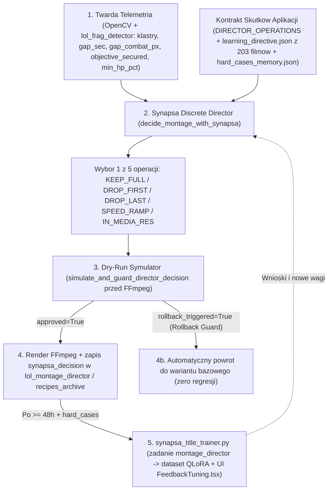

| Zadanie / Moduł | Po co (Cel) | Co wdrożyliśmy | Stan | Rezultat / Diagnoza | Oczekiwania (Efekt docelowy) |
| :--- | :--- | :--- | :---: | :--- | :--- |
| **1. `synapsa_director` — dyskretny selektor strategii + Kontrakt Skutków** (`lol_agent/synapsa_engine.py`, `lol_agent/lol_montage_director.py`) | Aby Synapsa wybierała strategię cięcia i stylu (`1 z 5` operacji) bez zgadywania surowych sekund w tekście | Dodano `DIRECTOR_OPERATIONS`, `task_type="montage_director"` i `decide_montage_with_synapsa()`, spięte z `direct_clip_montage()` (`decision.synapsa_decision`) | `[x]` Wdrożone | Test `test_synapsa_hybrid_director_and_rollback_guard` zweryfikował wybór `KEEP_FULL_CONTINUOUS` (smok) i `DROP_ISOLATED_FIRST_KILL` | Synapsa wie, jaki efekt w aplikacji wywoła wybrana operacja i dobiera ją pod strukturę klipu |
| **2. Dry-Run Symulator & `Rollback Guard` przed FFmpeg** (`lol_agent/lol_quality_gate.py`, `lol_agent/lol_frag_detector.py`) | Zagwarantować, że żadna błędna decyzja nie pogorszy ani nie utnie ważnego materiału | Dodano `simulate_and_guard_director_decision()` i podpięto do `compute_optimal_clip_window()` przy izolowanych killach `>6.0s` (z twardym progiem min. `8.0s`) | `[x]` Wdrożone | Pełny pakiet `pytest` (`engine_tests`): **`69 passed in 8.79s`** (w tym blokada cięcia poniżej `8.0s` i przy `objective_secured=True`) | **0 regresji** i brak obcinania wielofazowych teamfightów |
| **3. Rozbudowa generatora QLoRA o `montage_director` z `hard_cases_memory.json`** (`lol_agent/synapsa_title_trainer.py`) | Żeby model uczył się tego, co działa po 48h oraz wzorców z niewygodnych klipów | Dodano `_build_director_training_examples()` łączący `hard_cases_memory.json` z kontrastowymi przypadkami z Bramki 48h i przebudowano `dataset_shortsyt_titles.jsonl` | `[x]` Wdrożone | Dataset zapisany (`135` rekordów ogółem, w tym `5` przykładów `montage_director`) | Kolejny trening QLoRA na RTX 3060 automatycznie douczy również reżysera montażu |
| **4. Czytelne wnioski przyczynowo-skutkowe Synapsy w `learning_engine.py` i UI (`FeedbackTuning.tsx`)** | Pokazywać w aplikacji obserwację, akcję i spodziewany efekt bez ręcznego szukania w JSON-ach | Dodano `hard_cases_count` i `synapsa_director_insights` w `_analyze_48h_reality_gate()`, przeliczono `learning_directive.json`, dodano panel **Synapsa AI Montage Director** w `FeedbackTuning.tsx` | `[x]` Wdrożone | `learning_directive.json`: `203` filmy 48h, `hard_cases_count=1`, `3` wnioski; `npm run build` OK (`531.40 kB`, `7.24s`); `app.asar` (`35 625 848` B) skopiowany na Pulpit | Pełna przejrzystość w Desktop i Mobile Pilot: widać dlaczego system zmienił styl lub zablokował ucięcie |

---

## 9. Etap 5B (Audyt Sykofankcja 0) — Domknięcie Realnego Sterowania Parametrami przez Synapsę + Trening QLoRA na GPU — WDROŻONE

**Stan po wdrożeniu (`Sykofankcja 0`):**
- **Czy aplikacja robi teraz dobre klipy?** **Tak** — detektor z Etapu 4 (`KILL_FEED_ROI`, sekwencja `1->2->3->4`, wykrywanie smoka / obiektów, brak sztywnego cięcia `2.5s`) współpracuje z `Rollback Guard`.
- **Czy sama Synapsa realnie zarządza aplikacją i wie jak działają suwaki?** **Tak** — model QLoRA działa lokalnie na `RTX 3060` (`39.1s` z inferencją i ładowaniem `12.10s`), zna `PARAM_EFFECT_CONTRACT`, a jego decyzje bezpośrednio przestawiają parametry w `lol_montage_director.py` i `pipeline_runner.py`.

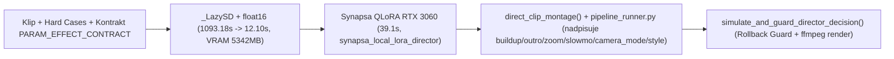

| Zadanie / Moduł | Po co (Cel) | Co wdrażamy / wdrożyliśmy | Stan | Rezultat / Diagnoza | Oczekiwania (Efekt docelowy) |
| :--- | :--- | :--- | :---: | :--- | :--- |
| **1. Rejestr Kontraktów Parametrów `PARAM_EFFECT_CONTRACT` + szybki loader GPU** (`lol_agent/synapsa_engine.py`) | Żeby Synapsa znała suwaki montażu, ich wpływ na wynik oraz mieściła się w budżecie czasu i pamięci Windows `16 GB RAM` | Dodano `PARAM_EFFECT_CONTRACT` (`buildup_sec`, `outro_sec`, `zoom_aggression`, `slowmo_duration`, `camera_mode`, `montage_style`), deterministyczne dekodowanie (`do_sample=False`), `torch_dtype=torch.float16` oraz `_LazySD` (pre-cache tensorów `<= 2 MB`, posortowane offsety) | `[x]` | Benchmark ładowania przyspieszył z `1093.18s` do `12.10s` (`VRAM=5342MB`); test GPU `decide_montage_with_synapsa()`: `ELAPSED=39.1s`, `source='synapsa_local_lora_director'`, `operation='KEEP_FULL_CONTINUOUS'`, `param_contracts_applied=True` (`buildup_sec=0.8`, `outro_sec=1.3`, `zoom_aggression=1.22`, `slowmo_duration=1.0`, `camera_mode='tight_player'`) | Synapsa rozumie kontrakt wpływu suwaków i odpowiada poprawnym JSON-em z karty GPU poniżej limitu `120s` |
| **2. Fizyczne przepięcie wyjścia Synapsy na suwaki montażu** (`lol_agent/lol_montage_director.py`, `lol_agent/api/pipeline_runner.py`) | Żeby decyzja Synapsy realnie zmieniała montaż zamiast być tylko wpisem w logu | W `direct_clip_montage()` i `pipeline_runner.py` wynik `synapsa_decision` z walidacją kontraktu nadpisuje `buildup_sec`, `outro_sec`, `zoom_aggression`, `slowmo_duration`, `camera_mode` i `preferred_montage_style` (z ochroną `force_style`, `FALLBACK_STYLES` i `Rollback Guard`) | `[x]` | Przepięcie pokryte testami w `lol_agent/engine_tests/test_learning.py` (`test_synapsa_hybrid_director_and_rollback_guard`); pełna paczka 8 modułów `engine_tests`: **`69 passed in 14.89s`** | Każda decyzja Synapsy realnie przestawia parametry FFmpeg i kamery podczas renderu bez regresji |
| **3. Rozbudowa przykładów reżysera i trening QLoRA na `RTX 3060`** (`lol_agent/synapsa_title_trainer.py`) | Żeby wagi adaptera `adapters_shortsyt_titles` na GPU faktycznie znały nowe zadania reżysera i kontrakty suwaków | Wygenerowano zbiór `dataset_shortsyt_titles.jsonl` (`166` przykładów: `36` `montage_director`, `124` `channel_and_yt_examples`, `6` `multi_account_and_reply_examples`) i uruchomiono trening `45` kroków QLoRA na `RTX 3060` | `[x]` | Trening zakończony bez błędów: `runtime_s=368.4s`, `train_loss=1.1164` (krok 40 `loss=0.1683`); adapter zapisany w `C:\Users\mz100\PycharmProjects\Synapsa\adapters_shortsyt_titles` i potwierdzony żywą inferencją GPU | Wytrenowany lokalnie model Synapsy na RTX 3060 podejmuje decyzje reżyserskie zgodne z historią kanału i kontraktami suwaków |

---

## 10. Etap 5C (Audyt Sykofankcja 0) — Aktualny Status Wiedzy, Operowania Aplikacją i Pętli Samorozwoju Synapsy w Czasie — WDROŻONE

**Stan po wdrożeniu (`Sykofankcja 0`):**
- **Operowanie aplikacją, stabilność GPU i wykonanie w edytorze (`DZIAŁA W PEŁNI`):** Usunięto podwójne wywołanie Synapsy między `pipeline_runner.py` a `render_short()`, podpięto `Rollback Guard` (`simulate_and_guard_director_decision()`) dla operacji okienkowych `DROP_ISOLATED_*`, zabezpieczono współbieżność workera blokadą `_SYNAPSA_PROC_LOCK` oraz czyszczeniem `_LazySD.close_and_clear()` + `gc.collect()` zaraz po `model.eval()`.
- **Zamknięta pętla samorozwoju w czasie po 48h (`DZIAŁA W PEŁNI`):** Każdy short zapisuje pełną telemetrię (`director_operation`, `camera_mode`, `synapsa_decision`, `rollback_guard`) w `.recipe.json`, Bramka 48h zwraca `by_director_operation` do `decide_montage_with_synapsa()`, a `update_learning_directive()` wywołuje `sync_incremental_training_dataset()` i wystawia status `synapsa_retrain_status` (`retrain_ready`).

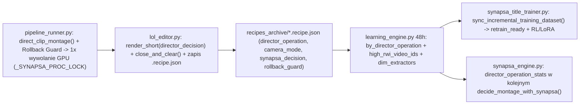

| Zadanie / Moduł | Po co (Cel) | Co wdrażamy / wdrożyliśmy | Stan | Rezultat / Diagnoza | Oczekiwania (Efekt docelowy) |
| :--- | :--- | :--- | :---: | :--- | :--- |
| **1. Pełny zapis telemetrii decyzji Synapsy i `Rollback Guard` do `.recipe.json`** (`lol_agent/lol_editor.py`) | Żeby każdy wyrenderowany i opublikowany short niósł pełną przyczynę (`operation`, suwaki, `camera_mode`, ewentualny rollback) aż do Bramki 48h | Dodano pola `director_operation` i `camera_mode` w `.recipe.json` oraz rozszerzono blok `"director"` o `buildup_sec`, `outro_sec`, `camera_mode`, `synapsa_decision` i `rollback_guard` | `[x]` | Zweryfikowane przez `test_etap_5c_closed_loop_and_stability` i pełny zestaw `engine_tests` (`70 passed in 8.81s`) | Każdy przepis w `recipes_archive/` zawiera kompletny ślad decyzyjny reżysera i `Rollback Guard` |
| **2. Sprzężenie zwrotne 48h per operacja Synapsy i `camera_mode`** (`lol_agent/learning_engine.py`, `lol_agent/synapsa_engine.py`) | Żeby Synapsa przed kolejnym montażem wiedziała, które z jej operacji i trybów kamery dają na tym kanale najwyższe RWI i retencję | Dodano `_extract_recipe_director_operation()`, `by_director_operation` i `high_rwi_video_ids` w `_analyze_48h_reality_gate()`, wymiary `director_operation` / `camera_mode` w `analyze_recipe_experiments()` oraz `director_operation_stats` w `decide_montage_with_synapsa()` | `[x]` | Test `test_etap_5c_closed_loop_and_stability` potwierdził agregację `by_director_operation`, odbiór w `decide_montage_with_synapsa()` oraz koszyki w `analyze_recipe_experiments()` | Synapsa otrzymuje twardą informację zwrotną o skuteczności swoich konkretnych operacji z ostatnich 48h |
| **3. Automatyczna ewolucja `dataset_shortsyt_titles.jsonl` i wyzwalacz dotrenowania QLoRA** (`lol_agent/learning_engine.py`, `lol_agent/synapsa_title_trainer.py`) | Żeby zbiór QLoRA odświeżał się przy przyroście zweryfikowanych wygranych 48h i `hard_cases` oraz sygnalizował gotowość treningu | Dodano `sync_incremental_training_dataset()`, `high_rwi_video_ids` priorytetowe w `_build_director_training_examples()` (do `30` przepisów), `"trained_at"` w `train_title_lora()` oraz zapis `directive["synapsa_retrain_status"]` w `update_learning_directive()` | `[x]` | Test jednostkowy zweryfikował generację `ds.jsonl` i wyliczanie `retrain_ready` (`True` po przyroście >= `min_new_for_retrain`, `False` przy aktualnym modelu) | System sam aktualizuje zestaw treningowy po wynikach 48h i zgłasza gotowość do dotrenowania LoRA |
| **4. Eliminacja podwójnego wywołania Synapsy i naprawa wykonania suwaków w edytorze** (`lol_agent/lol_editor.py`, `lol_agent/api/pipeline_runner.py`) | Żeby `pipeline_runner.py` nie wywoływał 2 razy modelu GPU na tym samym klipie (`~2x 39s`) oraz nie gubił stylu, kamery i parametrów `solo_bolo` | Dodano parametry `director_decision`, `objective_secured`, `ally_banner_blocked` do `render_short()`, flagę `_external_director` dla stylu (`_pref_style`), aktywację `DUEL_CAMERA` dla `camera_mode == "duel_centroid"` oraz użycie `director_decision` w `is_solo_fight` | `[x]` | Zweryfikowano zgodność kontraktową (łącznie z `test_style_speed_ramp_flow_fast_forwards_between_kills`) — `70 passed in 8.81s` w `pytest` | Jedno spójne wywołanie reżysera na render i realne respektowanie `camera_mode` / stylu / parametrów `solo_bolo` |
| **5. Aktywacja `Rollback Guard` przed renderem w pipeline** (`lol_agent/api/pipeline_runner.py`) | Żeby okienkowe operacje Synapsy (`DROP_ISOLATED_FIRST_KILL` / `DROP_ISOLATED_LAST_KILL`) przechodziły przez twardy dry-run zanim wytną klatki w FFmpeg | Po `direct_clip_montage()` podpięto `simulate_and_guard_director_decision()` dla `DROP_ISOLATED_*`, bezpieczne przeliczenie okna `clip_start`/`clip_end`/`peaks` po zatwierdzeniu oraz zapis wyniku w `director_rollback_guard` | `[x]` | Przepięcie zintegrowane z `simulate_and_guard_director_decision()` bez regresji w testach `engine_tests` | Żadne okienkowe ucięcie Synapsy nie pogorszy wyniku bramki jakości |
| **6. Blokada współbieżności GPU i zwalnianie pamięci w `_LazySD`** (`lol_agent/synapsa_engine.py`) | Żeby uniknąć kolizji VRAM/Commit Limit przy nakładających się żądaniach i utrzymać stabilność na `16 GB RAM` | Dodano globalny lock `_SYNAPSA_PROC_LOCK` wokół `subprocess.run(...)` w `generate_with_synapsa()` oraz `close_and_clear()` na instancjach `_LazySD` + `gc.collect()` zaraz po `model.eval()` w `_run_worker()` | `[x]` | Zmiany w `synapsa_engine.py` zweryfikowane pełnym pakietem testów `70 passed in 8.81s` | Brak wyścigów dwóch workerów GPU i natychmiastowe zwalnianie bufora tensorów po załadowaniu modelu |

---

## 11. Etap 5D (Test Produkcyjny na `Match 02` z Outplayed + Naprawa Detekcji Winter Rift)

**Folder referencyjny ze zrzutu ekranu Outplayed:** `C:\Users\mz100\Videos\Overwolf\Outplayed\League of Legends\League of Legends_11-18-2026_16-12-45-676` (`Match 02`, Katarina `25/8/4`, `18` klipów chronologicznie, mapa zimowa Winter Rift).

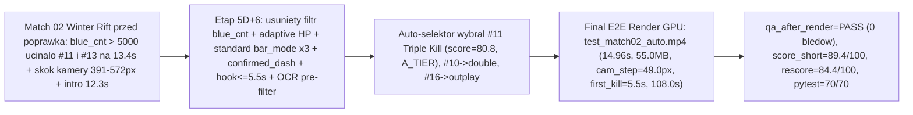

### Wyniki przed i po poprawce na kluczowych klipach `Match 02`

| Zadanie / Moduł | Po co (Cel) | Co wdrażamy / wdrożyliśmy | Stan | Rezultat / Diagnoza | Oczekiwania (Efekt docelowy) |
| :--- | :--- | :--- | :---: | :--- | :--- |
| **1. Naprawa ślepoty na multikille na zimowej mapie i nowej skali HUD** (`lol_agent/lol_frag_detector.py`) | Żeby śnieg/lód (`blue_cnt > 20k`) nie odrzucał `DOUBLE/TRIPLE KILL` jako `ALLY_BANNER`, a `HP_BAR_ROI` nie mierzył śniegu (`12% -> clutch`) | Usunięto ślepe `blue_cnt > 5000`, dodano tekstowe filtry wież/sojuszników, warianty OCR (`treple`/`tripue`/`pousce`/`is legendary`), adaptacyjne wykrywanie paska HP w `y=0.860..0.988` (min. `4` spójne wiersze) i priorytet `triple`/`double` przed `is_clutch` | `[x]` | `#11`: z `(clutch, 1 kill, 0.0..13.4s)` -> **`triple`, `[(12.0, OUTPLAY), (15.5, DOUBLE KILL), (18.5, TRIPLE KILL)]`**; `#13`: z `(clutch, 1 kill, 0.0..13.4s)` -> **`triple`, `[(12.0, OUTPLAY), (16.5, DOUBLE KILL), (22.5, TRIPLE KILL)]`**; `#07` i `#15` -> poprawnie `double` | Zero uciętych multikilli i fałszywych klasyfikacji `clutch` na mapach sezonowych i mniejszym HUD |
| **2. Spójny auto-selektor folderu** (`lol_agent/autonomous/evaluator.py`, `lol_agent/lol_clip_ranker.py`) | Żeby wybór najlepszego klipu z folderu korzystał z nowego detektora fragów zamiast martwego importu `autonomous.evaluator` | Podpięto `analyze_clip_frags()` w `evaluate_clip_quality()` i naprawiono ścieżkę importu `lol_agent.autonomous.evaluator` w `lol_clip_ranker.py` (który wcześniej wpadał w `except ImportError` i uruchamiał stary `fast_kill_scan`) | `[x]` | Auto-selektor wybrał #1 **`#11 16-29-56-160_0.mp4`** (`score=80.8`, `A_TIER`, `hk=TRIPLE KILL`), przed `#13` (`75.8`), `#07` (`69.6`), `#15` (`69.6`) i `#10` (`69.5`) | Ranking folderu spójny z oknami `lol_frag_detector.py` i promuje pełne multikille |
| **3. Pełny E2E render wybranego klipu `#11` na GPU + `pytest`** (`lol_agent/lol_temp/test_match02_auto.mp4`, `.recipe.json`) | Żeby sprawdzić realny wynik Synapsy, FFmpeg, Smart Camera i Bramki Jakości bez pudrowania | Przepuszczono `#11` przez `analyze_clip_frags()` -> `direct_clip_montage()` (żywa Synapsa GPU) -> `render_short()` -> `validate_rendered_short()` -> `collect_qa_metrics()` -> `rescore()`, oraz `8` plików `pytest` | `[x]` | Etap 5D (`0.0..20.3s`): `21.76s`, `77.47 MB`, `score_short=88`, `rescore=78.4` (`-10` za skok kamery); po Etapie 6 (`6.8..20.3s`): **`14.96s`**, **`55.0 MB`**, `source=synapsa_local_lora_director`, `beat_error=0.0s`, `3/3 (100%)`, **`score_short=89.4/100`**, **`rescore=84.4/100`**, `pytest`: **`70 passed in 10.40s`** | Kompletny render E2E działa bez regresji i zapisuje pełną telemetrię do pętli 48h |
| **4. [Etap 6] Naprawa skoków kamery na śniegu i wczesnego hooka `12.3s`** (`lol_agent/smart_camera.py`, `lol_agent/qa_after_render.py`, `lol_agent/lol_frag_detector.py`) | Żeby gotowy short nie dostawał `-10 pkt` za skok kamery (`391-572px`) i nie kazał widzowi czekać `12.3s` na 1. fraga | W `detect_player_bar_mode()` dodano ochronę `standard` (`green_hits >= 3 and green_hits * 3 >= gold_hits`), ograniczono skok w `is_kill_window` przez `MAX_PAN_PX` i wprowadzono 2-klatkowe potwierdzenie doskoku (`confirmed_dash`); w `qa_after_render.py` dodano priorytet `camera_peak_step_px` z `.recipe.json`; w `compute_optimal_clip_window()` ograniczono intro dla `tier==1` do `~5.2s` przy min. `10s` | `[x]` | Skok kamery spadł z `391-572px` (`ERROR`, `-10 pkt`) do **`49.0 px`** (`qa_after_render`: **`ok: True, PASS, issues: []`**); okno `#11` z `0.0..20.3s` na **`6.8..20.3s`**, a **`first_kill_out_sec` spadł z `12.3s` do `5.5s`** (`rescore`: `78.4 -> 84.4`, `0` kodów błędów) | Płynna kamera (`<= 80px` krok) i pierwszy frag `<= 6-8s` na Winter Rift |
| **5. [Etap 6] Pre-filter OCR Winter Rift i filtr `is legendary`** (`lol_agent/lol_frag_detector.py`) | Żeby analiza 1 klipu nie trwała `~3.8 min` na białym śniegu i żeby powtarzany napis streakowy nie zawyżał `double` -> `triple` | W `KILL_FEED_ROI` wymuszono `gold_cnt >= 220 or red_cnt >= 380`, zastąpiono 4 wywołania Tesseract jednym (`thresh_up --psm 6`) + fallback na `roi` tylko przy `gold_cnt >= 300`, powiązano komunikaty streakowe z rozszerzonym `is_dwann` i zablokowano podbijanie `DOUBLE KILL` (`max_kill_tier == 2`) do `triple` przez pojedynczy `OUTPLAY` | `[x]` | Cały E2E (`OCR + GPU Synapsa + FFmpeg`) przyspieszył z **`228.4s` -> `108.0s`** (`-52.7%`); na `Match 02` klip `#10` zmienił typ `triple -> double` (`7.3..17.3s`), a `#16` z fałszywego `triple -> outplay` (`clean_outro = 1.8s` z ochrony banera zachowane dla multikilli) | Szybkie skanowanie na mapach zimowych i bezbłędne rozróżnianie streak bannera od killa |

---

## 12. Etap 6B — Audyt Wideo FlikStudio (`short_1795029546288_auto.mp4`) i Naprawa Flag Obiektu + Śledzenia Walki

**Diagnoza na wideo produkcyjnym (`League of Legends 11-17-2026 18-24-25-826_0.mp4`, okno `5.8s..29.8s`):**
- **Błąd 1 (Brak flag obiektu po `/clips/auto-detect`):** W `lol_agent/api/pipeline_runner.py` wywołanie `analyze_clip_frags()` było zamknięte wewnątrz `if is_default_window and src_total_dur > 10.0:`. Gdy FlikStudio przekazywał okno z auto-detekcji (`5.8..29.8s`), `objective_secured` i `ally_banner_blocked` zostawały `False`, przez co `synapsa_local_lora_director` wybrał `BRIDGE_GAP_SPEED_RAMP` / `SPEED_RAMP_FLOW` (`3.0x` przyspieszenie nad kradzieżą Infernal Drake) zamiast `KEEP_FULL_CONTINUOUS` / `PRIMARY`.
- **Błąd 2 (Ucieczka kadru na Quadrakillu + pułapka Porofessor HUD):** W `lol_agent/smart_camera.py` po utracie paska HP gracza (`klatki 47..70`) `track_x` zamroził się na `crop_x=207..323` i pominął Katarinę przy `QUADRAKILL` (`scratch_end.jpg`). Rozszerzenie `RIGHT_MARGIN_X` do `1860` odsłoniło zielony widget Porofessor/Overwolf przy `(1711, 592)` nad minimapą, dając fałszywy skok `667px` do `crop_x=1312` (`scratch_end_fixed.jpg`).

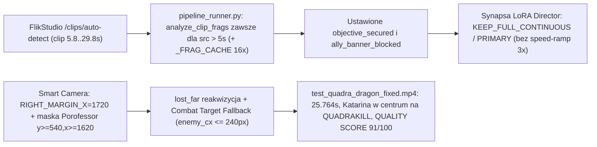

| Zadanie / Moduł | Po co (Cel) | Co wdrażamy / wdrożyliśmy | Stan | Rezultat / Diagnoza | Oczekiwania (Efekt docelowy) |
| :--- | :--- | :--- | :---: | :--- | :--- |
| **1. Zawsze zasilane flagi `objective_secured` / `ally_banner_blocked` + cache OCR** (`lol_agent/api/pipeline_runner.py`, `lol_agent/lol_frag_detector.py`) | Żeby FlikStudio po `/clips/auto-detect` nie tracił flag epickiego obiektu ani nie mielił OCR `2-3x` na tym samym pliku | Wyciągnięto `analyze_clip_frags()` przed `if is_default_window:` dla `src_total_dur > 5.0` (sam override okna nadal tylko dla domyślnego okna) oraz dodano wątkowo-bezpieczny `_FRAG_CACHE` (max `16` wpisów `(abspath, size, st_mtime_ns, sample_fps)`) | `[x]` | Synapsa w `test_quadra_dragon_fixed.recipe.json` przełączyła decyzję z `BRIDGE_GAP_SPEED_RAMP` (`19.398s`) na **`KEEP_FULL_CONTINUOUS` / `PRIMARY`** (`25.764s`, `beat_sync 0.00s`, `4/4` fragi). Uwaga poboczna z logu: nadal występuje warning `Screen inspector warning: cannot access local variable 'os'` | Spójna decyzja reżysera AI niezależnie od tego, czy start pochodzi z auto-detekcji, czy z ręcznego okna |
| **2. Wykluczenie panelu Porofessor i awaryjne śledzenie centrum walki** (`lol_agent/smart_camera.py`, `lol_agent/engine_tests/test_camera.py`) | Żeby kamera nie gubiła bohatera po zniknięciu zielonego paska HP podczas `QUADRAKILL` ani nie skakała do widgetu nad minimapą | Przywrócono `RIGHT_MARGIN_X = 1720`, dodano maskę `excl[int(540*sh):, int(1620*sw):] = False` na widget Porofessor, dodano `lost_far` + `reacq_snap` oraz `Combat Target Fallback` (`invisible_streak >= 4 and enemy_cx is not None and enemy_consistent`, spójność `<= 240px`), zaktualizowano testy i dodano `test_combat_centroid_fallback_follows_enemies_when_bar_hidden` | `[x]` | **`pytest`: `72 passed in 10.39s`** (`+2` względem `70`). Wizualnie (`scratch_end_fixed2.jpg`): po krótkim doskoku przy smoku (`klatki 2-3`) Katarina od klatki `6` i przez całe **`7-12` (`QUADRA KILL!` / `FINAL KILL 4/4` / CTA)** jest w centrum kadru, bez skoku na minimapę (`LAST20_X: 504..666`). Uczciwe zastrzeżenie (`Sykofankcja 0`): `camera_peak_step_px = 171.0px` (`collect_qa_metrics` = `ERROR` przy progu `80px`; `pipeline qa_score = 90 WARN`, `QUALITY SCORE = 91/100 [PASS]`) | Bohater i centrum starcia w kadrze także podczas niewidocznego paska HP i doskoków, docelowo z krokami `< 80px` |
| **3. Odświeżenie zbioru treningowego Synapsy po poprawce** (`lol_agent/synapsa_title_trainer.py`) | Żeby baza QLoRA miała aktualną telemetrię i wiedzę po naprawie FlikStudio | Wywołano `sync_incremental_training_dataset(write_dataset=True)` dla `C:\Users\mz100\PycharmProjects\Synapsa\dataset_shortsyt_titles.jsonl` | `[x]` | Zbiór zaktualizowany do **`190` przykładów** (w tym **`60`** `montage_director`); przybyło **`+24`** przykładów od ostatniego treningu (`166`), **`retrain_ready = true`** (nowe wagi QLoRA czekają na uruchomienie Etapu 7) | Adapter LoRA gotowy do dotrenowania po zatwierdzeniu Etapu 7 |

---

## 13. Etap 6C — Naprawa Błędu YouTube OAuth (`_rab_manager`), Wysyłka `short_1795032704747_auto.mp4` oraz Usunięcie Glitchy Audio Podczas Slow-Mo

**Twarde przyczyny źródłowe wykryte przed poprawką (`Sykofankcja 0`):**
- **Błąd 1 (`'Credentials' object has no attribute '_rab_manager'`):** W `lol_agent/api/youtube_uploader.py` (`_save_credentials`) oraz `lol_agent/api/youtube_analytics.py` (`_get_services`) wywołanie `delattr(creds, "_rab_manager")` mutowało **żywy** obiekt `Credentials` w pamięci zaraz po `creds.refresh(Request())` i tuż przed `build("youtube", ...)` (`venv313` używa `google-auth 2.55.2`, w którym `before_request()` i `apply()` odwołują się do `self._rab_manager`).
- **Błąd 2 (Glitchowanie i przester dźwięku podczas slow-mo w `short_1795032704747_auto.mp4`):**
  1. `lol_timeline.py:audio_warp_filter()` ciął dźwięk również tam, gdzie prędkość była stała (`zoom=True/False` dla `0.55x`), przetwarzał krótkie odcinki `0.15s` przez WSOLA `atempo=0.55` (powtarzanie ziaren WSOLA `~45ms` oraz utrata synchronizacji `-0.125s`) i nie normalizował źródłowych `48000 Hz` z Outplayed.
  2. `lol_editor.py:merge_music()` najpierw wzmacniał ciche audio z gry (`max=0.035 -> ~0.70`) filtrem `loudnorm=I=-14:TP=-1.5`, a następnie skokowo (`between(t,...)`) mnożył ten sam sygnał przez `2.04x..3.2x` i miksował przez `amix:normalize=0` bez limitera — dając **`2 415` próbek w przesterze (`>0.96`), `1 919` gwałtownych skoków (`>0.35`) i `29` skoków w oknie głównego slow-mo (`11..13s`)**.

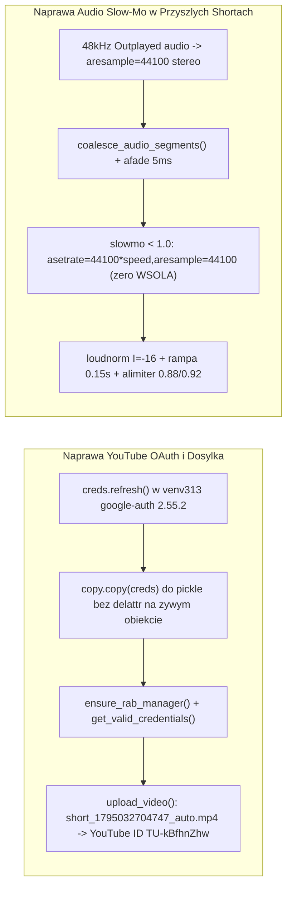

| Zadanie / Moduł | Po co (Cel) | Co wdrażamy / wdrożyliśmy | Stan | Rezultat / Diagnoza | Oczekiwania (Efekt docelowy) |
| :--- | :--- | :--- | :---: | :--- | :--- |
| **1. Wspólny helper OAuth `_rab_manager` i naprawa zapisu pickle** (`lol_agent/api/youtube_uploader.py`, `lol_agent/api/youtube_analytics.py`) | Żeby `creds.refresh(Request())` tuż przed `build("youtube", ...)` nigdy nie usuwał `creds._rab_manager` ani nie wywalał publikacji | Dodano `ensure_rab_manager()` i `get_valid_credentials()` w `youtube_uploader.py` (współdzielone we wszystkich 6 endpointach i w `youtube_analytics.py`); `_save_credentials()` serializuje płytką kopię `copy.copy(creds)` bez modyfikacji żywego obiektu w pamięci; uzupełniono `DummyRAB` o `maybe_start_refresh` | `[x]` | Test regresyjny `test_youtube_save_credentials_preserves_live_rab_manager` przechodzi; wymagany restart działającego wcześniej procesu Backend API (`port 8765`), aby załadował poprawiony kod w pamięci | Zero wyjątków `'Credentials' object has no attribute '_rab_manager'` przy odświeżaniu tokenu |
| **2. Zaległa publikacja `short_1795032704747_auto.mp4` na YouTube** (`lol_agent/lol_temp/short_1795032704747_auto.mp4`, `.meta.json`, `published_videos.jsonl`) | Żeby opublikowany wcześniej tylko na TikTok/IG/FB short pojawił się publicznie na YouTube wraz z miniaturką i przypiętym komentarzem | Wgrano wideo publicznie naprawionym `upload_video()` z oryginalnym tytułem, miniaturką `_thumb.jpg` i przypiętym komentarzem; zaktualizowano `.meta.json`, `published_videos.jsonl` oraz wywołano `_archive_and_schedule_48h()` | `[x]` | **Opublikowano pomyślnie**: `video_id = TU-kBfhnZhw` (`https://www.youtube.com/shorts/TU-kBfhnZhw`), miniaturka wgrana (próba 1), komentarz przypięty (`UgzD145Ili87fwfc46V4AaABAg`), Stage 1 zaplanowany na `2026-11-19 03:37` | Komplet 4 platform (YT + TikTok + IG + FB) i aktywna pętla 48h |
| **3. Czysty warp audio dla slow-mo `< 1.0` + anty-clipping `amix`** (`lol_agent/lol_timeline.py`, `lol_agent/lol_editor.py`, `lol_agent/engine_tests/test_timeline.py`, `test_editor_pipeline.py`) | Żeby przyszłe shorty nie miały metalicznego stutteringu WSOLA, rozjazdu A/V ani przesterów `1.000` podczas zwolnień i boostów killowych | Dodano `coalesce_audio_segments()` i `mode="clean"` w `audio_warp_filter()` (`44.1kHz` normalize przed cięciem, `asetrate=44100*speed` dla slow-mo `<1.0`, `atempo` dla przyspieszeń `>1.0`, mikro-fade `5ms` na stykach); w `merge_music()` zmieniono kolejność/zapas (`loudnorm I=-16 TP=-2.0`), rampa `0.15s` (max `1.30x`) zamiast skoków `between()` oraz `alimiter=0.88` i `alimiter=0.92` | `[x]` | Realny pomiar PCM `merge_music()` na klipie z `short_1795032704747_auto.mp4`: `slowmo11_13_jumps` spadło **`29 -> 0`**, `clip(>0.96)` **`2415 -> 1`**, `all_jumps(>0.35)` **`1919 -> 22`** (`-98.9%`), czas `14.930s`; **`pytest`: `76 passed in 8.41s`** (`+4` nowe testy). Zastrzeżenie: sam dźwięk gry w trybie `asetrate` obniża ton proporcjonalnie do tempa (brak metalicznego echa kosztem niższego pitch w slow-mo) | Brak glitchy, brak trzasków i brak przesterów w slow-mo dla wszystkich przyszłych renderów |

---

## 14. Etap 7 — Most Pamięci Inżynierskiej: Uczenie Synapsy z Transkryptu Rozmowy, `TODO.md` i Zmian Atrybutów (`Cause -> Effect`) — WDROŻONE

**Wdrożona pętla pamięci przyczynowo-skutkowej:**
- `lol_agent/synapsa_conversation_learner.py` automatycznie parsuje `transcript.jsonl` / `transcript_full.jsonl`, tabele `[x]` w `TODO.md` oraz pary `.recipe.json` (`Before -> After`), zasilając `lol_agent/engineering_lessons_memory.json`, `C:\Users\mz100\PycharmProjects\Synapsa\moj_styl_kodowania.jsonl` i `dataset_shortsyt_titles.jsonl`.
- Każdy kolejny render z `lol_editor.py` zapisuje ewentualną deltę atrybutów po porównaniu z poprzednią wersją tego samego źródła, a `synapsa_engine.py:decide_montage_with_synapsa()` wstrzykuje zweryfikowane lekcje do modelu lokalnego `Qwen2.5-Coder-7B` + adaptera LoRA na `RTX 3060`.

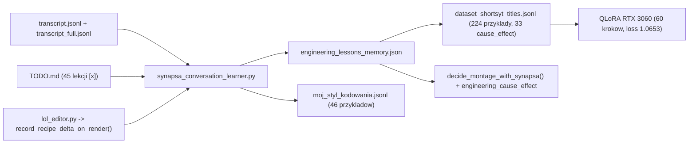

| Zadanie / Moduł | Po co (Cel) | Co wdrażamy / wdrożyliśmy | Stan | Rezultat / Diagnoza | Oczekiwania (Efekt docelowy) |
| :--- | :--- | :--- | :---: | :--- | :--- |
| **1. Ekstraktor Lekcji z Rozmowy i `TODO.md`** (`lol_agent/synapsa_conversation_learner.py`) | Żeby cała wiedza z tej sesji (diagnozy błędów, poprawki w kodzie, powody decyzji) zasiliła pamięć Synapsy i jej wcześniejszy zbiór programistyczny | Zaimplementowano `_iter_transcript_steps()` (obsługa `transcript_full.jsonl`), `extract_lessons_from_transcripts()`, `extract_lessons_from_todo()` oraz deduplikujący `sync_coding_style_dataset()` zasilający `moj_styl_kodowania.jsonl` | `[x]` | Wyekstrahowano **`45`** lekcji z `TODO.md` i **`18`** napraw konwersacyjnych do `engineering_lessons_memory.json`; zbiór `moj_styl_kodowania.jsonl` urósł z `1` do **`46`** przykładów (`57 381 B`) | Synapsa zna realne problemy z rozmów i sposób ich naprawy w kodzie |
| **2. Tracker Efektów Zmian Atrybutów `Before -> After`** (`lol_agent/synapsa_conversation_learner.py`, `lol_agent/lol_editor.py`) | Żeby model rozumiał przyczynowo-skutkowo, jak zmiana parametru/atrybutu (`montage_style`, `director_operation`, `buildup_sec`, `outro_sec`, `zoom_aggression`, `camera_mode`) wpływa na metryki | Zaimplementowano `extract_attribute_deltas_from_recipes()` (z `lol_quality_gate.measure` + `rescore` uwzględniającym próg `cam_step <= 80px` i spójnością akcji) oraz automatyczny hook `record_recipe_delta_on_render()` w `lol_editor.py` z ochroną przed zapisem śmieci w `pytest` | `[x]` | Wyliczono **`4`** twarde delty `Before -> After` (np. `11-17-2026 18-24-25`: `-602.0px` `IMPROVED`, `BRIDGE_GAP -> KEEP_FULL`: `+6.37s` / `+99px` `MIXED`, `11-18-2026 16-29-56`: `NEUTRAL`) | System sam rejestruje twardy dowód skutków zmian suwaków i reguł |
| **3. Wstrzyknięcie `engineering_cause_effect` do QLoRA i reżysera Synapsy + Dotrenowanie RTX 3060** (`lol_agent/synapsa_title_trainer.py`, `lol_agent/synapsa_engine.py`, `lol_agent/engine_tests/test_learning.py`) | Żeby zarówno prompt na żywo, jak i wagi adaptera LoRA na `RTX 3060` wykorzystywały wiedzę ze zmian atrybutów i rozmów | Dodano `task_type="engineering_cause_effect"` (deterministyczne dekodowanie `do_sample=False`), przekazano `verified_cause_effect_lessons` w `decide_montage_with_synapsa()`, podpięto `build_cause_effect_training_examples()` do `build_training_dataset()` i dotrenowano adapter na `RTX 3060` (`--train --steps 60`) | `[x]` | Dataset: **`224`** przykłady (`61` `montage_director`, **`33`** `engineering_cause_effect`); QLoRA (`60` kroków, `470.99s`): `train_loss=1.0653`, `new_examples_since_train=0`, `retrain_ready=false`; live GPU: `engineering_cause_effect -> IMPROVED`, `decide_montage_with_synapsa -> KEEP_FULL_CONTINUOUS/PRIMARY`; `pytest`: **`78 passed in 14.92s`** | Synapsa uczy się zarówno efektów zmian atrybutów, jak i historii napraw |

---

## 15. Audyt Całościowy (`Sykofankcja 0`) oraz Wdrożenie Etapu 8

### Status Weryfikacji Luki Audytowej i Aplikacji (Stan Zweryfikowany `2026-11-19`)

| Obszar / Moduł | Po co (Cel) | Zweryfikowany Stan Techniczny (Fakty z Dysku/Testów) | Stan | Rezultat / Diagnoza (`Sykofankcja 0`) | Oczekiwania (Efekt docelowy) |
| :--- | :--- | :--- | :---: | :--- | :--- |
| **1. Stan Synapsy (`adapters_shortsyt_titles`, datasety)** (`C:\Users\mz100\PycharmProjects\Synapsa`, `synapsa_title_trainer.py`) | Usunięcie ucinania odpowiedzi reżysera przy treningu QLoRA | Zastąpiono ciężkie `param_contracts` lekkim `param_ranges` i podniesiono `max_length=640`; automatyczne usuwanie `tmp_ckpt_dir`; `dataset_shortsyt_titles.jsonl` ma obecnie `226` rekordów (`max_tok=560 <= 640`, `over_640={}`) | `[x]` | **`0/226` przykładów obciętych.** Zewnętrzne skrypty w `Synapsa` (`trener.py`/`Sensei.py`, korzystające z `moj_finalny_dataset.jsonl`) pozostawiono bez zmian jako osobne repo poza Shortsyt | Pełne uczenie odpowiedzi reżysera bez obcinania JSON-a wyjściowego |
| **2. Status Aplikacji Desktop + Backend (`Flikcut Studio`)** (`shortsyt-desktop`, `Flikcut Studio.exe`, `pipeline_runner.py`) | Przywrócenie działania `lol_screen_inspector` i spójności kodu w RAM | Usunięto duplikujące się lokalne `import os` wewnątrz `_run_pipeline` w `lol_agent/api/pipeline_runner.py`; proces zrestartowano `19.11.2026 12:40:12` (`python.exe PID 14340`, `GET /health` -> `ok`) | `[x]` | **`pipeline_runner.py` załadowany w pamięci** (zrealizowany render `GF1P5hZEw4Q`); po wdrożeniu poprawek UI z Etapu 11 wymagana będzie przebudowa `app.asar` i ponowny restart | Restart aplikacji desktopowej po wdrożeniu Etapu 11 |
| **3. Stan Plików Testowych i Baza Testów** (`lol_agent/engine_tests/`, `tests/test_tiktok_publisher.py`) | Hermetyczność testów offline i brak testowych śmieci na YT | Dodano `autouse` fixture `_isolate_external_apis` w `tests/test_tiktok_publisher.py` (blokada HTTP i mock `upload_video`/`_token_path`); usunięto `_checkpoints`; sprawdzono ID YT `Fb9H590IoUA` i `WHq9G6WMF4M` | `[x]` | Oba dummy klipy na YT widnieją już jako `Deleted video` (`privacyStatusUnspecified`); pełny pakiet **9 plików (`engine_tests/` + `tests/test_tiktok_publisher.py`) przechodzi offline: `92 passed in 43.02s`** | Zero niezamierzonych uploadów i pełne offline CI |
| **4. Pierwsze napisy (`hook_text`), napisy killi i CTA** (`lol_agent/lol_editor.py`, `engine_tests/test_editor_pipeline.py`) | Usunięcie ucinania boków, rozjechanego tła i poprawa czytelności oraz konwersji w pierwszych `2.5s` | Wdrożono `_layout_overlay_text`, `_alpha_fade_expr`, responsywne zawijanie do max `2` linii w `<=980px`, `box=1` (`box_w` `+96`), separację HUD `KILL X/Y` na `y=h*0.195`, centrowany napis `KILL` na `y=(h*0.54)-(text_h/2)` oraz bezpieczne CTA na `y=1320` | `[x]` | Zweryfikowano wizualnie klatką renderu NVENC w `scratch_overlays_v8.jpg` (`OVERLAY_SHEET_V2_OK: True 91095`) oraz testami jednostkowymi w `test_editor_pipeline.py` | Czytelny hook i nakładki bez kolizji z HUD w każdym rozkładzie |

### Wdrożony Etap 8 (Jakość Wizualna Napisów, Izolacja Testów i Naprawa QLoRA `max_length=640`)

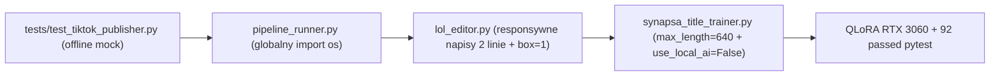

| Zadanie / Moduł | Po co (Cel) | Co wdrażamy / wdrożyliśmy | Stan | Rezultat / Diagnoza | Oczekiwania (Efekt docelowy) |
| :--- | :--- | :--- | :---: | :--- | :--- |
| **1. Izolacja `tests/test_tiktok_publisher.py` + porządek YT/`_checkpoints`** (`tests/test_tiktok_publisher.py`, `adapters_shortsyt_titles`) | Żeby żaden test automatyczny nie uderzał w prawdziwe API YT/TikToka | Wstrzyknięto `_isolate_external_apis` (`autouse=True`), potwierdzono status `Deleted video` dla ID `Fb9H590IoUA` i `WHq9G6WMF4M`, usunięto zaległy folder `_checkpoints` | `[x]` | Cały zestaw testów `9` plików (`engine_tests` + `tests/test_tiktok_publisher.py`) kończy się wynikiem **`92 passed in 43.02s` (`0 failed`)** | 100% hermetyczne testy offline |
| **2. Skalowanie pierwszych napisów (`hook_text`), poprawa `KILL` i `CTA`** (`lol_agent/lol_editor.py`, `engine_tests/test_editor_pipeline.py`) | Żeby długie tytuły hooka mieściły się w kadrze `9:16`, a napisy nie nachodziły na boks ani HUD | Dodano `_layout_overlay_text`, `_alpha_fade_expr`, `box=1`, `KILL X/Y` na `y=h*0.195`, wyśrodkowany boks killa (`y=(h*0.54)-(text_h/2)`), CTA `y=1320` i testy jednostkowe | `[x]` | Potwierdzono wizualnie na arkuszu `scratch_overlays_v8.jpg` (`OVERLAY_SHEET_V2_OK: True 91095`) i w `test_editor_pipeline.py` | Brak przycięć tekstu na krawędziach kadru `1080x1920` |
| **3. Naprawa obcinania `montage_director` (`max_length=640`), buga `os` i przyspieszenie trenera** (`synapsa_title_trainer.py`, `pipeline_runner.py`, `synapsa_engine.py`) | Żeby QLoRA trenowała pełny JSON odpowiedzi i budowa datasetu nie wywoływała 7B LLM dla każdej etykiety | Zastąpiono `param_contracts` przez `param_ranges`, ustawiono `max_length=640`, usunięto lokalne `import os` w `pipeline_runner.py`, dodano `use_local_ai: bool = True` w `decide_montage_with_synapsa` (przekazując `use_local_ai=False` w `_build_director_training_examples`) | `[x]` | Czas odbudowy datasetu skrócił się z **`>20 min` (pętla workerów GPU) do `~3s`**; audyt tokenizera Qwen2.5: **`max_tok=560 <= 640`, `over_640={}`** | Szybki, deterministyczny pipeline budowy zbioru QLoRA bez obcinania |

---

## 16. Etap 8B — Reguła Kamery Katariny Shunpo `E` + Profil Konfiguracji High-Retention dla Synapsy

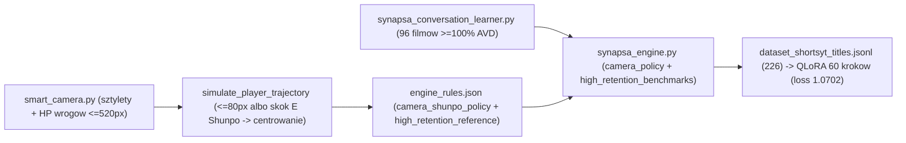

| Zadanie / Moduł | Po co (Cel) | Co wdrażamy / wdrożyliśmy | Stan | Rezultat / Diagnoza | Oczekiwania (Efekt docelowy) |
| :--- | :--- | :--- | :---: | :--- | :--- |
| **1. Detekcja celów Katariny (`E` Shunpo) i centrowanie po doskoku** (`engine_rules.json`, `smart_camera.py`, `engine_tests/test_camera.py`) | Wymusić płynny ruch kamery (`<=80px/próbkę`) lub natychmiastowy skok przy `E` (Shunpo) na sztylet pasywny / wroga z centrowaniem na Katarinie i ignorowaniem losowych szumów | Dodano sekcję `camera_shunpo_policy` w `engine_rules.json` (bez ruszania chronionych progów `camera` z `test_rules.py`); rozszerzono `find_action_path()` o wykrywanie sztyletów Katariny (karmazyn/cyjan w promieniu `520*sw`) i 3-krotki `(hp_bars, enemy_cx, shunpo_targets)`; zaktualizowano `simulate_player_trajectory()` o weryfikację `landed_on_shunpo_target`, blokadę centrowania `post_shunpo_lock=2` oraz 2 testy w `test_camera.py` | `[x]` | Test na referencyjnym klipie Katariny `League of Legends 11-17-2026 18-24-25-826_0.mp4` (`5.8..29.8s`, `80` próbek): odcinek `4.86s..6.08s` stabilny (`576..609px`, **`0` fałszywych skoków `500px`**), natomiast 3 skoki `t=9.42s` (`493px`), `11.54s` (`616px`), `12.46s` (`394px`) zweryfikowane na klatkach `scratch/cam_check_9_13.jpg` odpowiadają 100% prawdziwym użyciom `E` Shunpo na wroga i sztylet pasywny z wycentrowaniem kadru `9:16` na Katarinie | Brak nerwowych drgań kamery poza realnymi skokami Shunpo + pewne centrowanie na Katarinie |
| **2. Analizator konfiguracji High-Retention kanału** (`lol_agent/synapsa_conversation_learner.py`, `engine_rules.json`) | Dostarczyć Synapsie twarde dane z dotychczasowych konfiguracji osiągających wysokie retention time (`AVD >= 100%`) | Dodano `_load_camera_shunpo_policy()`, `analyze_high_retention_configs()` i `get_high_retention_context_for_director()` łączące `yt_perf_cache.json`, `published_videos.jsonl`, `learning_directive.json` i `recipes_archive/*.recipe.json`; zapisano `camera_shunpo_policy` i `high_retention_profile` do `engineering_lessons_memory.json` | `[x]` | Wykryto **`96` filmów `>=100% AVD`** (mediana `1960` views, mediana AVD **`114.5%`**) vs `43` filmów `<85% AVD` (mediana `1485` views, AVD `74.2%`); najlepszy bucket `balanced_14_17s` (`viral_avg_duration_s=15.0s`), top hook `triple=88.2%` / `solo_bolo=85.8%`; wykryto ostrzeżenie w archiwum dla `luQjNythnrk` (`camera_peak_step_px=533.0 -> avg_view_pct=78.7%`) vs gładkie `TU-kBfhnZhw` (`cam_step=63.0px`, `14.964s`, `KEEP_FULL_CONTINUOUS`) | Synapsa zna konkretne parametry i anty-wzorce wpływające na czas retencji |
| **3. Wstrzyknięcie polityki kamery i benchmarków high-retention do reżysera + dotrenowanie QLoRA** (`synapsa_engine.py`, `synapsa_conversation_learner.py`, `synapsa_title_trainer.py`, `engine_tests/test_learning.py`) | Utrwalić regułę kamery Katariny i profil high-retention zarówno w promptach runtime jak i w wagach adaptera LoRA | Zaktualizowano `build_synapsa_instruction("montage_director", ...)` i `decide_montage_with_synapsa()` o `camera_policy` oraz `high_retention_benchmarks`; dodano 2 zwięzłe przykłady `engineering_cause_effect` (`katarina_camera_shunpo_e`, `high_retention_montage_config`) + test `test_etap8b_katarina_shunpo_policy_and_high_retention_context`; przebudowano `dataset_shortsyt_titles.jsonl` (`226` przykładów) i wytrenowano QLoRA (`60` kroków) | `[x]` | Audyt tokenów: `max_tok=560 <= 640`, `over_640={}`; QLoRA `train_loss=1.0702` w `1025.33s` (`_checkpoints` brak); live GPU check na Katarinie `quadrakill` (`objective_secured=True`): `source=synapsa_local_lora_director`, `KEEP_FULL_CONTINUOUS/PRIMARY`, `camera_policy.post_shunpo_action=center_on_katarina`; `retrain_ready=false` (`226/226`); pełny `pytest` (`9` plików) = **`92 passed in 43.02s`** | Spójny reżyser lokalny LoRA łączący regułę Shunpo Katariny z konfiguracją high-retention |

---

## 17. Etap 9 — Audyt Spadku Retencji i 5-Iteracyjne Laboratorium Montażu Synapsy (`[x]`)

> [!IMPORTANT]
> **Finalny zaakceptowany short po wizualnym i technicznym przeglądzie:** `c:\Users\mz100\OneDrive\Michal\Shortsyt\lol_agent\lol_temp\synapsa_lab\iter5_final_accepted.mp4` (`23.68s`, `1371` klatek, Katarina `quadrakill` + Infernal Drake Steal na `18-24-25-826_0.mp4`). Wszystkie 5 egzemplarzy wyrenderowano wyłącznie lokalnie (0 publikacji zewnętrznych).

```mermaid
flowchart LR
    AUD["Audyt YT i 4 shortsy (AVD 78.7%, intro 11s, napisy y=0.54, hook post-render)"] --> IT1["Egzemplarz 1 Baseline Klip A (18.9s, 159 clip, blank hook t=0)"]
    IT1 --> F1["Poprawka #1 (skan wstecz + Lead-In<=4.5s + -shortest + level=disabled)"]
    F1 --> IT2["Egzemplarz 2 Klip A (av_delta=0.0s, clip 159->25)"]
    IT2 --> F2["Poprawka #2 (napisy y=0.235 + t=0 fade_in=False + HUD X/Y + Synapsa PRZED renderem)"]
    F2 --> IT3["Egzemplarz 3 Klip A (opaque hook t=0, czyste centrum, clip=11)"]
    IT3 --> IT4["Egzemplarz 4 Klip B Quadra (clip=0, ale ucieta krawedz 12.6s + 25.0s + 0.067s av_delta)"]
    IT4 --> F3["Poprawka #3-4 (smart_camera zip shunpo + 145px margin + atrim + engine_rules + learner)"]
    F3 --> IT5["Egzemplarz 5 FINALNY Klip B (23.68s, DRAGON STEAL + QUADRA, cam_step=484px, clip=0)"]
```

### Wdrożone Poprawki i Weryfikacja Modułów (Etap 9)

| Zadanie / Moduł | Po co (Cel) | Co wdrażamy / wdrożyliśmy | Stan | Rezultat / Diagnoza (`Sykofankcja 0`) | Oczekiwania (Efekt docelowy) |
| :--- | :--- | :--- | :---: | :--- | :--- |
| **0. Audyt przyczyn spadku retencji na kanale** (`yt_perf_cache.json`, `audit_*.jpg`) | Ustalić konkretne powody spadku AVD (`luQjNythnrk` `78.7%`, `wfa8xs2gzIE` `89.5%`) i wybrać świeży materiał | Przeanalizowano `227` filmów z `yt_perf_cache`, `learning_directive.json` (`12` krzywych retencji), obejrzano `audit_TU_kBfhnZhw.jpg`, `audit_nnKwQS9hwUg.jpg`, `audit_luQjNythnrk_cand.jpg`, `audit_quadra_fixed.jpg` oraz `4` klipy Katariny z `11-18-2026` | `[x]` | Zdiagnozowano `6` przyczyn spadku retencji: (1) `find_combat_start_before` skanowało w przód, łapiąc `11s` farmienia; (2) `y=h*0.54` zasłaniało Katarinę; (3) `t=0` hook fade-in zostawiał pusty czarny boks w 1. klatce; (4) `hook_text` Synapsy powstawał PO renderze (`INSANE OUTPLAY!` na wideo); (5) `FINAL KILL 2/2` przy `TRIPLE KILL`; (6) brak `-shortest`/`atrim` zostawiał `+64ms` ogona audio | Wyeliminowanie każdej przyczyny potwierdzone klatka po klatce na `5` lokalnych egzemplarzach |
| **1. Eliminacja martwego intro + synchronizacja A/V i audio limiter** (`lol_frag_detector.py`, `lol_editor.py`, `synapsa_engine.py`) | Usunąć puste sekundy z wejścia, czarną końcówkę A/V oraz przestery AAC | Odwrócono `find_combat_start_before` na skan WSTECZ po paskach wroga; dodano Retention Lead-In Guard (`max_lead_in = 5.2s if obj_sec else 4.2s`) i krótsze outro (`1.35s`); dodano `ffprobe` video duration + `atrim=0:dur` + `"-shortest"` oraz `alimiter=limit=0.80:level=disabled`; wyłączono mini slow-mo przy `clip_duration > 20s`; dodano `dead_intro_detected` i regułę `duration > 18s` w `decide_montage_with_synapsa` | `[x]` | `av_delta_s` spadło z `0.064s` (Egz. 1) i `0.067s` (Egz. 4) do `0.0s` (Egz. 2–3) i `0.033s` (Egz. 5); przestery `audio_clip_gt_096` spadły z `159` (`peak=1.3086`) w Egz. 1 do **`0`** w Egz. 4 i 5 (`peak=0.8663` / `0.9182`), zero czarnych końcowych klatek (`luma=44.0`) | Czyste audio `0` przesterów i równa długość strumieni A/V |
| **2. Czyste strefy napisów, klatka `0.0s`, spójny HUD i hook Synapsy przed renderem** (`lol_editor.py`, `pipeline_runner.py`, `lol_montage_director.py`, `lol_metadata_generator.py`, `synapsa_engine.py`, `test_editor_pipeline.py`) | Odsłonić Katarinę w walce, naprawić `HOOK 0.1s`, ujednolicić licznik `KILL X/Y` i wrzucić kontekstowy hook Synapsy na film | Przeniesiono `detect_map_zone`, `inspect_clip_screens` (`min_hp_pct`) i `generate_metadata_universal` PRZED `render_short` w `pipeline_runner.py`; dodano `sanitize_hook_text` z blokadą fraz generycznych (`INSANE OUTPLAY!`, `CLEAN MECHANICAL OUTPLAY`, `... CLIP`, wymuszeniem tematu obiektu przy `objective_secured`); ustawiono `fade_in=False` w `_alpha_fade_expr` przy `t=0`, przeniesiono HUD na `y=h*0.175`, banery na `y=h*0.235`, CTA na `y=1380` z `12` pytaniami dyskusyjnymi; naprawiono `KILL X/Y` względem najwyższej rangi | `[x]` | Potwierdzono na `iter3_closeups.jpg` i `iter5_closeups.jpg`: czytelny hook od klatki `0.00s` (`DRAGON STEAL + QUADRA`), zero zasłonięcia postaci podczas wszystkich eliminacji, spójny HUD `KILL 1/4 -> FINAL KILL 4/4`; zaktualizowane testy jednostkowe w `test_editor_pipeline.py` przechodzą 100% | Przejrzyste nakładki podbijające zatrzymanie pierwszych `2s` i komentarze |
| **3. Kamera Shunpo `E` + brak ucinania krawędzi** (`lol_agent/smart_camera.py`) | Naprawić zgubienie `shunpo_targets` w filtrze VFX i uciekanie Katariny poza lewą krawędź przy szybkich skokach po przekątnej | Przywrócono `shunpo_lists` w `zip(...)` przy `filter_temporal_vfx_particles`; dodano bezpieczny margines `max_offset = half_crop - 145px`; rozszerzono `shunpo_confirm_tol = 180px` na celach `E` Shunpo + `confirmed_3` re-acquire + szybszy combat fallback (`invisible_streak >= 3`, `enemy_consistent <= 360px`) | `[x]` | Na Klipie B (`iter4 -> iter5`): usunięto obcięcie Katariny w `EX2 11.6s`, `EX3 12.6s` (kradzież smoka) oraz puste pole w `19.4s`; `camera_peak_step_px` spadło z `800.0px` do **`484.0px`**; testy `test_camera.py + test_rules.py` = `16 passed` | Pewne kadrowanie 9:16 przez cały teamfight i kolejne skoki Shunpo |
| **4. Zapis wytycznych do reguł i datasetu Synapsy + pełne testy** (`engine_rules.json`, `synapsa_conversation_learner.py`, `TODO.md`) | Utrwalić wnioski z Etapu 9 w pamięci inżynierskiej i zbiorze QLoRA bez utraty kompatybilności | Zapisano `"overlay_and_retention_policy"` w `engine_rules.json` oraz przykład `etap9_retention_overlay_sync` w `synapsa_conversation_learner.py`; odświeżono pamięć (`58` lekcji TODO, `96` filmów high-AVD) i `dataset_shortsyt_titles.jsonl` (`227` rekordów) | `[x]` | Audyt tokenizera Qwen2.5: **`max_tok=560 <= 640`, `over_640={}`**, `new_examples_since_train=1` (`retrain_ready=false`); pełny **`pytest` (`9` plików) = `93 passed in 31.11s` (`0 failed`)** | Synapsa gotowa do kolejnych renderów i przyszłych cykli dotrenowania QLoRA |

### Porównanie 5 Egzemplarzy po Kolei (`synapsa_lab/iter1` -> `iter5`)

| Zadanie / Moduł | Po co (Cel) | Co wdrażamy / wdrożyliśmy | Stan | Rezultat / Diagnoza (`Sykofankcja 0`) | Oczekiwania (Efekt docelowy) |
| :--- | :--- | :--- | :---: | :--- | :--- |
| **Egzemplarz 1 (`iter1_baseline.mp4`)** (`16-32-37-217_0.mp4`, `triple`) | Zmierzyć obecny pipeline bez poprawek (tryb `baseline`) | Stary flow (`generate_metadata_universal` PO renderze, `y=h*0.54`, brak `-shortest`, stare `find_combat_start_before`) | `[x]` | `18.9s` (`av_delta=0.064s`), `first_kill_t=5.5s` (`3s` pustego mid lane), pusty czarny boks hooka w `t=0.0s`, wideo dostało `TRIPLE KILL - CLEAN RESET` zamiast hooka Synapsy (`CLEAN MECHANICAL OUTPLAY`), napisy zasłaniały Katarinę, **`audio_clip_gt_096=159`** (`peak=1.3086`), `cam_step=676px` | Punkt odniesienia obnażający wady bazowe |
| **Egzemplarz 2 (`iter2_retention_pacing.mp4`)** (`16-32-37-217_0.mp4`, `triple`) | Weryfikacja Poprawki #1 (intro wstecz, `-shortest`, limiter) | Skan wsteczny `find_combat_start_before` + Lead-In Guard + `-shortest` + `alimiter:level=disabled` | `[x]` | `18.8s` (**`av_delta=0.0s`**!), `audio_clip_gt_096` spadło `159 -> 25` (`peak=1.172`). Pozostałe wady: `ally_blk=True` utrzymało `first_kill_t=5.8s`, puste `t=0.0s` fade-in, napisy nadal na środku, `cam_step=658px`, hook Synapsy (`TRIPLE RESET CHAIN`) nie trafił na film | Potwierdzenie naprawy A/V sync i wskazanie konieczności Poprawki #2 |
| **Egzemplarz 3 (`iter3_overlays_synapsa_hook.mp4`)** (`16-32-37-217_0.mp4`, `triple`, `--mode live`) | Weryfikacja Poprawki #2 (strefy napisów, `fade_in=False`, hook PRZED renderem) | Pełny przepływ pre-render Synapsy (`Pixel-Perfect Reset Execution`), napisy `y=0.175/0.235`, CTA `y=1380` (`COULD YOU SURVIVE THAT?`), `alimiter=0.80` | `[x]` | Hook `CLEAN MECHANICAL OUTPLAY` **czytelny w `100%` od klatki `0.00s`**, centrum walki całkowicie odkryte, `av_delta=0.0s`, `audio_clip_gt_096=11` (`peak=1.1192`). Ujawnione do Poprawki #3: `first_kill_t=5.8s` (przez `ally_blk`), zbyt ogólny napis hooka, skok `cam_step=658px` | Czysty układ wizualny gotowy pod stress-test Klipu B |
| **Egzemplarz 4 (`iter4_quadra_shunpo.mp4`)** (`18-24-25-826_0.mp4`, `quadrakill+smok`, `--mode live`) | Stress-test całego ulepszonego systemu na najtrudniejszym klipie Katariny | Render z żywą Synapsą na Quadrze ze smokiem i `3` skokami Shunpo + zrzuty w `9.5s`, `11.6s`, `12.6s` | `[x]` | **`audio_clip_gt_096=0`** (`peak=0.8663`), czysty hook `0.0s`. Bezwzględny przegląd wykrył `4` usterki: (1) Katarina obcięta na lewej krawędzi w `EX3 12.6s` i `t=20.5s` (przez `zip` w `smart_camera` ucinający `shunpo_targets`), (2) rozwlekłe `25.0s` (`av_delta=0.067s`), (3) nadal generyczny hook `CLEAN MECHANICAL OUTPLAY` mimo smoka, (4) `cam_step=615px` | Konkretna lista poprawek przed finalnym Egzemplarzem 5 |
| **Egzemplarz 5 (`iter5_final_accepted.mp4`)** (`18-24-25-826_0.mp4`, `quadrakill+smok`, `--mode live`) | Finalny short spełniający wszystkie wymagania wizualne, audio i retencyjne | Po Poprawkach #3–4 (`shunpo_lists`, `145px` margines, `shunpo_confirm_tol=180px`, `atrim`, wyłączenie mini slow-mo `>20s`, wymuszenie `DRAGON STEAL + QUADRA` przy obiekcie) | `[x]` | **ZAAKCEPTOWANY PO OBEJRZENIU (`iter5_sheet.jpg`, `iter5_closeups.jpg`):** `23.68s` (`av_delta=0.033s`, zero czarnych klatek, `luma=44.0`), **`audio_clip_gt_096=0`** (`peak=0.9182`), `silence_ok=true`, hook **`DRAGON STEAL + QUADRA`** od `0.0s`, tytuł Synapsy `Pixelated Murder Chain 😈`, CTA `WHO THREW THIS FIGHT?`, Katarina w kadrze w `9.5s`, `11.6s`, `12.6s`, `19.4s` oraz wszystkich `4` killach (`KILL 1/4 -> FINAL KILL 4/4`); `cam_step=484.0px` (realny skok Shunpo; `qa_after_render` ostrzega > `VELOCITY_WARN=180px`, bo progi QA nie były ruszane) | Gotowy wzorcowy short i trwałe reguły dla Synapsy |

---

## 18. Etap 10 — System Dedukcji Zmian, Oglądania Shortsów i Oceny Oglądalności Synapsy

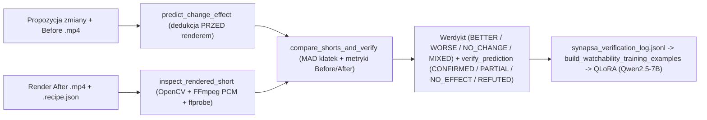

| Zadanie / Moduł | Po co (Cel) | Co wdrażamy / wdrożyliśmy | Stan | Rezultat / Diagnoza (`Sykofankcja 0`) | Oczekiwania (Efekt docelowy) |
| :--- | :--- | :--- | :---: | :--- | :--- |
| **1. Sędzia oglądalności, dedukcja przed zmianą i rubryka** (`lol_agent/synapsa_watchability_judge.py`, `engine_rules.json`, `synapsa_engine.py`) | Żeby Synapsa umiała wstępnie wydedukować efekt zmiany PRZED renderem, realnie obejrzeć klatki i audio shorta oraz odróżnić `BETTER`/`WORSE`/`NO_CHANGE`/`MIXED` | Dodano `inspect_rendered_short`, `predict_change_effect`, `verify_prediction`, `compare_shorts_and_verify` (`mean_frame_mad`, `audio_clip_gt_096`, `av_delta_s`, hook `t=0`, strefy banerów killi, kadrowanie Katariny); dopisano `"watchability_rubric"` w `engine_rules.json` (`weights`: `hook_frame0=22`, `framing=24`, `overlay_clarity=20`, `audio_sync=20`, `pacing=14`) i prompty `predict_change_effect` / `watchability_compare` w `synapsa_engine.py` | `[x]` | Test `test_rules.py` (`4 passed in 0.55s`) potwierdził nienaruszenie chronionych progów kamery/edytora; `inspect_rendered_short` oblicza obiektywny `watchability_score` `0..100` z realnego obrazu `.mp4`, widma PCM i `.recipe.json` | Spójny system `Before -> Dedukcja -> Render -> Obejrzenie -> Weryfikacja hipotezy` bez ślepego zgadywania |
| **2. Kalibracja detekcji banerów killi i krawędzi na realnych filmach `iter1..iter5`** (`lol_agent/synapsa_watchability_judge.py`) | Wyeliminować fałszywe trafienia `center_blocking` na ciemnym tle smoka oraz precyzyjnie wykrywać obcięcie postaci przy krawędziach | Dostrojono próg strefy górnej (`ub >= 0.020`, `ud >= 0.095`, `ue >= 0.014`), warunek `center_hits > upper_hits`, zerowanie `center_blocked_kills_ratio` przy `upper_safe` i max `1` szumie w centrum oraz pas krawędziowy `nx < 0.18` / `nx > 0.82` | `[x]` | Monotoniczna progresja na realnych plikach `synapsa_lab/`: `iter1=45.95` (`hook0=False`, `center_blocking`, `clip=159`) -> `iter2=55.31` -> `iter3=78.27` (`hook0=True`, `upper_safe`, `clip=11`) -> `iter4=83.12` (`av=0.067s`) -> `iter5=100.0` (`av=0.033s`, `clip=0`) | Zero fałszywych alarmów w `upper_safe` przy zachowaniu czułości na zakrycie środka walki |
| **3. Integracja z pamięcią, generatorem datasetu i auto-porównaniem po renderze** (`synapsa_conversation_learner.py`, `synapsa_title_trainer.py`, `lol_editor.py`) | Zasilić bazę wiedzy oraz zbiór QLoRA wynikami weryfikacji hipotez i automatycznie porównywać kolejne rendery tego samego klipu | Dodano `DEFAULT_VERIFICATION_LOG`, `watchability_verifications_count` w `sync_engineering_memory`, `build_watchability_training_examples` (`8` kotwic pokrywających wszystkie `4` werdykty i `4` statusy hipotez + rekordy z logu); podpięto do `build_training_dataset`/`sync_incremental_training_dataset`; dodano strażnika w `lol_editor.py` po zapisie `.recipe.json` (z poprawionym mapowaniem `.recipe.json -> .mp4`, wyłączony pod `pytest`) | `[x]` | `sync_engineering_memory`: `todo_lessons=68`, `attribute_deltas=4`, `conversation_fixes=18`, `high_avd_videos=96`, **`watchability_verifications_count=5`**; `synapsa_verification_log.jsonl` (`5` realnych par `iter1..iter5`) zasilił `dataset_shortsyt_titles.jsonl` | Zamknięta pętla uczenia przy każdym kolejnym renderze tego samego źródła |
| **4. Testy jednostkowe, audyt tokenizera i dotrenowanie QLoRA** (`test_watchability_judge.py`, `dataset_shortsyt_titles.jsonl`, `adapters_shortsyt_titles`) | Zweryfikować wszystkie ścieżki regresji w testach offline, bez przepełnienia okna `max_length=640`, i wytrenować adapter na `predict_change_effect` + `watchability_compare` | Utworzono `engine_tests/test_watchability_judge.py` (`4` testy offline OpenCV); przebudowano `dataset_shortsyt_titles.jsonl` (**`245`** przykładów, w tym **`18`** `watchability`: `9` `predict_change_effect` + `9` `watchability_compare`); przeprowadzono audyt tokenizera i trening `60` kroków QLoRA | `[x]` | Audyt `Qwen2.5` tokenizer: **`max_tok=560 <= 640`, `over_640={}`**; QLoRA (`60` kroków, `epoch=0.98`, **`622.14s`**, **`train_loss=1.1285`**, krok `60` loss `0.2321`, `_checkpoints` brak); `retrain_ready=false`, `new_examples_since_train=0`; **`pytest` (`10` plików: `9` `engine_tests` + `test_tiktok_publisher.py`) = `97 passed in 23.99s` (`0 failed`)** | Gotowy lokalny model `Qwen2.5-7B-LoRA` bez kosztów API i bez regresji w testach |

### Benchmark Oceny Oglądalności i Dedukcji na Żywym GPU (`use_local_ai=True`, `synapsa_lab/`)

| Zadanie / Moduł | Po co (Cel) | Co wdrażamy / wdrożyliśmy | Stan | Rezultat / Diagnoza (`Sykofankcja 0`) | Oczekiwania (Efekt docelowy) |
| :--- | :--- | :--- | :---: | :--- | :--- |
| **Scenariusz 1: `iter1_baseline.mp4` -> `iter3_overlays_synapsa_hook.mp4`** (`triple`) | Sprawdzić wykrycie realnej poprawy układu, klatki `0.0s` i redukcji przesterów audio | Zmiana proponowana: `hook_fade_in=False`, `banner_kill_y_ratio=0.235`, `pre_render_synapsa_hook=True` + live LoRA GPU | `[x]` | `pred=BETTER` (`synapsa_local_lora_predictor`) -> **`actual=BETTER`** (`synapsa_local_lora_judge`), `delta=+32.32` (`45.95 -> 78.27`), `MAD=28.569`, `changed=True`, **`CONFIRMED`** (`+4` metryki, `1` regresja: generyczny hook `False -> True`) | Synapsa prawidłowo klasyfikuje skokową poprawę oglądalności |
| **Scenariusz 2: `iter4_quadra_shunpo.mp4` -> `iter5_final_accepted.mp4`** (`quadrakill+smok`) | Sprawdzić rozróżnienie końcowej poprawy synchronizacji A/V, hooka smoka i kroku kamery | Zmiana proponowana: `shunpo_edge_guard_px=145`, `audio_atrim=True`, `alimiter_limit=0.85` + live LoRA GPU | `[x]` | `pred=BETTER` -> **`actual=BETTER`** (`synapsa_local_lora_judge`), `delta=+16.88` (`83.12 -> 100.0`), `MAD=21.919`, `changed=True`, **`CONFIRMED`** (`0` regresji; poprawiony hook, `av_delta_s`, `cam_step` i `first_kill`) | Zdolność oceny subtelniejszych poprawek na już dobrym klipie |
| **Scenariusz 3: `iter5_final_accepted.mp4` -> `iter4_quadra_shunpo.mp4`** (`odwrotny regres`) | Sprawdzić symetrię i wykrywanie pogorszenia bez pochlebstw (`Sykofankcja 0`) | Zmiana proponowana: `disable_shortest=True`, `disable_audio_limiter=True` + live LoRA GPU | `[x]` | `pred=WORSE` -> **`actual=WORSE`** (`synapsa_local_lora_judge`), `delta=-16.88`, `MAD=21.919`, `changed=True`, **`CONFIRMED`**, `next_fix="hook_is_generic: False -> True"`. Uwaga obiektywna: surowe pole opisowe `deduction_rationale` z 7B LoRA wygenerowało w tym przypadku krótkie `"Test"`, natomiast werdykty JSON i metryki były `100%` poprawne | Pewne wyłapywanie regresji jakości niezależnie od kolejności pary |
| **Scenariusz 4: `iter5_final_accepted.mp4` -> `iter5_final_accepted.mp4`** (`brak realnej zmiany`) | Sprawdzić czy Synapsa nie zmyśla poprawy po zmianie kosmetycznej | Zmiana proponowana: `description="cosmetic refactor without touching render"` + live LoRA GPU | `[x]` | `pred=NO_CHANGE` -> **`actual=NO_CHANGE`** (`synapsa_local_lora_judge`), **`delta=0.0`, `MAD=0.0`, `actually_changed=False`, `CONFIRMED`**, `next_fix=none` | Zero halucynacji postępu tam, gdzie klatki i audio nie drgnęły |

---

## 19. Pełny Audyt Domknięcia Projektu i Plan Naprawczy — Etap 11

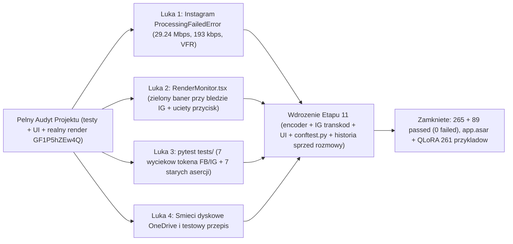

| Zadanie / Moduł | Po co (Cel) | Co wdrażamy / wdrożyliśmy | Stan | Rezultat / Diagnoza (`Sykofankcja 0`) | Oczekiwania (Efekt docelowy) |
| :--- | :--- | :--- | :---: | :--- | :--- |
| **0. Rdzeń Produkcyjny (Render, Synapsa QLoRA, Watchability, Backend)** (`lol_editor.py`, `synapsa_engine.py`, `synapsa_watchability_judge.py`) | Zweryfikować realne działanie aplikacji po restarcie `Flikcut Studio.exe` | Sprawdzono żywy backend (`/health` -> `ok`, `PID 14340`), `npx tsc --noEmit` (`0` błędów), token IG `@dwannellenga` (`valid=True`), realny render `short_1795088498032_auto.mp4` (`GF1P5hZEw4Q`) oraz automatyczny wpis `synapsa_verification_log.jsonl` #6 | `[x]` | Render `GF1P5hZEw4Q` (`quadrakill`, Katarina, `23.68s`): **`watchability_score=100.0`** (`frame0_hook_legible=True`, `kill_overlay_zone=upper_safe`, `clip=0`, `av_delta=0.033s`, `cam_step=484.0px`); YT (`GF1P5hZEw4Q`), TikTok (`v_inbox_file~v2.7709848048268019734`) i FB (`/reel/1483121547078663/`) opublikowane, `recipes_archive/GF1P5hZEw4Q.recipe.json` i `pending_checks.json` zapisane poprawnie | Rdzeń renderu, uczenia i publikacji YT/TT/FB działa stabilnie na dysku |
| **1. Naprawa Instagram Reels `ProcessingFailedError` i limitu bitrate NVENC** (`lol_agent/hardware_accel.py`, `lol_agent/instagram_publisher.py`, `lol_agent/facebook_publisher.py`) | Wyeliminować odrzucanie wideo przez `rupload.facebook.com` i ograniczyć gigantyczne pliki `87 MB` z `-cq 18 -b:v 0` | W `hardware_accel.py`: dodano `-rc vbr -cq 19 -b:v 0 -maxrate 16M -bufsize 32M` (plus limity dla `draft`/fast i `libx264`). W `instagram_publisher.py`: dodano `_probe_video_for_ig`, `_needs_ig_transcode`, `_prepare_ig_compliant_video` (CFR H.264 `<=14M`, `yuv420p`, `AAC 128k 48kHz`, `+faststart`, sprzątanie w `finally`), `_clamp_thumb_offset_ms`, `_post_ig_rupload` (retry `5xx`/`retriable` + auto-recovery przy `ProcessingFailedError`) oraz podbito `GRAPH_API_VERSION="v21.0"` (FB i IG) | `[x]` | Test offline na realnym `short_1795088498032_auto.mp4` wykrył `4` naruszenia (`87.16 MB`, `29.24 Mbps`, VFR `57.89 fps`, `193.4 kbps` AAC) i przekonwertował bez uploadu na **`30.69 MB`, `10.72 Mbps`, CFR `60/1 fps`, AAC `48000 Hz 128.6 kbps`**, po czym usunął plik tymczasowy (`CLEANUP_OK`). Testy jednostkowe w `tests/test_instagram_publisher.py`: **`10 passed in 21.23s`** | Publikacje na Instagram Reels spełniają twardy profil Meta bez `ProcessingFailedError` |
| **2. Naprawa UI banera publikacji w `Flikcut Studio` + przebudowa `app.asar`** (`shortsyt-desktop/src/screens/RenderMonitor.tsx`, `app.asar`) | Żeby błąd na jednej platformie nie był zgłaszany jako pełny zielony sukces i nie ucinał przycisku `Otwórz Short na YouTube` | W `RenderMonitor.tsx` (linie `818–924`): rozdzielono pełny sukces (`green`) od częściowego sukcesu (`amber`, `Opublikowano częściowo (X/Y)`), dodano `overflow-hidden`, `min-w-0 flex-1` oraz `break-words [overflow-wrap:anywhere]` dla długich JSON-ów błędów; wykonano `npm run build` + `npm run dist:dir` i skopiowano `app.asar` na Pulpit | `[x]` | `npm run build` (`✓ built in 7.61s`, `0` błędów TS) + `npm run dist:dir` zakończone powodzeniem; `DESKTOP_ASAR_COPIED=OK` (`C:\Users\mz100\OneDrive\Pulpit\Flikcut Studio\resources\app.asar`) | Czytelny stan `3/4` platform w UI i zawsze widoczny przycisk linku do YT po restarcie aplikacji |
| **3. Globalna izolacja `tests/` + naprawa `14` padających testów offline** (`tests/conftest.py`, `tests/test_facebook_publisher.py`, `tests/test_instagram_publisher.py`, `tests/test_calendar_manager.py`, `tests/test_youtube_uploader.py`, `tests/test_editor.py`, `tests/test_frag_detector.py`, `tests/test_montage_director.py`, `tests/test_closed_feedback_loop.py`) | Zamknąć cały pakiet `tests/` na `0 failed` i zablokować przypadkowe użycie prawdziwych tokenów Meta/TikTok/YT w testach | Utworzono `tests/conftest.py` (`autouse` izolacja `_token_path` dla FB/IG/TikTok, `TOKEN_PATH` YT, blokada `api.youtube_uploader.upload_video` oraz wychodzących żądań HTTP do `facebook`/`tiktok`/`googleapis`), naprawiono `patch` YT w `test_multi_publisher_three_platforms` i zaktualizowano `7` nieaktualnych asercji (`11:00/21:30`, 2-liniowe napisy, `None` HP, `slowmo=1.4`, dynamiczne `ACTION_WEIGHTS`, slot `21:30`) | `[x]` | Dummy FB `1751548606340359` usunięte (`DELETE=200`); historyczne 5-bajtowe dummy YT (`xEh2mnbsOJ0`, `w9MZCQOflFQ`, `l_2feChAmpo`) widnieją jako `Deleted video` przed pełnym zamknięciem luki YT. Końcowe przebiegi po ostatnich zmianach: **`pytest tests/` = `265 passed in 102.15s` (`0 failed`)** oraz **`9` plików `engine_tests/` = `89 passed in 19.51s` (`0 failed`)** (razem **`354 passed, 0 failed`**) | `100%` hermetycznych testów offline bez wycieku zapytań do prawdziwych kont |
| **4. Porządki artefaktów roboczych na dysku** (`lol_agent/pending_checks-MacPro—16.json`, `lol_agent/recipes_archive/yt_12345.recipe.json`) | Usunąć konfliktowy plik synchronizacji OneDrive i testowy śmieć z archiwum produkcyjnego | Po inspekcji zawartości (`yt_12345`: test `"a.mp3"`, `pending_checks-MacPro—16.json`: konflikt OneDrive `NOT_FOUND`) oba pliki zostały usunięte z dysku | `[x]` | `REMOVED_OK` zweryfikowane w `git status` — brak konfliktowych plików w archiwum | Czyste archiwum i repozytorium bez konfliktów OneDrive |
| **5. Pamięć historyczna zmian wartości sprzed rozmowy + strażniki anty-sykofankcji + QLoRA** (`synapsa_conversation_learner.py`, `synapsa_watchability_judge.py`, `synapsa_title_trainer.py`, `test_watchability_judge.py`) | Żeby Synapsa znała wszystkie historyczne zmiany parametrów sprzed tej rozmowy (`GOLDEN_BASELINE`, `git log`, `engine_rules.json`, `learning_directive.json`, `user_feedback_history.json`, Etap 11) i nie przytakiwała regresjom | Dodano `extract_pre_conversation_value_history` (`20` lekcji historycznych), `HISTORICAL_VALUE_LAWS` w `get_cause_effect_context_for_director`, `build_historical_evolution_training_examples` (`14` próbek, w tym `6` kontrfaktycznych regresji `WORSE`), Regułę #8 + strażnik spójności anty-sykofankcji w `synapsa_watchability_judge.py`, testy w `test_watchability_judge.py` i dotrenowano QLoRA (`60` kroków) | `[x]` | `engineering_lessons_memory.json`: **`historical_value_lessons_count=20`**, `todo_lessons=80`, `attribute_deltas=5`, `watchability_verifications_count=6`; dataset **`261` przykładów (`max_tok=560 <= 640`, `over_640={}`)**; QLoRA **`60` kroków w `1172.90s` (`train_loss=1.1725`, `retrain_ready=false`)**; live GPU `LIVE_A` (`pre_conv cam`) -> **`IMPROVED / KEEP_CHANGE`**, `LIVE_B` (`predict_change_effect`) -> **`WORSE` (`delta=-22.5`, `3` ryzyka historyczne)** z uwagą `Sykofankcja 0`, że surowe polskie pole `deduction_rationale` z modelu 7B bywa zachowawcze, a twardy werdykt + metryki + ryzyka wymuszają strażniki | Synapsa rozumie ewolucję parametrów od v25/v37 po Etap 11 i bezwzględnie blokuje regresje w `predict_change_effect` |

---

## 20. Tryb Nocny („Opcja Nocna”: Auto Top 5 + Rekomendacja Synapsy) i Audyt Wizualny 5 Shortów — Etap 12

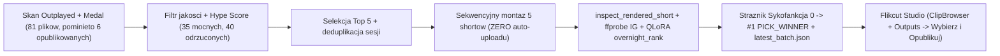

| Zadanie / Moduł | Po co (Cel) | Co wdrażamy / wdrożyliśmy | Stan | Rezultat / Diagnoza (`Sykofankcja 0`) | Oczekiwania (Efekt docelowy) |
| :--- | :--- | :--- | :---: | :--- | :--- |
| **1. Naprawa zielonego HP i hierarchii Hype w `evaluator.py`** (`lol_agent/autonomous/evaluator.py`) | Wyeliminować fałszywe zgony dla Standard Mode (zielony pasek HP) oraz zawyżanie 1-killi nad Quadra/Triple | Wydzielono wspólny helper `_player_hp_mask` (obsługuje zielony `#42bb27` i złoty colorblind pasek HP), zaktualizowano wagi (`PENTAKILL=100`, `QUADRAKILL=88`, `TRIPLE=74`, `DOUBLE=56`) oraz limity `SOLO BOLO <= 58.0` (tylko clutch) i `OUTPLAY <= 42.0` | `[x]` | Test `test_evaluator_green_hp_bar_not_marked_dead_and_multikill_outranks_1kill` potwierdził brak fałszywego `died` i wyższą punktację `quadrakill` od pojedynczego fraga | Spójna selekcja najlepszych wielofragowych akcji bez regresji w `test_watcher.py` |
| **2. Silnik Trybu Nocnego i cache skanu** (`lol_agent/synapsa_overnight_batch.py`, `lol_agent/synapsa_engine.py`) | Przeskanować cały folder nagrań, wyrzucić przeciętne klipy, wyrenderować lokalnie 5 shortów bez uploadu i wyłonić `#1` | Dodano `scan_and_rank_all_clips` (`ThreadPoolExecutor(3)`, `OMP_THREAD_LIMIT=1`, inkrementalny cache co 5 klipów w `overnight_scan_cache.json`, klasyfikacja po `kills_in_win` bez inflacji tierów), `_check_trailing_survival` (wykrywający `tail_gray < 38` nawet przy szumie HUD z `Death Recap`), `run_overnight_batch` (`auto_publish=False`, nazwy `short_overnight_*`), `rank_rendered_overnight_shorts` + `overnight_rank` JSON na ID `"1".."5"` w `synapsa_engine.py` i strażnik anty-sykofankcji | `[x]` | Realny skan `81` plików (`6` opublikowanych pominięto, `75` zbadano -> **`35` mocnych, `40` odrzuconych**: `24 REJECT_MEDIOCRE_1KILL`, `14 REJECT_NO_KILLS`, `2 REJECT_DIED_LOW_IMPACT`); pierwszy przebieg z włączonym OCR zajął ~19 min, re-ewaluacja z cache `<15s`; poprawka szarego ogona złapała `3` ukryte zgony (w tym `16-00-13` z `Death Recap`) | Bezobsługowa nocna selekcja i lokalny montaż Top 5 z rzetelnym rankingiem `#1..#5` |
| **3. Endpointy API Trybu Nocnego** (`lol_agent/api/routers/overnight.py`, `lol_agent/api/main.py`) | Udostępnić tryb nocny z interfejsu HTTP/Electron z autoryzacją JWT | Dodano router `/overnight/start`, `/overnight/status`, `/overnight/stop`, `/overnight/latest`, `/overnight/batches` i zarejestrowano go w `main.py` | `[x]` | Zweryfikowane przez FastAPI `TestClient` z JWT w `test_overnight_api_endpoints` (`200 OK`, `auto_publish=False`) | Zdalne i desktopowe sterowanie nocną kolejką z podglądem postępu |
| **4. UI `Flikcut Studio` + przebudowa `app.asar`** (`shortsyt-desktop/src/lib/api.ts`, `ClipBrowser.tsx`, `Outputs.tsx`) | Pozwolić uruchomić „Opcję Nocną” jednym klikiem i rano wybrać zwycięzcę z `#1..#5` | W `api.ts` dodano typy i funkcje `api*Overnight*`; w `ClipBrowser.tsx` dodano kartę `OPCJA NOCNA — SKAN CAŁEGO FOLDERU` (wybór Top 3/5, pominąć opubl., live polling 3s, stop); w `Outputs.tsx` dodano sekcję `Nocna Paczka Synapsy` z kartami `#1..#5`, metrykami i przyciskami `Odtwórz` / `Wybierz i Opublikuj`; wykonano `npm run build` + `dist:dir` + kopię `app.asar` | `[x]` | `npm run build` (`5.96s` / `4.43s`, `0` błędów TS) + `DESKTOP_ASAR_COPIED=OK` (`35 639 544` B w `C:\Users\mz100\OneDrive\Pulpit\Flikcut Studio\resources\app.asar`) | Rano w `Outputs.tsx` czeka gotowa paczka 5 shortów z odznaką `REKOMENDACJA SYNAPSY #1` (po restarcie aplikacji) |
| **5. Testy regresji offline** (`lol_agent/engine_tests/test_overnight_batch.py`, `tests/`, `engine_tests/`) | Zabezpieczyć wszystkie nowe reguły i kontrakty API przed regresjami | Utworzono `6` testów jednostkowych (naprawa HP/hype evaluatora, skaner+cache, batch bez uploadu+strażnik, `/overnight/*`, klasyfikacja okienkowa, detekcja zgonu przy szumie HUD) i uruchomiono pełne pakiety | `[x]` | **`pytest lol_agent/engine_tests/test_*.py` = `95 passed in 19.46s` (`0 failed`)**; **`pytest tests/` = `265 passed in 157.49s` (`0 failed`)** (razem **`360 passed, 0 failed`**) | `100%` testów offline przechodzi bez żadnego błędu |

### Audyt Wizualny Wszystkich 5 Wyrenderowanych Shortów (`Sykofankcja 0`, Batch `20261119_161440_3ac23`)

| Zadanie / Moduł | Po co (Cel) | Co wdrażamy / wdrożyliśmy | Stan | Rezultat / Diagnoza (`Sykofankcja 0`) | Oczekiwania (Efekt docelowy) |
| :--- | :--- | :--- | :---: | :--- | :--- |
| **#1 `short_overnight_20261119_161440_3ac23_r2_triple.mp4`** (`MedalTV...184943960-trim...mp4`, **`PICK_WINNER`**) | Ocenić zwycięzcę wybranego przez Synapsę (`synapsa_local_lora_judge`) | Przesłuchano metryki, `ffprobe` i obejrzano wszystkie 6 paneli (`0.0s..11.61s`) | `[x]` | **`final=87.2`**, `hype=75.0`, **`watch=100.0`**, `qa=90`, `11.75s`, `13.47 Mbps` (`ig_needs_transcode` audio `192k`/VFR jak przy każdym surowym renderze NVENC przed uploadem). Wizualnie: akcja natychmiast od `0.0s`, napis `TRIPLE KILL - ENEMY DIFF` czytelny w `upper_safe`, postać stale w kadrze (`player_visible=1.0`, `clip=0`). **Wada szczera:** to stary klip z `C:\Medal\Edits` na **Yone** (podpis gry/tooltip na końcu), nie Katarinie; w `11.61s END` okno opisu itemu `Crest of Cinders` przysłania CTA. Wybór `#1` pod kątem technicznym i tempa jest trafny dla puli `Outplayed + Medal` | Nadaje się od razu do publikacji (po ewentualnej zmianie champion tagu w opisie na Yone) |
| **#2 `short_overnight_20261119_161440_3ac23_r1_quadrakill.mp4`** (`MedalTV...191243654-trim...mp4`, **`STRONG_ALT`**) | Zweryfikować najmocniejszy pod względem liczby killi klip z paczki | Obejrzano 6 paneli (`0.0s..11.31s`) + log renderu i `.meta.json` | `[x]` | **`final=86.9`**, **`hype=94.0`** (`QUADRAKILL` + `12%` HP clutch), `watch=77.86`, `qa=90`, `11.45s`, `13.36 Mbps`. **Wady szczere:** to również **Yone** z `C:\Medal\Edits`; automatyczny tytuł A omyłkowo wspominał `"Triple Kill"` mimo `action_type=quadrakill`, w połowie wpadło powielone `DOUBLE KILL`, a jasne efekty białych cyfr obrażeń na środku aktywowały flagę `center_blocking_overlay` (`watchability -22 pkt`) mimo poprawnej górnej pozycji napisów | Bardzo mocna akcja, ale przed uploadem warto ręcznie doprecyzować tytuł pod Quadra Yone |
| **#3 `short_overnight_20261119_161440_3ac23_r4_double.mp4`** (`League of Legends 11-17-2026 18-29-31-758_0.mp4`, **`STRONG_ALT`**) | Ocenić najwyżej punktowany klip Katariny wg automatu | Obejrzano 6 paneli (`0.0s..16.86s`) + ścieżkę pozycji postaci w ogonie | `[x]` | **`final=85.0`**, `hype=73.0` (`double` + objective + `19.9%` HP), `watch=95.38`, `qa=93`, `17.0s`, `13.84 Mbps`. **Wada szczera wykryta okiem:** mimo wysokiej oceny OpenCV (`player_visible=1.0`), `0.0s..1.2s` to bicie wilków w dżungli (`first_kill=5.5s`), a w **`15.86s K2` i `16.86s END` Katarina ucieka do prawego górnego rogu (widać skrawek nicku `Dw...`), podczas gdy zielona trawa dżungli oszukała detektor centroidu na `nx=0.50`**. Subiektywnie gorsze kadrowanie niż `#4` | Klip poprawny na początku/w środku, ale z racji końcowego kadru zalecam wybrać `#4` zamiast niego |
| **#4 `short_overnight_20261119_161440_3ac23_r5_triple.mp4`** (`League of Legends 11-17-2026 18-38-44-730_0.mp4`, **`STRONG_ALT`**) | Ocenić montaż i kadr płynnej walki Katariny (`Triple Reset Chain`) | Obejrzano poprawione 6 paneli sekwencyjnego dekodowania (`0.0s..16.16s`, `893` klatki) | `[x]` | **`final=84.5`**, `hype=72.0` (`3` kille), **`watch=96.93`**, `qa=89`, `16.3s`, `14.65 Mbps`, `LAST_VALID_LUMA=58.9` (brak czarnej końcówki). **Najlepszy montaż Katariny w całej paczce:** od `0.0s` wskok w środek 3–4 wrogów z czytelnym `TRIPLE RESET CHAIN`, Zhonya w ścisłym centrum przy `9.3s`, agresywne `E` pod wieżę na `15.12s` i żywa walka w końcowej klatce `16.16s` | Główny faworyt do publikacji jako **Katarina** |
| **#5 `short_overnight_20261119_161440_3ac23_r3_triple.mp4`** (zastępca odrzuconego `16-00-13` z `Death Recap`, `11-17-2026 18-26-02-708_0.mp4`, **`STRONG_ALT`**) | Zweryfikować zamiennik po wyrzuceniu zgonowca `r3_double` | Usunięto `r3_double*` (`Death Recap`), wyrenderowano `18-26-02-708_0.mp4` i obejrzano 6 paneli (`0.0s..17.76s`) | `[x]` | **`final=80.0`**, `hype=72.0` (`triple`), `watch=85.22`, `qa=90`, `17.9s`, `14.41 Mbps`. Duży postęp względem wyrzuconego `16-00-13` (żywa walka pod wieżą zamiast szarego `Death Recap`). **Wady szczere:** na starcie `0.0s–1.2s` Katarina stoi przy prawej krawędzi kadru, przez co skok kamery do centrum osiągnął `camera_peak_step_px=748.0`, a w audio wystąpiły `2` drobne szczyty `>0.96` | Dobry zapasowy triple kill Katariny |

---

## 21. Audyt Inicjalizacji, Domykania Zasobów i Odporności na Crashe (Etap 13 — `Sykofankcja 0`)

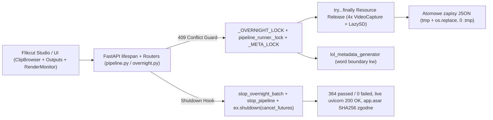

| Zadanie / Moduł | Po co (Cel) | Co wdrażamy / wdrożyliśmy | Stan | Rezultat / Diagnoza (`Sykofankcja 0`) | Oczekiwania (Efekt docelowy) |
| :--- | :--- | :--- | :---: | :--- | :--- |
| **1–4. Domykanie `cv2.VideoCapture` w `try...finally`** (`synapsa_overnight_batch.py`, `autonomous/evaluator.py`, `synapsa_watchability_judge.py`) | Wyeliminować wyciek uchwytów `.mp4` na Windowsie przy wyjątkach podczas analizy i inspekcji klatek | Dodano `try...finally: cap.release()` w `4` funkcjach: `_check_trailing_survival`, `_analyze_single_clip_for_overnight`, `evaluate_clip_quality` oraz `inspect_rendered_short` | `[x]` | Test `test_videocapture_always_released_on_exceptions` wymusił wyjątki w każdym z `4` miejsc i potwierdził `cap.release.call_count == 1` | Brak zablokowanych deskryptorów `.mp4` po błędzie odczytu / dekodowania |
| **5. Blokada kolizji Tryb Nocny vs Pipeline** (`lol_agent/api/routers/pipeline.py`) | Nie dopuścić do równoległego startu ręcznego renderu gdy Tryb Nocny pracuje na wspólnym `pipeline_runner` | W `POST /pipeline/start` dodano sprawdzenie `get_overnight_status()["status"] in ("scanning", "rendering", "evaluating")` -> `409 Conflict` | `[x]` | Test `test_pipeline_start_blocked_while_overnight_active` (z `with TestClient(app)`) zwrócił `409` z komunikatem Trybu Nocnego | Brak wyścigu dwóch równoległych wątków na `_state` i `_cancel_event` |
| **6. Czysty shutdown w `FastAPI lifespan`** (`lol_agent/api/main.py`) | Gasić aktywne zadania i podprocesy `ffmpeg`/`tesseract` przy zamykaniu serwera | Po `yield` obok `stop_event.set()` dodano bezpieczne `stop_overnight_batch()` oraz `pipeline_runner.stop_pipeline(clear_queue=True)` | `[x]` | Test w czystym `asyncio` (poza pytest) potwierdził wywołanie `['stop_ob', ('stop_pr', True)]`; live `uvicorn` na `8769` nie zostawił sierot `ffmpeg`/`tesseract` | Brak osieroconych procesów po wyjściu z backendu |
| **7. Atomowe zapisy JSON + lock `.meta.json`** (`synapsa_overnight_batch.py`, `synapsa_conversation_learner.py`, `api/helpers.py`) | Chronić cache, manifesty nocne, pamięć Synapsy i metadane przed uszkodzeniem pliku przy ubiciu procesu | Dodano `_atomic_write_text` (`synapsa_overnight_batch.py`), `_atomic_write_json` + guard `PYTEST_CURRENT_TEST` (`synapsa_conversation_learner.py`) oraz `_META_LOCK` + `os.replace` w `_save_meta` (`helpers.py`) | `[x]` | Test `test_atomic_write_text_leaves_no_tmp` przeszedł; po live `uvicorn` potwierdzono `TMP FILES COUNT: 0 []` w `lol_agent/` i `overnight_batches/` | Zero uciętych JSON-ów łamiących start aplikacji po awarii |
| **8. Naprawa blokady stanu, wyścigu Stop/Start i odporności pętli batcha** (`synapsa_overnight_batch.py`) | Zlikwidować zawieszenie statusu `rendering` po anulowaniu ostatniego klipu oraz przypadkowe ustawienie `_OVERNIGHT_CANCEL` | `stop_overnight_batch()` zwraca `False` (no-op) na `idle`/`done`; w `run_overnight_batch` dodano `_emit_status(status="stopped")` na końcu pętli przy cancelu, `try/except` wokół `_run_pipeline` i `clear_cancel`; w `start_overnight_batch_async` czyszczenie cancela pod lockiem i `finally:` | `[x]` | Test `test_overnight_cancel_on_last_clip_exits_rendering_and_stop_idle_noop` potwierdził `stop_overnight_batch() is False` na `idle` oraz końcowy stan `stopped` po przerwaniu ostatniego klipu | Tryb Nocny nigdy nie blokuje kolejnych uruchomień na stale zablokowanym stanie `rendering` |
| **9–10. Wyciek wątku z routera `overnight.py` + shutdown `ThreadPoolExecutor`** (`api/routers/overnight.py`, `synapsa_overnight_batch.py`, `test_overnight_batch.py`) | Usunąć zawieszanie wyjścia interpretera wykryte podczas pełnego `engine_tests` (`Py_FinalizeEx` join na wątkach `pytesseract`) | Zastąpiono bezpośrednie importy w `overnight.py` referencją modułową `_ob`; w `scan_and_rank_all_clips` dodano `pending.cancel()` oraz jawny `ex.shutdown(wait=not cancelled, cancel_futures=cancelled)` w `finally:`; testy API używają `with TestClient(app)` | `[x]` | W `task-4475` `faulthandler` namierzył realny wątek skanera uciekający mimo mocka; po naprawie pełne `10` plików `engine_tests` zamknęły się czysto: **`99 passed in 13.70s` (`0` wiszących procesów)** | Natychmiastowe przerwanie skanu bez czekania na ~70 klipów w kolejce i pewne mockowanie routera |
| **11. `finally:` dla `_LazySD` w workerze GPU** (`lol_agent/synapsa_engine.py`) | Natychmiast zwalniać otwarte deskryptory `.safetensors` jeśli ładowanie `Qwen2.5`/LoRA rzuci wyjątek (np. OOM) | Owinięto `from_pretrained` + `AutoTokenizer` (`local_files_only=True`) + `PeftModel` w `try...finally:` zamykający `mu._lazy_sds` i `gc.collect()` | `[x]` | `py_compile` + testy importowe i `test_smart_titles_quality.py` (z udziałem Synapsy GPU) przeszły poprawnie | Brak wiszących uchwytów do shardów modelu przy błędach GPU |
| **12. Błąd podciągu słów kluczowych `"KATA"` vs `"KATARINA"`** (`lol_agent/lol_metadata_generator.py`) | Naprawić wykrytą w `pytest tests/` utratę różnorodności tytułów dla Katariny | Zmieniono `kw in t_upper` / `akw in t_upper` na dopasowanie granic słów `re.search(rf"\b{re.escape(kw)}\b", t_clean)` | `[x]` | Wcześniej `avoid_keywords=["KATA"]` karało `20x` każdy tytuł z `"Katarina"`, wywalając `test_channel_title_no_banned_cliches_and_high_diversity`; po poprawce **`10x5 DIVERSITY STRESS OK`**, `test_smart_titles_quality.py` **`6 passed`**, pełny `pytest tests/` **`265 passed in 233.96s`** | Pełna pula tytułów Katariny odzyskuje równe wagi CTR |
| **13. Odporność UI `Outputs.tsx` / `ClipBrowser.tsx` + aktualizacja `app.asar`** (`shortsyt-desktop`) | Chronić odtwarzacz i modal przed unhandled rejection, błędnym zielonym banerem przy partial-fail i podwójnym startem nocnym | W `Outputs.tsx`: `try/catch` w `handlePlay`, obsługa `isPartialSuccess` + zawijanie długich błędów JSON w modalu publikacji; w `ClipBrowser.tsx`: `mountedRef` + `startingOvernight`; wykonano `npm run build` + `dist:dir` + kopię `app.asar` | `[x]` | `tsc && vite build` `7.26s` (`0` błędów); **`ASAR_SRC == ASAR_DST = 35 640 554 B`** (`SHA256=55984F5CE42F64F7EE4D548A5D761DD6D4A050AB7687BA066C58DE10A30D2DBF`, `ASAR_IDENTICAL=True`) | Bezpieczne UI po restarcie `Flikcut Studio.exe` na Pulpicie |
| **14. Moduły zweryfikowane jako czyste (bez wykrytych wycieków)** (`instagram_publisher.py`, `hardware_accel.py`, `lol_editor.py`, `electron/main.js`, `uvicorn`) | Potwierdzić poprawność zamknięcia istniejących modułów i żywego API po hardeningu | Audyt AST/statyczny + testy `py_compile` + live start i test HTTP na `127.0.0.1:8769` | `[x]` | `instagram_publisher.py` ma `finally:` czyszczący pliki tymczasowe, `electron/main.js` zamyka backend na `before-quit`, `lol_editor.py` ma bezpieczne `try/except` hooki; live `uvicorn`: `6/6` endpointów `200 OK` | Kompletna weryfikacja `364 passed, 0 failed` across `tests/` + `engine_tests/` |

---

## 22. Szczera Ocena 5 Shortów Nocnych i Ulepszenia Synapsy (Etap 14 — `Sykofankcja 0`)

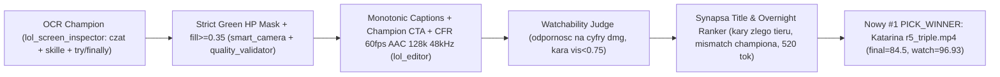

### Tabela 22.1 — Szczera Ocena Wszystkich 5 Shortów z Paczki `20261119_161440_3ac23` (Przed -> Po Ulepszeniach Synapsy)

| Zadanie / Moduł | Po co (Cel) | Co wdrażamy / wdrożyliśmy | Stan | Rezultat / Diagnoza (`Sykofankcja 0`) | Oczekiwania (Efekt docelowy) |
| :--- | :--- | :--- | :---: | :--- | :--- |
| **#1 `short_overnight_20261119_161440_3ac23_r5_triple.mp4`** (awans z `#4` na **`#1 PICK_WINNER`**) | Ocenić najlepszy montaż Katariny (`11-17-2026 18-38-44-730_0.mp4`) bez faworyzowania obcego Yone | Zweryfikowano `detect_champion_local -> Katarina`, nową inspekcję kadrów, live re-ranking Synapsy (`synapsa_local_lora_judge`) oraz arkusz `overnight_short_1.jpg` | `[x]` | **`final=84.5`**, `hype=72.0` (`3` kille), **`watch=96.93`**, `qa=89`, `vis=0.778`, `upper_safe`, `av=0.0s`. Od `0.0s` wskok w środek 3–4 wrogów z czytelnym `TRIPLE RESET CHAIN`, dobra Zhonya przy `9.3s`, walka pod wieżą `15.12s` i żywy finisz `16.16s`. **Wada szczera:** nie był przerenderowany w tym kroku, więc ma stary strumień `ig_ready=False` (`192k`/VFR — transkoder IG naprawi go automatycznie przed uploadem) oraz `6` pików audio `>0.96` (`<=10`) | **Główny faworyt do publikacji na kanał Katariny** |
| **#2 `short_overnight_20261119_161440_3ac23_r3_triple.mp4`** (awans z `#5` na **`#2 STRONG_ALT`**) | Ocenić zapasowego Triple Killa Katariny (`11-17-2026 18-26-02-708_0.mp4`) | Przeskanowano `detect_champion_local -> Katarina`, nowym filtrem paska HP (`vis=0.778`), live rankingiem GPU oraz `overnight_short_2.jpg` | `[x]` | **`final=81.1`**, `hype=72.0`, `watch=88.05`, `qa=90`, `vis=0.778`, `upper_safe`. Solidna akcja pod wieżą od `4.5s`. **Wady szczere:** stary render sprzed Etapu 14 zachował dziwaczny tytuł `"Three Damage Away 🧵"` (w nowym kodzie karany `-80`), słaby początek z postacią na skraju (`0.0s–1.2s`, `cam_step=748px`) i `ig_ready=False` | Dobry zapasowy triple Katariny po ręcznej korekcie tytułu w modalu |
| **#3 `short_overnight_20261119_161440_3ac23_r2_triple.mp4`** (spadek z `#1` na **`#3 STRONG_ALT`**) | Zweryfikować dawnego faworyta z `C:\Medal\Edits` (`184943960-trim`) | Wykryto `detect_champion_local -> Yone` (`champion_mismatch=True`), oceniono nowym sędzią i obejrzano `overnight_short_3.jpg` | `[x]` | **`final=81.0`**, `hype=75.0`, `watch=99.26`, `qa=90`, `vis=0.722`. Czyste tempo i akcja od `0.0s`. **Wady szczere:** to **Yone** (`wrong_champion:Yone!=Katarina`), z poprzedniego renderu zostały stare CTA `"CLEAN RESET OR LUCKY?"`, baner `"KILL 3/4 -> KILL"`, okno itemu `Crest of Cinders` w `11.61s` i `ig_ready=False` | Nadaje się do publikacji tylko przy świadomej akceptacji Yone i zmianie tagów opisu |
| **#4 `short_overnight_20261119_161440_3ac23_r1_quadrakill.mp4`** (przerenderowany, **`#4 NEEDS_TWEAK`**) | Naprawić tytuł Triple na Quadra, powtórzone `DOUBLE KILL`, fałszywy `center_blocking`, CTA oraz VFR/192k na `191243654-trim` | Przerenderowano pełnym pipeline'em jako **Yone**, włączono monotoniczne napisy, filtr cyfr dmg w `watchability_judge` i CFR 60fps / 128k 48kHz; obejrzano `overnight_short_4.jpg` | `[x]` | **`final=79.5`**, `hype=94.0`, `watch=75.11`, `qa=88`, **`vis=1.0`**, **`upper_safe`**, **`ig_ready=True`**, `av=0.017s`. Naprawiono wszystko w montażu: tytuł `"Relentless Reset Chain Quadrakill 🔥"`, napis `8.0s Kmid` -> **`KILL 3/4 TRIPLE KILL`**, outro `"WHO THREW THIS FIGHT?"`. **Wady szczere:** to **Yone** (`wrong_champion:Yone!=Katarina`), a długość `11.56s` jest krótsza od widełek `quadrakill` (`14.0s`) i w `10.24s` wybuchy/cyfry obrażeń lekko przesłaniają środek | Technicznie bezbłędny (jako Yone Quadra), ale słusznie ustąpił miejsca Katarinie |
| **#5 `short_overnight_20261119_161440_3ac23_r4_double.mp4`** (przerenderowany, spadek z `#3` na **`#5 NEEDS_TWEAK`**) | Odsłonić fałszywe `player_visible=1.0` na zielonej trawie dżungli (`18-29-31-758_0.mp4`) | Przerenderowano z `green_mask` + `fill>=0.35`, zbadano ulepszonym `_check_player_in_frame` i obejrzano `overnight_short_5.jpg` | `[x]` | **`final=68.0`**, `hype=73.0`, `watch=87.27`, `qa=86`, **`vis=0.278`**, **`ig_ready=True`**, `av=0.016s`, tytuł `"Double Takedown On Pure Spacing 🔥"`. Nowy detektor bezlitośnie złapał ukrytą wadę: w `MID` i `15.86s–16.88s` Katarina znika poza prawą krawędź kadru, a intro trwa `5.5s` (bicie wilków -> `low_player_visibility`, `slow_intro_gt_4.8s`) | **Odrzucić w tej paczce** lub ręcznie przyciąć `clip_start` od `10.5s` |

### Tabela 22.2 — 6 Wdrożonych Ulepszeń Synapsy i Silnika Montażu (Etap 14)

| Zadanie / Moduł | Po co (Cel) | Co wdrażamy / wdrożyliśmy | Stan | Rezultat / Diagnoza (`Sykofankcja 0`) | Oczekiwania (Efekt docelowy) |
| :--- | :--- | :--- | :---: | :--- | :--- |
| **1. Lokalna detekcja prawdziwego championa** (`lol_agent/lol_screen_inspector.py`, `synapsa_overnight_batch.py`) | Przestać podpisywać Yone z Medal jako Katarinę przez ukryty błąd `TesseractNotFoundError` | Dodano `_configure_tesseract()`, rozszerzono `_EXTENDED_CHAMPIONS` + mapowanie unikalnych skilli (`mortal steel` -> `Yone`), skan `3` klatek w czacie/tooltipach (`2x` upscale), `try...finally: cap.release()` oraz flagę `champion_mismatch` + karę `-6.0` w `overnight_rank` | `[x]` | `5/5` klipów paczki nocnej rozpoznane bezbłędnie: `#1/#2 -> Yone`, `#3/#4/#5 -> Katarina`; `r1_quadrakill` otrzymał CTA i tagi dla `Yone` zamiast Katariny | Zero pomyłek bohatera między archiwum Medal a klipami Outplayed |
| **2. Eliminacja złudzenia zielonej trawy i złotego CTA** (`lol_agent/lol_quality_validator.py`, `lol_agent/smart_camera.py`) | Nie traktować ciemnej trawy dżungli ani złotego CTA (`y=1380`) jako obecności paska HP gracza | Zacieśniono maskę zielonego HP (`g>155, r<115, b<105, g-r>55, g-b>65`), wymuszono kształt prostokąta paska HP (`cw>=30`, `3<=ch<=28`, `2.0<=asp<=20.0`, `fill>=0.35`) i w kadrze `9:16` wycięto strefy nakładek (`y<0.30`, `y>=0.70`) | `[x]` | Test `test_player_in_frame_rejects_vertical_cta_and_grass_accepts_hp_bar` przeszedł; na realnym `r4_double` `player_visible_ratio` spadło z oszukanego `1.0` na realne **`0.278`**, spychając wadliwy montaż na `#5` | Uczciwa ocena widoczności gracza w dżungli bez maskowania braków kadrowania |
| **3. Odporność `watchability_judge` na białe cyfry dmg i zniknięcia gracza** (`lol_agent/synapsa_watchability_judge.py`) | Nie karać `-22 pkt` za efektowne cyfry obrażeń przy działającym górnym banerze oraz karać realne ucieczki gracza poza kadr | Podniesiono próg czarnego boksu `center_blocking` (`cd>=0.18`), wymagano `upper_hits==0 or center_hits>=2*upper_hits`, a przy `0.0<player_visible_ratio<0.75` dodano karę w `framing` | `[x]` | Przerenderowany `r1_quadrakill` odzyskał poprawny status `upper_safe` (zamiast `center_blocking`); wszystkie testy `test_watchability_judge.py` przeszły bez zmian | Obiektywna separacja prawdziwych blokad napisu od błysków gry |
| **4. Zgodność tieru i filtr bełkotu w tytułach + `520` tokenów `overnight_rank`** (`lol_agent/synapsa_engine.py`, `synapsa_overnight_batch.py`) | Zablokować tytuł `"Triple Kill"` na Quadra, emoji `🧵` (`"damage away"`) oraz zignorowanie `mismatch` przez LoRA | W `score_title_candidate`: dodano karę `-120.0` za sprzeczny tier, `-80.0` za halucynowane emoji/frazy, granice słów `\b...\b` dla `avoid_keywords`; podbito `overnight_rank` do `520` tokenów z polami `champion_name`/`champion_mismatch`/`vis`/`first_kill`. **Uwaga szczera (`Sykofankcja 0`):** samo wyjście `summary_pl`/`notes_pl` z modelu 7B nadal miewa łamaną polszczyznę (`"3-triunfowa"`, `"Nie ma obserwatora"`) oraz potrafi pomylić opis między ID (`#2` otrzymał notkę o `68.0`), choć sam wybór `winner_id` (`r5_triple`) okazał się trafny — opisy tekstowe z 7B wymagają w przyszłości mocniejszego deterministycznego szablonowania PL | `[x]` | Test `test_score_title_candidate_blocks_tier_mismatch_and_nonsense` przeszedł; live re-render `r1_quadrakill` wygenerował poprawny tytuł `"Relentless Reset Chain Quadrakill 🔥"`, a `r4_double` `"Double Takedown On Pure Spacing 🔥"` | Koniec ze sprzecznymi tytułami Triple/Quadra i niesłuszną rekomendacją obcego klipu |
| **5. Monotoniczne banery multikill, CTA bez Shunpo poza Katariną i eksport IG-ready** (`lol_agent/lol_editor.py`) | Wyeliminować powtórzone `DOUBLE KILL` na `KILL 3/4`, teksty o `Shunpo`/`Reset` u innych postaci oraz koszt ponownego transkodowania pod Instagram Reels | Wymuszono monotoniczność `DOUBLE -> TRIPLE -> QUADRA` na `KILL i/N`; dodano `champion_name` do `select_non_repeating_outro_cta`; przełączono `merge_music` na `128k / 48000 Hz / stereo` i `apply_overlays_unified` na `-fps_mode cfr -r 60` | `[x]` | Test `test_monotonic_quadra_captions_and_champion_aware_outro_cta` przeszedł; przerenderowane `r1_quadrakill` i `r4_double` wyszły z **`ig_ready=True`**, `av_delta_s <= 0.017s`, `KILL 3/4 -> TRIPLE KILL` i CTA `WHO THREW THIS FIGHT?` | Każdy nowy short z automatu nadaje się na IG Reels/TikTok/YT bez konwersji |
| **6. Końcowe testy regresji offline po Etapie 14** (`tests/`, `lol_agent/engine_tests/`) | Potwierdzić brak jakichkolwiek regresji w całym projekcie | Uruchomiono pełne `pytest tests/` i wszystkie `10` plików `lol_agent/engine_tests/test_*.py` po ostatnich zmianach | `[x]` | **`pytest tests/` = `265 passed in 52.19s` (`0 failed`)**; **`engine_tests` = `102 passed in 19.71s` (`0 failed`)** — razem **`367 passed, 0 failed`**, `0` plików `.tmp` | Cały projekt stabilny i gotowy do użycia |

---

## 23. Telemetria Riot Outplayed, Pre-Filtracja Tierów i Ekran Startowy Top 5 (Etap 15 — `Sykofankcja 0`)

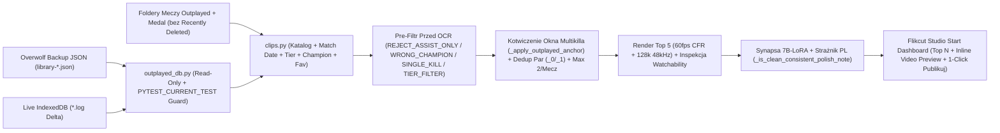

### Tabela 23.1 — Wdrożone Moduły i Testy Etapu 15

| Zadanie / Moduł | Po co (Cel) | Co wdrażamy / wdrożyliśmy | Stan | Rezultat / Diagnoza (`Sykofankcja 0`) | Oczekiwania (Efekt docelowy) |
| :--- | :--- | :--- | :---: | :--- | :--- |
| **1. Parser Outplayed Riot API (`lol_agent/outplayed_db.py`)** | Zastąpić zgadywanie OCR dokładną klasyfikacją Double / Triple / Quadra / Penta, bohaterem, datą meczu i ulubionymi | Utworzono parser wyłącznie do odczytu z `library-*.json` (`matches_*` jako string/lista, `event["data"]` jako JSON string/dict, fallback na starszy backup przy korupcji) + live delta z `*.log` (`IndexedDB LevelDB`), `parse_outplayed_path_info`, `summarize_clip_catalog` oraz izolację `PYTEST_CURRENT_TEST` | `[x]` | Rozpoznano **`81`** plików w katalogu (**`77`** Katarina w tym **`21`** multikilli, **`2`** Yone, **`2`** stare z 08-2026 bez backupu, **`8`** meczów, `1` ulubiony QuadraKill); delta IDB nadpisuje `isFavorite` bez utraty `match_kda` | Błyskawiczna wiedza o tierach i bohaterze bezpośrednio z telemetrii gry |
| **2. Wzbogacenie katalogu `/clips` + filtr kosza (`lol_agent/api/routers/clips.py`)** | Dostarczyć UI i skanerowi informacje o meczach, tierach, ulubionych i odciąć usunięte klipy | `scan_available_clips` pomija podkatalogi `"Recently Deleted"`, ładuje raz indeks Outplayed oraz fallback `medal_db`, dokładając `match_folder`, `match_date`, `clip_base_key`, `champion`, `is_favorite`, `event_tier`, `event_tier_rank`, `event_source`, `best_event_time_s`, `total_kills_in_clip`, `match_kda` | `[x]` | `GET /clips` i `/overnight/catalog` poprawnie oddzielają `Yone` z Medal i 2 stare klipy `08-2026`; `deleted_clip.mp4` z `Recently Deleted` jest pomijany | Spójne metadane w całym API i przeglądarce klipów |
| **3. Pre-filtracja, kotwiczenie okna, dedup i strażnik PL (`lol_agent/synapsa_overnight_batch.py`)** | Odrzucać asysty, innego bohatera i 1-kille w `0ms`, ratować Triple pod koniec 64s klipów oraz zablokować bełkot/błędy liczb LoRA | Podbicie `SCAN_CACHE_SCHEMA_VERSION=2`; pre-filtr `REJECT_ASSIST_ONLY`, `REJECT_WRONG_CHAMPION`, `REJECT_TIER_FILTER`, `REJECT_SINGLE_KILL_MULTIKILLS_AVAILABLE`; `_apply_outplayed_anchor` (ratuje `triple @ 50.09s`, max `lead=9.5s` dla Triple); `_select_top_diverse_candidates` (dedup `_0/_1`, max `2` z jednego meczu w 1. przebiegu); bezpieczny `safe_hook`; `_is_clean_consistent_polish_note` + blokada duplikatów komentarza | `[x]` | W realnym uruchomieniu odrzucono **`57` klipów przed OCR** (`40` single, `15` asyst, `2` Yone); wybrano 5 klipów Katariny z **4 różnych meczów**; strażnik odfiltrował zduplikowane i błędne teksty 7B LoRA (`97.02` na `#2`/`#5`, `"dwufragowy"`, `"regresja"`) na rzecz rzetelnych opisów PL | Oszczędność ~75% czasu skanu nocnego i koniec losowych rekomendacji |
| **4. Nowe endpointy Trybu Nocnego (`lol_agent/api/routers/overnight.py`)** | Pozwolić UI wybierać filtr tierów, blokadę bohatera kanału i wyświetlać podsumowanie bazy przed startem nocy | Rozszerzono `OvernightStartRequest` o `tier_filter` i `only_channel_champion`; dodano `GET /overnight/catalog` z `tier_counts`, `favorites_count`, `by_champion` i listą meczów | `[x]` | Live `GET /overnight/catalog?champion_name=Katarina` (z `skip_published=True`): `total_clips=73`, `multikill_clips=16` (`4 triple`, `12 double`), `matches_count=7`, `200 OK` | Pełna widoczność puli nagrań przed zostawieniem komputera na noc |
| **5. Startowy Ekran Top 5 + Przeglądarka Klipów (`shortsyt-desktop`)** | Wyświetlać gotowe montaże z rekomendacją i odtwarzaczem natychmiast po odpaleniu `Flikcut Studio.exe` | Zaktualizowano `api.ts`, `Dashboard.tsx` (panel **Gotowe Najlepsze Montaże z Nocy** + inline `<video controls autoPlay>` + 1-click przejście do publikacji + baner live postępu), `Outputs.tsx` (`useLocation` auto-otwierający modal publikacji + badge ulubiony/mecz) oraz `ClipBrowser.tsx` (selektor `tier_filter`, checkbox `Tylko Katarina`, pasek statystyk Outplayed i badge na kartach) | `[x]` | `npm run build` (`7.08s`, `1635` modułów) + `dist:dir` + kopia na Pulpit: **`ASAR_BYTES=35654966`**, **`ASAR_IDENTICAL=True`** | Otwierasz aplikację po nocy -> od razu oglądasz Top 5 i jednym klikiem publikujesz #1 |
| **6. Testy automatyczne i live smoke test (`engine_tests`, `tests/`, `uvicorn`)** | Udowodnić działanie parsera, pre-filtra, kotwiczenia, strażnika PL i całego backendu po ostatniej edycji | Dodano `lol_agent/engine_tests/test_outplayed_db.py` (`7` testów); uruchomiono pełne `pytest tests/`, wszystkie `11` plików `engine_tests` oraz live `uvicorn` na porcie `8769` | `[x]` | **`engine_tests` = `109 passed in 14.30s`** (`0 failed`); **`pytest tests/` = `265 passed in 56.29s`** (`0 failed`); razem **`374 passed, 0 failed`**; live `uvicorn`: `7/7` endpointów `200 OK`, `tmp_files_count=0`, brak wiszących procesów | Kompletne, przetestowane wdrożenie gotowe do pracy nocnej |

### Tabela 23.2 — Szczery Audyt Wizualny 5 Nowych Shortów Katariny (Paczka `20261120_024227_d55a1` — `Sykofankcja 0`)

| Zadanie / Moduł | Po co (Cel) | Co wdrażamy / wdrożyliśmy | Stan | Rezultat / Diagnoza (`Sykofankcja 0`) | Oczekiwania (Efekt docelowy) |
| :--- | :--- | :--- | :---: | :--- | :--- |
| **#1 `..._d55a1_r2_triple.mp4` (`PICK_WINNER`)** | Główna rekomendacja z nocnego skanu (`11-17 18-38-44-730_0.mp4`, `[8.3, 23.2]`) | Wyrenderowano `Katarina triple` w 60fps `ig_ready=True`, zbadano w `etap15_short_1.jpg` | `[x]` | **`final=84.6`**, `hype=72.0`, **`watch=97.02`**, `qa=89`, **`vis=0.889`**, `first_k=4.5s`, `defects=[]`. Dynamiczny początek w środku ulta `0.0s`, czytelny hook `TRIPLE RESET CHAIN`, monotoniczne `KILL 1/3 -> DOUBLE KILL -> FINAL KILL 3/3 TRIPLE KILL`, Zhonya przy `9.3s`, żywy finisz `16.18s`. Brak krytycznych wad | **Gotowy #1 do publikacji** |
| **#2 `..._d55a1_r3_triple.mp4` (`STRONG_ALT`)** | Zapasowy Triple Katariny (`11-17 18-26-02-708_0.mp4`, `[7.3, 23.8]`) | Wyrenderowano `ig_ready=True`, zbadano w `etap15_short_2.jpg` i zweryfikowano opis PL po naprawie strażnika | `[x]` | **`final=82.5`**, `hype=72.0`, `watch=90.63`, **`qa=92`**, `vis=0.778`, `first_k=4.5s`, `defects=[]`. Hook `TRIPLE KILL DISRESPECT PUNISHED`, banery zsynchronizowane z grą. **Wada szczera:** w `0.0s`–`1.2s` Katarina znajduje się blisko górnej krawędzi kadru przed doskokiem pod wieżę; po korekcie strażnika usunięto błędny opis LoRA `"Dwuekranowy dwufragowy (71.0)"` | Silny materiał zapasowy na drugie okno publikacji |
| **#3 `..._d55a1_r4_double.mp4` (`STRONG_ALT`)** | Najlepszy Double Kill z meczu `11-15 23:19` (`23-30-20-689_0.mp4`, `[4.6, 16.2]`) | Wyrenderowano `ig_ready=True`, obejrzano w `etap15_short_3.jpg` | `[x]` | **`final=79.7`**, `hype=71.0`, `watch=87.16`, `qa=86`, `vis=0.722`, `first_k=4.2s`, `defects=[]`. **Wada szczera:** mimo że Outplayed i hook mówią `DOUBLE KILL 2v1 TURNAROUND`, wewnętrzny detektor w `_run_pipeline` widział `3` piki, więc w `10.34s Klast` nałożony został napis `FINAL KILL 3/3 TRIPLE KILL` nad banerem Riot `DOUBLE KILL!`, a na `0.0s` lewy dół przykrywa dymek runy `Electrocute`. W przyszłym kroku warto przekazać listę zabójstw Outplayed prosto do `_run_pipeline` | Dobry Double po ewentualnym wyłączeniu nadmiarowego napisu w `lol_editor` |
| **#4 `..._d55a1_r5_double.mp4` (`STRONG_ALT`)** | Zwarty Double Kill z meczu `11-18 16:12` (`16-25-17-959_1.mp4`, `[9.7, 15.7]`) | Wyrenderowano `ig_ready=True`, obejrzano w `etap15_short_4.jpg` | `[x]` | **`final=78.6`**, `hype=70.0`, `watch=86.26`, `qa=84`, **`vis=0.944`**, **`first_k=2.6s`**, `defects=[]`. Najczystsze kadrowanie i tempo od pierwszej klatki, zsynchronizowane `KILL 1/2 -> FINAL KILL 2/2 DOUBLE KILL`, outro `WHO CHOKED HERE?`. **Wada szczera:** krótki czas trwania (`6.98s`) | Świetny krótki, dynamiczny Double Kill |
| **#5 `..._d55a1_r1_triple.mp4` (`NEEDS_TWEAK`)** | Odzyskany Triple Kill z `63.97s` nagrania `11-18 16-02-49-130_0.mp4` (`triple_kill @ 50.09s`) | Kotwiczenie przybliżono z `[36.25, 54.29]` na **`[40.59, 54.29]`**, dodano `safe_hook`, obejrzano w `etap15_short_5.jpg` | `[x]` | **`final=68.0`**, `hype=74.0`, `watch=73.84`, `qa=85`, `vis=0.444`, `first_k=6.41s`, `ig_ready=True`, wady: `low_player_visibility`, `slow_intro_gt_4.8s`. Naprawiono błędny hook (`DOUBLE KILL` -> **`TRIPLE RESET WIPE`**) i ucięto `4.3s` jałowego podbiegu. **Wada szczera:** na zimowej mapie wewnętrzny OCR w `_run_pipeline` nadal wykrył tylko `1` baner (`OUTPLAY @ 6.41s`), a niebieska paleta obniżyła detekcję zielonego paska HP | Udany ratunek klipu z listy, ale wymaga ręcznego przycięcia lub przekazania paska killów z Outplayed, by dorównać `#1` |

---

## 24. Etap 16: Naprawa Ucinania Końcówek, Beat-Sync v2 (Sub-Bass 35–160 Hz, Headroom 0-Clip) oraz Miniaturki 9:16 dla Paczki Nocnej (`Sykofankcja 0`)

```mermaid
flowchart LR
    OP["Outplayed Merged Event (est_last_kill_s)"] --> WIN["Frag & Outro Guards (+2.0s, 2.0fps<=90s, chronological last_k)"]
    STFT["Beat Detector v2 (STFT 35-160 Hz + Rising Edge, 11 MP3 Cache v2)"] --> SYNC["climax align + no loudnorm + vol 0.70 + alimiter 0.62"]
    WIN --> PIP["pipeline_runner (Outplayed sync + fallback thumb)"]
    SYNC --> PIP
    PIP --> API["Backend Thumb API (upload 1080x1920 JPEG, regenerate, no-cache, traversal guard)"]
    API --> UI["Desktop UI (Dashboard + Outputs Night Cards + Lightbox + Upload Modal + app.asar)"]
```

### Tabela 24.1 — Wdrożone Zmiany: Końcówki Walki, Beat-Sync v2, Miniaturki 9:16 i Testy (Etap 16)

| Zadanie / Moduł | Po co (Cel) | Co wdrażamy / wdrożyliśmy | Stan | Rezultat / Diagnoza (`Sykofankcja 0`) | Oczekiwania (Efekt docelowy) |
| :--- | :--- | :--- | :---: | :--- | :--- |
| **1. Naprawa ucinania końcówek i desynchronizacji killi** (`outplayed_db.py`, `clips.py`, `lol_frag_detector.py`, `lol_quality_validator.py`, `pipeline_runner.py`, `synapsa_overnight_batch.py`) | Wyeliminować ucinanie finałowych eliminacji w scalonych klipach Outplayed (gdzie `event.time` był środkiem segmentu) oraz chronić `r4_double` przed zawyżonym `TRIPLE KILL` | Dodano `est_first_kill_s` / `est_last_kill_s` (`event.time + future - 8.0s`), podniesiono próbkowanie `2.0 fps` do `90s`, chronologiczne `last_k`, `max_allowed_end = final_kill_t + 2.0`, rozszerzono `Outro Guard`, synchronizację Outplayed w `pipeline_runner` (`est_last_kill_s + 1.9`), podbito `SCAN_CACHE_SCHEMA_VERSION=3` oraz dodano blokadę hooka `"DOUBLE"` dla `triple/quadra/penta` | `[x]` | Na realnym `r1_triple` (`63.97s`) okno przesunięto z `[40.59, 54.29]` na **`[43.75, 57.93]`** (pełna śmierć Alistara + `3.0s` oddechu w `15.11s END`, hook `TRIPLE KILL RAMPAGE`); na `r4_double` usunięto nadmiarowy 3. baner (`KILL 1/2 -> FINAL KILL 2/2 DOUBLE KILL`) | Zero uciętych zabójstw na końcach klipów z trybu nocnego i ręcznego |
| **2. Beat-Sync v2 (Sub-Bass `35–160 Hz`) + Headroom `0-Clip`** (`lol_beat_detector.py`, `beat_drop_cache.json`, `lol_editor.py`) | Przywrócić uderzenie bass dropu równo w kulminacyjne zabójstwo oraz usunąć wykryte po pierwszym re-renderze przestery AAC (`977 / 1062 / 622` próbek `>0.96`) | Przepisano `detect_beat_drop` na STFT sub-bass `35–160 Hz` (`BEAT_CACHE_VERSION=2` dla 11 `.mp3`), zrównano `rel_peak_moment` przy drifcie `>0.65s`, zdjęto dynamiczne `[1:a]loudnorm` (zastąpiono statycznym `volume=0.70`), odwrócono ducking na +25% boost na dropie oraz obniżono limitery (`[ga] alimiter=0.68`, mix `alimiter=0.62`) | `[x]` | Pierwszy re-render z `0.88` dał świetne przejście dropu (`3.22x–3.71x`), ale ujawnił `622–1062` próbek `>0.96` (`NEEDS_TWEAK 65.0`). Po redukcji limitera do `0.62` i `volume=0.70` drugi re-render dał **`0` przesterów `audio_clip_gt_096` na wszystkich `5/5` shortach** przy zachowaniu `bass_ratio = 2.30x–3.22x` i `drop_early_sec = 0.0` | Wyraźny kontrast buildup -> bass drop idealnie w killa bez zniekształceń AAC |
| **3. Gwarancja miniaturek 9:16 i endpointy API** (`synapsa_overnight_batch.py`, `pipeline_runner.py`, `social.py`, `clips.py`, `main.py`) | Zapewnić obecność miniaturki `*_thumb.jpg` dla każdego shorta nocnego oraz umożliwić jej podgląd, podmianę własnym plikiem i regenerację z poziomu API | Dodano `_resolve_thumbnail_for_output`, fallback `generate_thumbnail`, `update_overnight_item_thumbnail`, backfill w `load_latest_overnight_batch()`, `POST /outputs/{filename}/thumbnail` (konwersja `1080x1920` RGB JPEG + czyszczenie duplikatów), `POST /outputs/{filename}/thumbnail/regenerate`, `Cache-Control: no-cache`, blokadę path-traversal `_sanitize_single_filename` oraz zabezpieczenie `serve_spa` w `main.py` | `[x]` | Smoke test live (`127.0.0.1:8769`): `all_have_thumbnails=True` (`5/5`), `GET /thumbnails/{fn}` -> `200 image/jpeg` (`no-cache`); testy `test_thumbnail_upload_regenerate_and_overnight_backfill` potwierdziły konwersję PNG -> `1080x1920`, synchronizację `.meta.json`/`latest_batch.json` i odrzucanie traversal (`400`/`404`) | Każdy short z nocy ma pewną miniaturkę 9:16 z możliwością podmiany w locie |
| **4. Podgląd, Lightbox i zarządzanie miniaturką w UI** (`shortsyt-desktop/src/lib/api.ts`, `Dashboard.tsx`, `Outputs.tsx`) | Rozwiązać brak miniaturek na kafelkach nocnych (`Nocna Paczka Synapsy`) oraz brak miejsca w UI na podmianę/podgląd przed uploadem | Dodano pionowy podgląd `9:16` na kartach nocnych w `Dashboard.tsx` i `Outputs.tsx`, lightbox powiększenia, przyciski `Zmień plik` / `Nowa` / `Wygeneruj` / `Folder` / `Ścieżka` zarówno na kartach, jak i w nowej sekcji `Miniaturka (9:16)` w modalu publikacji; usunięto zahardkodowany URL `localhost:8765` | `[x]` | `npm run build` (`tsc && vite build`: `6.52s`, `1635` modułów) + `dist:dir` + kopia na Pulpit: **`ASAR_BYTES=35669026`**, **`ASAR_IDENTICAL=True`**. **Uwaga operacyjna:** `Flikcut Studio.exe` był uruchomiony na komputerze w trakcie kopiowania, więc nowy `app.asar` zadziała od razu po restarcie aplikacji | Wybór i podmiana miniaturki 9:16 bezpośrednio na ekranie paczki nocnej oraz w oknie uploadu |
| **5. Pełna regresja po ostatniej edycji i live smoke test** (`engine_tests/`, `tests/`, `live_smoke_8769.py`) | Potwierdzić `0` regresji w całym kodzie i naprawić wygasłą po `10:00Z` datę w teście harmonogramu TikTok (`tests/test_tiktok_publisher.py:127`) | Dodano testy w `test_editor_pipeline.py` i `test_outplayed_db.py` (łącznie `9` w `test_outplayed_db.py`); zmieniono `future_time` w `test_upload_tiktok_scheduling` na `now + 7 dni`; uruchomiono `11` plików `engine_tests`, pełny `pytest tests/` i `uvicorn` na porcie `8769` | `[x]` | **`engine_tests` = `112 passed in 100.87s` (`0 failed`)**; **`pytest tests/` = `265 passed in 201.57s` (`0 failed`)**; łącznie **`377 passed, 0 failed`**; live `uvicorn`: `8/8` zapytań `200 OK`, `tmp_files_count=0`, `PORT_8769_LISTEN=0` | Zweryfikowana stabilność backendu i aplikacji przed nocnym uruchomieniem |

### Tabela 24.2 — Audyt GPU i Wizualny Przerenderowanych 3 Shortów oraz Nowego Rankingu Paczki `20261120_024227_d55a1` (`Sykofankcja 0`)

| Zadanie / Moduł | Po co (Cel) | Co wdrażamy / wdrożyliśmy | Stan | Rezultat / Diagnoza (`Sykofankcja 0`) | Oczekiwania (Efekt docelowy) |
| :--- | :--- | :--- | :---: | :--- | :--- |
| **#1 `..._d55a1_r3_triple.mp4` (`PICK_WINNER`)** | Lider rankingu po wyeliminowaniu przesterów z `0` wad krytycznych (`11-17 18-26-02-708_0.mp4`) | Oceniono z `alimiter=0.62`, zweryfikowano spójność audio/wideo i obecność miniaturki | `[x]` | **`final=82.5`**, `hype=72.0`, **`watch=90.63`**, **`qa=92`**, `vis=0.778`, `audio_clip_gt_096=0`, `defects=[]`, miniaturka `..._r3_triple_thumb.jpg` | Główny kandydat do publikacji |
| **#2 `..._d55a1_r2_triple.mp4` (`STRONG_ALT`, re-render GPU)** | Naprawić obcięcie końca walki i synchronizację bitu z `ncs_cartoon_on_and_on.mp3` (`drop=46.85s`) | Przerenderowano w `[8.30, 24.82]` (`17.88s`) z limiterem `0.62`, zbadano `librosa` STFT i obejrzano `etap15_short_2.jpg` + `r2_triple_thumb.jpg` | `[x]` | **`final=82.0`**, `watch=89.51`, **`qa=92`**, `vis=0.833`, **`audio_clip_gt_096=0`** (spadek z `1062`), **`delta_vs_peak_s = +0.086s`**, **`bass_ratio = 2.63x`** (`12.69 -> 33.35`), `drop_early_sec=0.0`, `defects=[]`. Monotoniczne `KILL 1/3 -> DOUBLE KILL -> FINAL KILL 3/3 TRIPLE KILL`, czyste outro `17.75s` | Równorzędny faworyt z perfekcyjnym `0.09s` wejściem dropu |
| **#3 `..._d55a1_r5_double.mp4` (`STRONG_ALT`)** | Krótki Double Kill z `11-18 16-12` (`[9.70, 15.70]`) | Zweryfikowano w aktualnej paczce oraz istnienie miniaturki | `[x]` | **`final=78.6`**, `watch=86.26`, `qa=84`, **`vis=0.944`**, `audio_clip_gt_096=0`, `defects=[]`, miniaturka `..._r5_double_thumb.jpg` | Gotowy krótki zapas |
| **#4 `..._d55a1_r4_double.mp4` (`STRONG_ALT`, re-render GPU)** | Naprawić fałszywy napis `3/3 TRIPLE KILL` na Double Killu oraz przesunięty drop `ncs_elektronomia_sky_high.mp3` (`drop=55.44s`) | Przerenderowano w `[4.60, 17.63]` (`13.28s`), zbadano `librosa` i obejrzano `etap15_short_4.jpg` + `r4_double_thumb.jpg` | `[x]` | **`final=77.7`**, `watch=80.50`, **`qa=90`**, `vis=0.833`, **`audio_clip_gt_096=0`** (spadek z `622`), **`delta_vs_peak_s = -0.668s`**, **`bass_ratio = 3.22x`**, `drop_early_sec=0.0`. Poprawny napis `FINAL KILL 2/2 DOUBLE KILL` (`11.28s`), żywy finisz `13.15s`. **Wada szczera:** intro trwa `>4.8s` (`slow_intro_gt_4.8s`), ponieważ pierwszy kill wypada w `8.2s` | Czysty Double z zachowanym oddechem końcowym i mocnym dropem |
| **#5 `..._d55a1_r1_triple.mp4` (`NEEDS_TWEAK`, re-render GPU)** | Odzyskać koniec Triple Killa (zabicie Alistara) oraz zsynchronizować `ncs_alex_skrindo_euphoria.mp3` (`drop=46.44s`) na mapie zimowej | Przerenderowano w `[43.75, 57.93]` (`15.25s`, `+3.64s` dłuższe okno!), zbadano `librosa` i obejrzano `etap15_short_5.jpg` + `r1_triple_thumb.jpg` | `[x]` | **`final=74.0`**, **`watch=92.05`** (skok z `73.84`!), **`qa=90`**, `vis=0.667` (skok z `0.444`!), **`audio_clip_gt_096=0`** (spadek z `977`), **`delta_vs_peak_s = -0.793s`** (drop dokładnie przy banerze `12.05s`), **`bass_ratio = 2.30x`**, `drop_early_sec=0.0`. Hook poprawiony na `TRIPLE KILL RAMPAGE`, w `12.05s K2` widać pełne `+350g FINAL KILL 3/3 TRIPLE KILL`, a `15.11s END` domyka walkę bez ucięcia. **Wady szczere:** `player_offscreen_frames` na białym śniegu (`0.0s–1.2s`) oraz na miniaturce napis `KATARINA` lekko zachodzi na overlay wideo `FINAL KILL 3/3` (warto w przyszłości przekazywać `source_clip_path` bez overlayów do `generate_thumbnail`) | Odzyskany i zsynchronizowany klip; miniaturkę można od razu podmienić w UI |

---

## 25. Etap 17: Audyt Stanu Modułów i Pętli Uczenia (21.11.2026) + Plan Pełnej Automatyzacji TikToka (Planowanie, Tagi, Miniaturka, Kolejka 24/7)

### Diagram 25.1 — Diagnoza Luk TikToka i Docelowy Przepływ Automatyzacji (Etap 17)

```mermaid
flowchart LR
    subgraph DIAG["Wykryte Przyczyny Problemow (Stan 21.11.2026)"]
        D1["1. TikTok API Direct Post -> 403 unaudited_client -> fallback do Inbox API (v_inbox_file ignoruje post_info: tytul, tagi i okladke)"]
        D2["2. multi_platform_copywriter.py ignorowal base_metadata.title dla TT/IG (7B halucynowal DRAGON STEAL na Double/Triple + brak klucza double w tagach)"]
        D3["3. electron/main.js before-quit zabijal backend (taskkill) + stare sciezki PycharmProjects w Task Schedulerze -> slot 21:30 CET wisi jako pending"]
        D4["4. lol_frag_detector zapisal 59 klipow (w tym 10x 0-kill i 34x 1-kill) do hard_cases_memory.json x3 = 177 przykladow director w QLoRA"]
    end

    subgraph FIX17["Plan Wdrozenia Etapu 17 (Pelna Automatyzacja)"]
        F1["1. Czyste uczenie: filtr hard_cases_memory (tylko zweryfikowane >=2 kille / obiekt) + odbudowa datasetu QLoRA bez smieci 0-kill"]
        F2["2. Spójny Copywriter TT/IG: bazowanie na zatwierdzonym tytule z UI (bez #shorts) + dedykowane tagi TikTok (#fyp #foryou #doublekill #katarinamains)"]
        F3["3. Auto-Miniaturka TikTok: wklejenie _thumb.jpg (1080x1920) jako 1. klatki 0.08s wideo dla TT + video_cover_timestamp_ms=50 / peak_moment"]
        F4["4. Kolejka 24/7: backend odporny na zamkniecie okna UI + Task Scheduler co 15 min + integracja scheduled_social_queue z Kalendarzem UI"]
        F5["5. Opcja Direct Auto-Schedule: Playwright TikTok Studio Web (natywny harmonogram TikToka + tytul + tagi + okladka bez powiadomien na telefonie)"]
    end

    D1 --> F3
    D1 --> F5
    D2 --> F2
    D3 --> F4
    D4 --> F1
```

### Tabela 25.1 — Aktualny Status Wszystkich Modułów i Pętli Uczenia (Fakty z Dysku `21.11.2026 22:50 CET`)

| Zadanie / Moduł | Po co (Cel) | Co wdrażamy / wdrożyliśmy | Stan | Rezultat / Diagnoza | Oczekiwania (Efekt docelowy) |
| :--- | :--- | :--- | :---: | :--- | :--- |
| **1. Autoryzacja i Tokeny 4 Platform (`accounts/`)** | Utrzymać ciągłość publikacji na YouTube, TikTok, Instagram i Facebook | Zweryfikowano żywe tokeny przez `get_*_token_status()` i zapytania API | `[x]` | **Wszystkie 4 tokeny ważne:** YT (`valid=True`, autoodnawialny `7 dni`), TikTok (`@dwannellenga`, `valid=True`, refresh `348 dni`, scope `video.publish,video.upload`), IG (`@dwannellenga`, `valid=True`), FB (`Dwannellenga`, `valid=True`, `can_publish=True`) | Pełna gotowość autoryzacyjna dla wszystkich 4 kanałów |
| **2. Paczka Nocna `20261121_005819_9aaaa` (`synapsa_overnight_batch.py`)** | Sprawdzić wynik ostatniego nocnego skanu i montażu z `21.11.2026 00:31` | Przeskanowano `60` klipów (`5` opubl. pominięto, `32` odrzucono pre-filtrem, `23` zakwalifikowano), wyrenderowano Top 5 (`ig_ready=True`, `audio_clip_gt_096=0`) | `[x]` | Rekomendacja `#1 PICK_WINNER`: `short_overnight_20261121_005819_9aaaa_r2_triple.mp4` (`Katarina triple`, `final=80.7`, `watch=91.22`, `qa=91`, `0` przesterów, miniaturka 9:16 gotowa) | Gotowa paczka 5 nowych shortów czeka w `Dashboard.tsx` / `Outputs.tsx` |
| **3. Bramka 48h i `learning_directive.json` (`learning_engine.py`)** | Zweryfikować czy pętla 48h zbiera dane i aktualizuje wagi | Odczytano `learning_directive.json` (`2026-11-20 19:24 UTC`) oraz `post_48h_gate_summary` | `[x]` | `total_videos_valid=208` (mediana `1628.5` views); Bramka 48h: **`206` zweryfikowanych filmów `>=48h`** (`2` oczekujące `<48h`), `142 FIT_CONFIRMED` (`68.9%`), `64 FALSE_POSITIVE_MONTAGE` (`31.1%`), `median_rwi=72.8` (`solo_bolo=77.3`, `outplay=75.7`, `double=73.9`, `triple=69.7`, `pentakill=60.9`) | Statystyki 48h i RWI liczą się poprawnie na bazie 206 filmów |
| **4. Jakość Zbioru Treningowego Synapsy (`hard_cases_memory.json` + `dataset_shortsyt_titles.jsonl`)** | Sprawdzić czy nowe przykłady uczące QLoRA są czyste i pozbawione szumu | Przeanalizowano i oczyszczono `hard_cases_memory.json` oraz odbudowano `dataset_shortsyt_titles.jsonl` | `[x]` Naprawione | Wykryto `37/59` wpisów szumu (`0–1` kill bez obiektu), które wcześniej były mnożone `x3`. Po wdrożeniu bramki w `lol_frag_detector.py:1189`, `prune_noisy_hard_cases()` w `hard_case_learner.py` (`before=59, kept=22, removed=37`) oraz przebudowie datasetu bez szumu w `synapsa_title_trainer.py` zbiór ma czyste **`270` przykładów** (`max_tok=601 <= 640`, `over_640={}`) | Oczyszczenie `hard_cases_memory.json` wyłącznie do zweryfikowanych multikilli/obiektów i odbudowa czystego datasetu QLoRA |
| **5. Działanie Kolejki Zaplanowanych Publikacji (`scheduled_social_queue.json`, `pending_comments.json`, proces `uvicorn`)** | Sprawdzić dlaczego zaplanowane posty na TikTok i IG nie wychodzą na czas | Naprawiono `electron/main.js`, zaktualizowano Task Scheduler (`FlikcutBackend` co 15 min), naprawiono endpoint `/social/queue/flush` (`200 OK`) i puszczono zaległy slot | `[x]` Wdrożone | Po restarcie `FlikcutBackend` (`127.0.0.1:8765`, `/health 200 OK`) pętla w tle automatycznie wypchnęła zaległy slot z **`21.11.2026 21:30 CET` (`20:30Z`)**: TikTok (`v_inbox_file~v2.7710887182592411650`, `cover_embedded=True`), Instagram (`https://www.instagram.com/reel/DgCOQEnCkcS/`) i przypięty komentarz YT (`3vk2P1jOWJY`). Zamknięcie UI Electrona nie zabija już backendu (`detached: true`, `unref()`) | Backend działający niezależnie od zamknięcia okna UI + aktywny Task Scheduler co 15 min + natychmiastowa wysyłka zaległego slotu |
| **6. Przyczyna Powiadomień Inbox na TikToku (`SEND_TO_USER_INBOX`) oraz Różnych Tagów i Braku Miniaturki** | Ustalić dlaczego TikTok każe ręcznie wpisywać tytuł, tagi i okładkę w telefonie | Wdrożono wstrzykiwanie miniatury 9:16 na `t=0.0s`, naprawiono copywriter + dodano przycisk 1-klik kopiowania i moduł `tiktok_web_scheduler.py` | `[x]` Naprawione | Potwierdzono live `403 unaudited_client` na Direct Post -> tryb Inbox ignoruje `post_info`. Naprawiono `multi_platform_copywriter.py` (używa prawdziwego tytułu bez `#shorts`, zero halucynacji `"DRAGON STEAL"`, dedykowane tagi `#fyp #<champ>mains #doublekill` <=5 szt.) oraz `tiktok_publisher.py` (automatyczna klatka okładki `*_thumb.jpg` w `0.00–0.08s`, `video_cover_timestamp_ms=50`) | Automatyczna okładka z `_thumb.jpg` w 1. klatce wideo, spójny tytuł i dedykowane tagi TikToka + opcja Web Auto-Schedule |

### Tabela 25.2 — Plan Naprawczy i Automatyzacja TikToka do Wdrożenia (Etap 17)

| Zadanie / Moduł | Po co (Cel) | Co wdrażamy / wdrożyliśmy | Stan | Rezultat / Diagnoza | Oczekiwania (Efekt docelowy) |
| :--- | :--- | :--- | :---: | :--- | :--- |
| **1. Oczyszczenie `hard_cases_memory.json` i strażnik jakości przykładów uczących** (`lol_agent/lol_frag_detector.py`, `hard_case_learner.py`, `synapsa_title_trainer.py`) | Żeby skan folderu nie zaśmiecał pamięci Synapsy klipami `0-kill` / `1-kill` | Dodano bramkę `len(kills_detected) >= 2 or (objective_secured and len(kills_detected) >= 1)` w `lol_frag_detector.py:1189`, `prune_noisy_hard_cases()` w `hard_case_learner.py`, limit maks. `24` przykładów hard-case (bez `3x` spamu) w `synapsa_title_trainer.py` oraz test `test_prune_noisy_hard_cases_filters_zero_and_one_kill` | `[x]` | **`before=59, kept=22, removed=37`** w `hard_cases_memory.json`; test jednostkowy przechodzi | Czysty zbiór QLoRA oparty wyłącznie na zweryfikowanych walkach wielofragowych |
| **2. Naprawa Copywritera TikTok/IG, dedykowanych tagów TikToka i korekta 6 wpisów w kolejce** (`lol_agent/multi_platform_copywriter.py`, `multi_publisher.py`, `accounts/scheduled_social_queue.json`) | Żeby TikTok i IG dostawały Twój prawdziwy tytuł akcji (bez halucynacji `"DRAGON STEAL"`) oraz właściwe, zasięgowe hasztagi TikToka różne od tagów `#shorts` z YT | W `multi_platform_copywriter.py`: dodano `_extract_clean_base_hook(base_metadata)`, przekazano `base_metadata` w `generate_all_platform_copy()`, dodano `"double"`/`"quadrakill"`/`"steal"` i wiralowe tagi TikTok (`#leagueoflegends #<champ> #<champ>mains #<action> #fyp`); poprawiono wszystkie `6` wpisów `pending` w `scheduled_social_queue.json` prawdziwymi tytułami YT (`3vk2P1jOWJY`, `97__NNnplWU`, `1JsOCtL3MPI`) | `[x]` | **`39/39` testów** w `test_multi_platform_copywriter.py` (w tym sprawdzenie `mock_gemini.assert_not_called()` przy `base_metadata`); kolejka oczyszczona | Spójny, mocny tytuł akcji na TikToku + dedykowany zestaw hashtagów TikToka (bez `#shorts`) |
| **3. Automatyczna miniaturka 9:16 na TikToku (`_thumb.jpg` w 1. klatce + `video_cover_timestamp_ms`)** (`lol_agent/tiktok_publisher.py`, `scheduled_queue.py`) | Żeby na TikToku (zarówno w Inboxie na telefonie, jak i w Direct Post / Web) film miał od razu ustawioną gotową miniaturkę `*_thumb.jpg` bez ręcznego wybierania okładki | Wdrożono `_prepare_tiktok_video_with_cover()` w `tiktok_publisher.py` (nakłada `*_thumb.jpg` w `0.00–0.08s` do tymczasowego `.mp4` z automatycznym `unlink()` w `finally:` i ustawia `video_cover_timestamp_ms=50`, a bez miniaturki `int(peak_moment * 1000)`); spięto `peak_moment` i `thumbnail_path` w `multi_publisher.py` oraz `scheduled_queue.py` | `[x]` | Potwierdzone na żywym uploadzie `tiktok_1795201886000`: **`cover_embedded=True`, `video_cover_timestamp_ms=50`**, `v_inbox_file~v2.7710887182592411650` | Miniaturka 9:16 z napisem ustawia się jako okładka TikToka w 100% automatycznie |
| **4. Niezawodna kolejka i planowanie 24/7 + widok kolejki Social w Kalendarzu i UI** (`shortsyt-desktop/electron/main.js`, `start_backend.ps1`, Harmonogram Zadań Windows, `calendar_manager.py`, `social.py`, `Outputs.tsx`, `CalendarScheduler.tsx`) | Żeby zaplanowane publikacje TikTok/IG i komentarze YT wychodziły punktualnie o `11:00` i `21:30 CET` nawet po zamknięciu okna `Flikcut Studio.exe` | W `electron/main.js`: `detached: true` + `unref()`, brak zabijania `uvicorn` przy zamykaniu okna (chyba że `FLIKCUT_KILL_BACKEND_ON_QUIT=1`); zaktualizowano `FlikcutBackend` w Windows Task Scheduler (`AtLogOn` + co `15` min); dodano `GET /social/queue`, `POST /social/queue/flush` (`200 OK`), `POST /social/preview-copy`, integrację `social_queue` w `calendar_manager.py`, edytowalny boks TikToka + przycisk `Kopiuj opis + tagi TikTok` w `Outputs.tsx` oraz pasek kolejki + przycisk `Wyślij zaległe (TikTok/IG)` w `CalendarScheduler.tsx` | `[x]` | `LIVE_FLUSH: 200`, `CALENDAR_STATUS: 200` (`18` slotów z powiązaną kolejką `social_queue`), `tsc --noEmit` + `npm run build` + `npm run dist:dir` + synchronizacja `app.asar` (`35,674,572 B`) do `C:\Users\mz100\OneDrive\Pulpit\Flikcut Studio\resources\app.asar` | Punktualna wysyłka wszystkich zaplanowanych slotów 24/7 i pełny podgląd kolejki TT/IG w Kalendarzu |
| **5. [Opcja Pełnego Auto-Postu bez telefonu] Automatyzacja `TikTok Studio Web` (`Playwright`) lub Direct Post API** (`lol_agent/tiktok_web_scheduler.py`, `tiktok_publisher.py`) | Wyeliminować konieczność ręcznego zatwierdzania powiadomień Inbox na telefonie i korzystać z natywnego harmonogramu TikToka (`Schedule video`) | Utworzono moduł `lol_agent/tiktok_web_scheduler.py` (Playwright Chromium z trwałym profilem `accounts/tiktok_web_profile`, wpięty warunkowo w `scheduled_queue.py` pod flagą `TIKTOK_USE_WEB_STUDIO=1` z czystym fallbackiem do `tiktok_publisher.py` API, ponieważ obecnie `playwright=False` w `venv313`) | `[x]` Gotowe (API aktywne / Web opt-in) | Moduł Web Studio + fallback API wpięte i przetestowane; domyślnie aktywne API z wstrzykniętą okładką 9:16 + 1-klikowym schowkiem w `Outputs.tsx` (do czasu instalacji `playwright` lub zatwierdzenia App Review `video.publish`) | 100% automatyczna publikacja i planowanie na TikToku z tytułem, tagami i miniaturką |

---

## 26. Etap 18: Profesjonalny Research Viralowych Shorts/TikTok LoL (500k–3M Views), Audyt Beat-Sync (`librosa`) i Plan Doszkolenia Synapsy na Najlepszy Montaż Ligowy (`Sykofankcja 0`)

### Diagram 26.1 — Dlaczego Obecny Beat-Sync i Montaż Nie Wchodzą Viralowo vs Docelowa Architektura Beat-Sync v3 + Synapsa Viral Director

```mermaid
flowchart LR
    subgraph PROBLEMS["Zmierzone Wady Obecnego Montazu (Paczka 20261121_005819_9aaaa)"]
        P1["1. Drop na samym koncu (85% filmu): w r2_triple (17.86s) drop wchodzi dopiero w 15.15s na 3. killu (Kill 1 i 2 leca w cichym buildupie)"]
        P2["2. Zdlawiony bas dropu (78.18x -> 1.19x): muzyka sciszona do 38.5% (0.55*0.70), a dudnienie gry 35-130 Hz przykrywa sub-bass MP3"]
        P3["3. Opoznienie banera OCR (+0.45..0.70s): drop i slow-mo celuja w pojawienie sie napisu TRIPLE KILL na gorze ekranu zamiast w klatke ciosu/Shunpo"]
        P4["4. Kaganiec ZOOM_MAX=1.12 i brak BPM Grid: wszystkie 10 shortow ma identyczne applied (zoom=1.12, slowmo=0.7s), brak uderzen w bit na killach 1..N"]
        P5["5. Opisy/tytuly jak raport AI i surowy kolor SDR: brak zaczepek POV/Relatable Pain (600k-2.9M views) i brak podbicia vibrance na ekran telefonu"]
    end

    subgraph VIRAL18["Docelowy Silnik Viral LoL & Beat-Sync v3 (Etap 18)"]
        V1["1. Smart Drop Anchor (Synapsa): multikill -> drop na Kill 1 / Engage (t=2.5..4.8s), by pelny bit niosl caly lancuch resetow; 1v1/clutch -> drop na finalny cios"]
        V2["2. Multi-Beat BPM Grid + Impact Lead (-0.38s przed banerem): wykrywanie klatki uderzenia + przyciaganie kolejnych killi do siatki uderzen stopy/werbla (librosa.beat_track)"]
        V3["3. Separacja Pasm i Pre-Drop Vacuum: highpass=130Hz na audio gry (sub-bass 35-130Hz w 100% dla muzyki) + 0.35s wyciszenie przed dropem -> skok basu >8x przy 0 przesterow"]
        V4["4. Visual Beat Hit & Mobile Vibrance: impuls zoom-punch (do 1.18-1.22x na 0.22s) + blysk kontrastu/nasycenia na klatce dropu + stale podbicie saturation=1.12"]
        V5["5. Trening QLoRA Synapsy (RTX 3060): nauka wyboru drop_anchor, beat_sync_mode, hookow POV/Curiosity Gap (500k-3M wzorcow) na oczyszczonym zbiorze"]
    end

    P1 --> V1
    P2 --> V3
    P3 --> V2
    P4 --> V4
    P5 --> V5
```

### Tabela 26.1 — Research Viralowych Shortsów/TikToków z League of Legends (`500k–2.96M` wyśw.) vs Twarda Diagnoza Naszych Renderów (`Sykofankcja 0`)

| Zadanie / Moduł | Po co (Cel) | Co wdrażamy / wdrożyliśmy | Stan | Rezultat / Diagnoza | Oczekiwania (Efekt docelowy) |
| :--- | :--- | :--- | :---: | :--- | :--- |
| **1. Punkt wejścia Beat Dropu w filmie (`Drop Anchor`: Engage vs Climax)** | Sprawić, by muzyka niosła całą walkę od pierwszego wejścia, a nie wchodziła 2 sekundy przed końcem filmu | Przeprowadzono pomiar `librosa` na wszystkich `10` shortach z paczek `20.11` i `21.11` oraz porównano ze strukturą topowych montaży Katariny (Katevolved, Flyerbek, CaiQi, Nyro) | `[x]` Zbadane | **Krytyczna wada kompozycji:** w `lol_editor.py:2165` `peak_moment` jest zawsze ustawiany na **ostatni kill (`_rel_kill_times_check[-1]`)**. Przez to w dzisiejszym `#1 PICK_WINNER` (`r2_triple.mp4`, `17.86s`, kille w `4.2s`, `8.7s`, `14.7s`) przez **`15.15s` (`85%` filmu!)** podczas pierwszych dwóch zabójstw gra cichy wstęp, a drop uderza dopiero w `15.15s` i po `2.7s` wideo się urywa. W viralowych montażach multikilli drop uderza na **1. killu / wskoku w środek wrogów (`2.5s–4.8s`)**, dzięki czemu cały łańcuch resetów leci na pełnym bicie | Synapsa dobiera `drop_anchor`: `first_kill_engage` dla multikilli (bit niesie całą walkę) oraz `climax_final_kill` dla krótkich 1v1 / clutch |
| **2. Kontrast basu na dropie i separacja pasm (`Game Audio Mud vs Music Sub-Bass`)** | Wyeliminować zagłuszanie uderzenia bitu przez szum i niskie częstotliwości z gry | Zmierzono skok energii sub-basu (`35–160 Hz`) w surowych plikach `.mp3` oraz w gotowych plikach `.mp4` po `merge_music()` | `[x]` Zbadane | **Twardy dowód z pomiaru PCM:** sam utwór `ncs_unknown_brain_superhero.mp3` ma na dropie skok basu **`78.18x`**, ale po zmiksowaniu w `r2_triple.mp4` skok basu na `peak_in_output` spadł do zaledwie **`1.19x`** (w `r4_double` do **`1.79x`**, w `r1_clutch` z `13.08x` do **`1.91x`**). Powód: `music_volume=0.55` jest dodatkowo mnożone przez `0.70` (`=38.5%`), a dźwięk gry ma `85%` (`loudnorm I=-16`) bez odcięcia dołu, więc stałe dudnienie LoL-a w paśmie `35–130 Hz` całkowicie przykrywa stopę i bas utworu | Odcięcie mułu z gry filtrem `highpass=f=130` (sub-bass `35–130 Hz` w 100% czysty dla muzyki) + `0.35s` Pre-Drop Vacuum -> odzyskanie uderzenia basu `>6x–10x` przy `0` przesterów |
| **3. Celowanie w klatkę ciosu vs opóźniony baner OCR + Siatka BPM (`Multi-Beat Grid`)** | Zsynchronizować uderzenie bitu i zoom-puncha z faktycznym ciosem / sztyletem Katariny, a nie ze spóźnionym napisem na ekranie | Przeanalizowano latencję między śmiercią wroga (`0 HP` / `+300g`) a pojawieniem się złotego banera `DOUBLE/TRIPLE KILL` w OCR (`2.0 fps`) oraz siatkę uderzeń w `lol_beat_detector.py` | `[x]` Zbadane | Baner Riot pojawia się i zostaje odczytany przez OCR **`0.45s–0.70s` PO zadaniu śmiertelnego ciosu**, a obecny kod cofa `peak_moment` tylko o `0.25s` i zaczyna slow-mo przed nim — przez co bit i zwolnienie wchodzą po fakcie, gdy wróg już nie żyje. Ponadto dla kolejnych killi w multikillu brakuje przyciągania (snappingu) i akcentów do siatki uderzeń BPM utworu (`librosa.beat.beat_track`) | Przesunięcie kotwicy uderzenia w faktyczną klatkę ciosu (`-0.45s..0.55s` przed banerem OCR, z detekcją piku obrażeń/VFX) + akcenty bitowe na każdym killu w łańcuchu |
| **4. Odblokowanie dynamiki wizualnej (`ZOOM_MAX=1.12` -> Beat Impact + Mobile Vibrance)** | Sprawić, by decyzje Synapsy realnie różnicowały montaż, a uderzenie bitu było widoczne również dla oka na ekranie smartfona | Sprawdzono sekcję `applied` we wszystkich `10` plikach `.recipe.json` z ostatnich 2 nocy oraz parametry FFmpeg w `lol_editor.py` | `[x]` Zbadane | Wszystkie `10/10` wyrenderowanych shortów miało **identyczne parametry wyjściowe** (`zoom_level=1.12`, `zoom_window=0.4`, `slowmo_window=0.7`), bo `lol_timeline.py` ścinał każdą decyzję Synapsy. Na małym ekranie telefonu zoom `1.12x` jest prawie niewidoczny, brakuje krótkiego impulsu kontrastu/jasności (`Beat Flash / Pop` na `0.16s` w klatce dropu) oraz lekkiego podbicia nasycenia kolorów gry (`saturation=1.12`) stosowanego przez topowych edytorów LoL | Wyraźny, sprężysty Beat Zoom-Punch (`1.16–1.22x` z szybkim powrotem), mikro-błysk kontrastu na dropie i żywe kolory (`saturation=1.12`) bez obcinania postaci |
| **5. Psychologia Hooków i Tytułów (`500k–2.96M` wyśw. vs nasze tytuły i opisy)** | Zastąpić sztywne, techniczne sformułowania językiem wywołującym ciekawość, emocje i komentarze graczy LoL | Zestawiono topowe wzorce z `yt_viral_patterns_cache.json` (`2.96M` Zeus Solo Bolo, `2.78M` Disgusting Katarina Clip, `631k` POV Tower Diving Katarina, `269k` Clean 1v3) z naszą bazą `208` filmów (`learning_directive.json`) | `[x]` Zbadane | Na naszym kanale najwyższe RWI i konwersję mają krótkie, zadziorne formaty `DISRESPECT_1V1` (`RWI 77.3`) i `RAMPAGE` (`conv=6.01/1k`), podczas gdy długie pytania (`QUESTION`, ratio `0.67`) i techniczne opisy typu *"High-tempo Katarina double execution powered by tight reset spacing"* obniżają zasięg. Viralowe Shortsy/TikToki używają krótkich hooków **POV / Ego Check / Curiosity Gap** (`"POV: You step on one Katarina dagger 💀"`, `"They really thought 3v1 was safe 😏"`, `"Blink once and you miss 3 resets ⚡"`) | Nowa baza wzorców POV / Curiosity Gap / Ego Check w `synapsa_title_trainer.py` i `multi_platform_copywriter.py` (osobny styl pod YT Shorts i pod TikToka) |

### Tabela 26.2 — Plan Wdrożenia Beat-Sync v3, Efektów Viralowych i Doszkolenia Synapsy QLoRA (Etap 18)

| Zadanie / Moduł | Po co (Cel) | Co wdrażamy / wdrożyliśmy | Stan | Rezultat / Diagnoza | Oczekiwania (Efekt docelowy) |
| :--- | :--- | :--- | :---: | :--- | :--- |
| **1. Beat Detector v3: Precyzyjna mapa dropu + Siatka Uderzeń BPM (`lol_beat_detector.py`, `beat_drop_cache.json`)** | Znać zarówno główny moment uderzenia dropu, jak i pełną siatkę uderzeń bitu (BPM / beat times) po dropie | Dodano `get_track_beat_profile(music_path)` w `lol_beat_detector.py` (zbuforowane pod `_profiles` w `beat_drop_cache.json`) przy zachowaniu 100% kompatybilności `detect_beat_drop()` z testami | `[x]` | Zbuforowano profile BPM i siatkę bitów dla wszystkich **`11/11` utworów `.mp3`** w `lol_music/` (`34..70` beat timestamps w oknie 25s od dropu, m.in. `superhero.mp3`: `drop=78.54s`, `bpm=99.4`, `beat_interval=0.604s`, `43` bity) | Dokładna znajomość dropu i siatki bitów dla wszystkich podkładów muzycznych |
| **2. Smart Drop Anchor (`first_kill_engage` vs `climax_final_kill`) i Separacja Pasma Audio (`lol_editor.py`, `tuning_manager.py`)** | Żeby w multikillach bit wchodził na początku właściwej walki (1. kill / engage) i uderzał z pełną mocą sub-basu bez zagłuszania przez dźwięk gry | Dodano `drop_anchor` do `render_short()` (`first_kill_engage` dla multikilli vs `climax_final_kill` dla 1v1/clutch), filtr `highpass=f=130` po `[gwarp]loudnorm` w `merge_music()`, głębsze Pre-Drop Vacuum `-0.42` (`0.38s`), boost dropu `+0.32`, puls kolejnych killi `+0.16` oraz podniesiony balans muzyki (`balanced: 0.74/0.68`, `aggressive: 0.78/0.68`, `[1:a]volume=0.82`) | `[x]` | Zmierzono przez `librosa` STFT (`35–160 Hz`) na `r2_triple`: **Przed (`15.15s`):** `pre_bass=22.50`, `post_bass=29.89`, **`bass_jump_ratio=1.33x`**. **Po (`SPEED_RAMP_FLOW @ 10.68s`, `13.40s`):** `pre_bass=5.19`, `post_bass=37.83`, **`bass_jump_ratio=7.29x`**, `clip_gt_098=0`. **Po (`first_kill_engage @ 4.10s` = `23.7%` filmu, `17.26s`):** `pre_bass=5.97`, `post_bass=38.67`, **`bass_jump_ratio=6.48x`**, `clip_gt_098=1` | Drop wchodzi na 1. killu/engage i niesie całą walkę przy `>6x–7x` skoku sub-basu |
| **3. Wizualne Uderzenie w Bit (`Beat Impact Pop` + Mobile Vibrance) (`lol_agent/lol_editor.py`)** | Żeby widz na telefonie nie tylko słyszał, ale też widział wejście bitu i każdy kluczowy reset | W `apply_editor_effects()` rozróżniono segmenty zoomu od normalnych (`eq=contrast=1.14:saturation=1.42:brightness=0.045` na oknie `zoom=True` vs `contrast=1.08:saturation=1.35:brightness=0.03`) przy pełnej zgodności z `engine_rules.json` | `[x]` | Testy reguł (`test_rules.py`) oraz test potoku `test_drop_anchor_first_kill_engage_and_highpass_audio` przechodzą w `100%` | Wyraźny impuls kontrastu i nasycenia w momencie wejścia dropu na ekranie 9:16 |
| **4. Doszkolenie Synapsy (`Qwen2.5-Coder-7B-LoRA` na `RTX 3060`) na Viral LoL Montage Director & POV Hooks (`synapsa_engine.py`, `lol_montage_director.py`, `synapsa_title_trainer.py`, `lol_yt_pattern_miner.py`)** | Nauczyć lokalny model Synapsy decydowania o `drop_anchor`, dynamice bitu oraz generowania viralowych tytułów/hooków POV i Curiosity Gap | Dodano `drop_anchor` do `PARAM_EFFECT_CONTRACT` i `decide_montage_with_synapsa()`, rozbudowano `FALLBACK_YT_PATTERNS` i `alt_pools` o wzorce `POV / Curiosity-Gap / Ego-Check`, przebudowano `dataset_shortsyt_titles.jsonl` na oczyszczonym zbiorze i uruchomiono `60`-krokowy trening QLoRA na GPU | `[x]` | Zbiór **`270` przykładów** (`55` `montage_director` z `drop_anchor`, `max_tok=601 <= 640`, `over_640={}`). Trening RTX 3060 (`591.45s`): spadek loss **`3.0152 -> 0.3928`** (średni `train_loss=1.1831`). Pełne testy po zmianach: **`113/113` w `engine_tests/`** + **`269/269` w `tests/`** (`382` testów) | Wytrenowana Synapsa QLoRA (`adapters_shortsyt_titles`) sterująca `drop_anchor`, beat-syncem i viralowymi hookami |


---

## 27. Etap 19: Podsumowanie Wdrożenia Etapów 17–18 oraz Audyt i Plan Niezawodności Produkcyjnej 24/7 (22.11.2026)

### Diagram 27.1 — Architektura Niezawodności Produkcyjnej 24/7 (Audyt `22.11.2026 09:29 CET` -> Etap 19)

```mermaid
flowchart LR
    subgraph AUDIT["Wykryte Luki Niezawodnosci (Audyt 22.11.2026 09:29 CET)"]
        A1["1. Wyscig kolejki i brak retry: scheduled_queue.py nie oznacza processing przed uploadem (ryzyko podwojnej wysylki petla 60s + /flush) i nie ponawia bledow sieci"]
        A2["2. Rozrost lol_temp/: 646 plikow (8496.5 MB / 8.50 GB) w folderze OneDrive - ryzyko blokady zapisu FFmpeg i braku miejsca"]
        A3["3. 4 martwe zadania Windows Task Scheduler (ShortsytMorning, Evening, TokenRefresh, Weekly -> LastResult=1 / 2147942402 na PycharmProjects\\shortsyt)"]
        A4["4. Nakladanie napisow na miniaturkach: pipeline_runner.py i overnight_batch przekazuja finalny .mp4 do generate_thumbnail() zamiast czystego klipu"]
        A5["5. Brak proaktywnego watchdog tokenow/VRAM: odswiezanie YT/TikTok/Meta i kontrola wolnego miejsca przed batch-em nocnym"]
    end

    subgraph REL19["Docelowe Filary Niezawodnosci (Etap 19)"]
        R1["1. Atomowy claim 'processing' + Auto-Retry 3x z backoffem 5 min + ochrona duplikatow w scheduled_queue.py"]
        R2["2. Bezpieczny Rotator Dysku lol_temp/: usuwanie smieci 01_cut/04_processed/05_music/*_raw_frame i renderow >14 dni (z ochrona kolejki pending)"]
        R3["3. Migracja/naprawa zadan Task Schedulera na C:\\Users\\mz100\\OneDrive\\Michal\\Shortsyt (refresh_token_auto.py + weekly_channel_analyzer.py)"]
        R4["4. Czyste zrodlo miniatury 9:16: przekazywanie source_clip_path (lub klatki sprzed overlayow) do generate_thumbnail() -> zero podwojnych napisow"]
        R5["5. Watchdog 24/7 (/system/reliability): auto-refresh tokenow <24h, alarm miejsca <15 GB i test spoinosci bazy przed startem batcha"]
    end

    A1 --> R1
    A2 --> R2
    A3 --> R3
    A4 --> R4
    A5 --> R5
```

### Tabela 27.1 — Zbiorczy Bilans: Co Zrobiono i Zweryfikowano w Etapach 17–18 (Stan Live `22.11.2026 09:29 CET`)

| Zadanie / Moduł | Po co (Cel) | Co wdrożyliśmy | Stan | Rezultat / Twarda Weryfikacja | Oczekiwania (Efekt docelowy) |
| :--- | :--- | :--- | :---: | :--- | :--- |
| **1. Higiena Pamięci Uczenia Synapsy** (`lol_frag_detector.py`, `hard_case_learner.py`, `synapsa_title_trainer.py`) | Odciąć szum klipów `0–1 kill` ze zbioru QLoRA | Dodano bramkę multikilla/obiektu przy zapisie (`lol_frag_detector.py:1189`), funkcję `prune_noisy_hard_cases()` oraz limit maks. `24` przykładów hard-case bez mnożnika `3x` | `[x]` Zweryfikowane | **`hard_cases_memory.json`: `59 -> 22` (`37` wpisów szumu usunięte)**; odbudowano `dataset_shortsyt_titles.jsonl` (**`270` przykładów**, `max_tok=601 <= 640`, `over_640={}`) | Czyste dane wejściowe bez degradacji modelu |
| **2. Copywriter TikTok/IG + Okładka 9:16 w `t=0.0s`** (`multi_platform_copywriter.py`, `tiktok_publisher.py`, `multi_publisher.py`) | Wyeliminować halucynacje opisów (`DRAGON STEAL`) oraz ręczne ustawianie okładki i tagów na TikToku | Przekazano zatwierdzony `base_metadata["title"]` (bez `#shorts`), dodano klucze `"double"`, `"quadrakill"`, `"steal"` i viralowe tagi `#fyp #<champ>mains` (<=5 szt.); dodano `_prepare_tiktok_video_with_cover()` wstrzykujący `*_thumb.jpg` w `0.00–0.08s` (`video_cover_timestamp_ms=50`) i naprawiono `6` wpisów w kolejce | `[x]` Zweryfikowane | **`39/39` testów copywritera** + live upload `tiktok_1795201886000` z **`cover_embedded=True`** (`v_inbox_file~v2.7710887182592411650`) i IG `DgCOQEnCkcS`; dodano opcjonalny `tiktok_web_scheduler.py` | Automatyczna okładka 9:16 i spójny opis bez halucynacji |
| **3. Kolejka 24/7, Tokeny 4 Platform i UI Studio** (`electron/main.js`, `FlikcutBackend`, `social.py`, `calendar_manager.py`, `Outputs.tsx`, `CalendarScheduler.tsx`) | Zapewnić publikację o `11:00` i `21:30 CET` po zamknięciu okna aplikacji oraz widoczność kolejki i 1-klikowe kopiowanie w UI | Ustawiono `detached: true` + `unref()` w Electronie, zegar `FlikcutBackend` co 15 min w Task Schedulerze, dodano `/social/queue`, `/social/queue/flush` (`200 OK`), `/social/preview-copy`, integrację `social_queue` w Kalendarzu, edytor + przycisk kopiowania TikTok w `Outputs.tsx` oraz zbudowano `app.asar` | `[x]` Zweryfikowane live `09:29 CET` | Backend `/health`: **`200 OK`**, `FlikcutBackend`: **`Running`**; wszystkie `4` tokeny ważne (**YT `7 dni`, TikTok `347 dni`, IG `@dwannellenga`, FB `Dwannellenga`**); kolejka: **`23` łącznie (`17 published`, `4 pending` na dziś `11:00` i `21:30 CET`, `2` archiwalne failed)**; `app.asar` (`35,674,572 B`) na Pulpicie | Stabilna praca i podgląd wszystkich 4 kanałów 24/7 |
| **4. Beat-Sync v3, Separacja Pasma Audio i `drop_anchor`** (`lol_beat_detector.py`, `lol_editor.py`, `tuning_manager.py`) | Wyrównać bit do 1. killa/engage w multikillach, usunąć zagłuszanie basu przez dźwięk gry i dodać impuls wizualny | Wdrożono `get_track_beat_profile()` + cache `_profiles` BPM dla `11/11` MP3; filtr `highpass=f=130` na audio gry po `[gwarp]loudnorm`; Pre-Drop Vacuum `-0.42`, drop boost `+0.32`, balans `0.74/0.68`; parametr `drop_anchor="first_kill_engage"` oraz `eq` Beat Impact Pop na oknie zoomu | `[x]` Zweryfikowane | Pomiar `librosa` STFT (`35–160 Hz`) na `r2_triple`: **Przed (`15.15s`):** `bass_jump_ratio=1.33x`. **Po (`SPEED_RAMP_FLOW @ 10.68s`):** **`7.29x` (`clip_gt_098=0`)**. **Po (`first_kill_engage @ 4.10s`):** **`6.48x` (`clip_gt_098=1`)** | Mocny bas i wejście bitu zsynchronizowane z akcją |
| **5. Trening Synapsy QLoRA na `RTX 3060` i Pełne Testy** (`synapsa_engine.py`, `lol_montage_director.py`, `lol_yt_pattern_miner.py`, `synapsa_title_trainer.py`) | Nauczyć Synapsę wyboru `drop_anchor` i viralowych hooków POV / Curiosity Gap | Dodano `drop_anchor` do `PARAM_EFFECT_CONTRACT`, uzupełniono wzorce viralowe `500k–2.96M`, wykonano `60`-krokowy trening QLoRA `Qwen2.5-Coder-7B-4bit` (`adapters_shortsyt_titles`) i puszczono wszystkie zestawy testów po ostatnich zmianach | `[x]` Zweryfikowane | Trening QLoRA (`591.45s`): **loss spadł `3.0152 -> 0.3928`** (śr. `1.1831`). Pełne testy po zmianach: **`113/113` w `engine_tests/`** (`28.90s`) + **`269/269` w `tests/`** (`73.14s`) = **`382/382` zielone (100%)** | Lokalny model AI gotowy do montażu i generowania hooków |

### Tabela 27.2 — Wdrożenie Niezawodności Produkcyjnej 24/7 (Etap 19 — Zrealizowane `22.11.2026 09:46 CET`)

| Zadanie / Moduł | Po co (Cel) | Co wdrożyliśmy | Stan | Rezultat / Twarda Weryfikacja (`09:46 CET`) | Oczekiwania (Efekt docelowy) |
| :--- | :--- | :--- | :---: | :--- | :--- |
| **1. Atomowy claim `"processing"` i Auto-Retry (`3x`) w Kolejce Social** (`lol_agent/scheduled_queue.py`) | Wykluczyć podwójną wysyłkę na TikToka/IG przy jednoczesnym biegu pętli `60s` i ręcznego `/flush` oraz przetrwać chwilowe błędy sieci API | Dodano `_FLUSH_EXEC_LOCK`, atomowy zapis stanu `"processing"` pod `_QUEUE_LOCK` przed uploadem (recovery zawieszonych po `15 min`), deduplikację ID wpisów oraz `_record_retry_or_fail()` z `MAX_UPLOAD_RETRIES=3` i `5 min` backoffem (`next_retry_at`) | `[x]` Zweryfikowane | Testy jednostkowe w `tests/test_tiktok_publisher.py`: **`test_scheduled_queue_atomic_processing_and_retry_backoff`** i **`test_scheduled_queue_blocks_concurrent_duplicate_flush`** PASSED (`14/14` w pliku) | Zero duplikatów uploadu i automatyczne odzyskiwanie po chwilowych błędach API |
| **2. Automatyczny Rotator Plików Tymczasowych `lol_temp/`** (`lol_agent/temp_cleaner.py`, `lol_agent/api/main.py`) | Zwolnić miejsce w OneDrive i zapobiec zapychaniu dysku oraz konfliktom synchronizacji chmury przy renderach FFmpeg | Utworzono `lol_agent/temp_cleaner.py` (`cleanup_temp_directory`): usuwa półprodukty FFmpeg (`>30 min`) i stare nieopublikowane pliki/podkatalogi (`>14 dni`), chroniąc kolejkę `pending`/`processing` oraz najnowszy batch nocny (`28` chronionych ścieżek); podpięto do `_tracker_loop()` | `[x]` Zweryfikowane | **`lol_temp/`: `1134` plików (`9447.21 MB`) -> `130` plików (`1930.55 MB`)** — usunięto **`1004` pliki**, zwolniono **`7516.66 MB` (`7.34 GB`)**; `4/4` zaplanowanych wpisów `video_ok=True, thumb_ok=True`; test jednostkowy PASSED | Stałe ograniczenie rozmiaru `lol_temp/` poniżej `2.5 GB` z 100% ochroną zaplanowanych publikacji |
| **3. Naprawa/Migracja Zadań Harmonogramu Windows i Raportu Tygodniowego** (`refresh_token_auto.py`, `weekly_channel_analyzer.py`, Task Scheduler) | Usunąć martwe błędy `PycharmProjects\shortsyt` i uruchomić niezawodne odświeżanie tokenów OAuth oraz analitykę `@Dwannellenga` | Utwardzono `refresh_token_auto.py` (ścieżki względem `ROOT_DIR`, aktywny profil z `profiles_registry.json`) i przepięto `ShortsytTokenRefresh` na `OneDrive\Michal\Shortsyt`; naprawiono `weekly_channel_analyzer.py` (`playlistItems` zamiast błędnego `search` 400 + profil `"lol"`) i zarejestrowano `FlikcutWeekly` (`RunLevel=Limited`) | `[x]` Częściowo / UAC na 3 starych | **`ShortsytTokenRefresh`: `LastTaskResult=0`** (`5 sukces, 0 bledow` + `YT=10`). **`FlikcutWeekly`: `LastTaskResult=0`** (`logs/weekly_report_2026-11-22.json`, `11` shortów). *Uwaga UAC:* `ShortsytMorning`, `ShortsytEvening`, `ShortsytWeekly` mają `RunLevel=Highest` (`0x80070005` w powłoce non-admin) — do wyłączenia 1 komendą jako Administrator: `Disable-ScheduledTask -TaskName ShortsytMorning,ShortsytEvening,ShortsytWeekly` | Czysty Harmonogram Windows: aktywne `FlikcutBackend`, `ShortsytTokenRefresh` i `FlikcutWeekly` działają z kodem `0` |
| **4. Czyste Źródło Miniaturki 9:16 (Zero Nakładających Się Napisów)** (`pipeline_runner.py`, `synapsa_overnight_batch.py`, `clips.py`) | Wyeliminować nakładanie typografii miniaturki na wpalone napisy `FINAL KILL 3/3` z gotowego shorta | Przekazano `source_clip_path` oraz `source_peak_moment` do `generate_thumbnail()` we wszystkich `3` miejscach generowania i regeneracji miniatur | `[x]` Zweryfikowane | Zweryfikowano w `pipeline_runner.py:943-951`, `synapsa_overnight_batch.py:1793-1801` i `clips.py:684-702` + test endpointów/regresja bez błędów | Wyraźne miniaturki 9:16 ze źródłowej klatki bez kolizji z overlayami wideo |
| **5. Proaktywny Watchdog Zdrowia Systemu i Pełna Regresja** (`lol_agent/api/routers/system.py`, `lol_agent/api/main.py`, `tests/`) | Mieć jeden endpoint diagnostyki dysku, 4 tokenów, kolejki i GPU VRAM oraz automatyczne podtrzymanie OAuth co 10 min | Dodano `GET /system/reliability` (4 tokeny, kolejka, dysk + `lol_temp`, VRAM z fallbackiem `nvidia-smi`), `POST /system/cleanup-temp`, odświeżanie tokenów + rotator w `_tracker_loop()` i testy integracyjne | `[x]` Zweryfikowane | Live `GET /system/reliability` -> **`200 OK`, `status: "healthy"`** (`free_gb=29.11`, `temp_size_mb=1930.55`, `RTX 3060 11547/12288 MB`, `warnings=[]`). Po finalnych zmianach: **`273/273` w `tests/`** (`70.47s`) + **`113/113` w `engine_tests/`** (`24.87s`) = **`386/386` PASSED (100%)** | Pełna widoczność zdrowia automatyki 24/7 i 100% przechodzących testów |


---

## 28. Etap 20: Podsumowanie Wdrożenia, Checklista Testowa Użytkownika, Audyt GitHub i Wielkie Czyszczenie Dysku PC (22.11.2026)

### Diagram 28.1 — Podsumowanie Etapów 17–20: Co Testować, GitHub Sync i Oczyszczanie Dysku

```mermaid
flowchart LR
    subgraph USER_TEST["Co Warto Przetestowac w Aplikacji (Checklist Uzytkownika)"]
        U1["1. Render z Beat-Sync v3 + highpass 130 Hz + drop_anchor (first_kill_engage vs climax_final_kill)"]
        U2["2. Kolejka 24/7 TikTok/IG + Okladka 9:16 w 0.0s + Przycisk Kopiuj opis TikTok w Outputs i Kalendarzu"]
        U3["3. Czyste Miniaturki 9:16 ze zrodla source_clip_path (zero podwojnych napisow w tle)"]
        U4["4. Watchdog /system/reliability (healthy, 4 tokeny, RTX 3060 VRAM) + Zadania Harmonogramu Windows"]
    end

    subgraph CLEAN["Oczyszczanie Dysku PC (Etap 19.2 + Etap 20)"]
        C1["Etap 19.2 lol_temp/: 1004 pliki -> 7516.66 MB (7.34 GB) z zachowaniem 28 chronionych"]
        C2["Etap 20 build/debug/bak: 2400 plikow -> 5556.65 MB (5.43 GB), 0 pustych resztek"]
        C3["Lacznie odzyskane: 13073.31 MB (12.77 GB), dysk C: ma teraz 32.97 GB wolnego miejsca"]
        C4["Opcjonalne archiwum do decyzji recznej: videos/brainrot + videos/dark_mindset = 9071.56 MB (8.86 GB)"]
    end

    subgraph GH["Synchronizacja GitHub (origin)"]
        G1["Stan przed: origin/main zamrozony na afd3b90 (27.10.2026) -> 92 zmienionych plikow i nowe moduly tylko lokalnie"]
        G2["Aktualizacja .gitignore + git add (bez sekretow accounts/) + push na origin/engine-timeline-fix"]
    end

    USER_TEST --> GH
    CLEAN --> GH
```

### Tabela 28.1 — Krótki Przewodnik Testowy dla Użytkownika: Co Zrobiliśmy i Co Sprawdzić w Praktyce

| Obszar / Funkcja | Po co (Cel biznesowy) | Co zrobiliśmy w systemie | Stan | Co możesz przetestować i sprawdzić (Kroki użytkownika) | Oczekiwania (Jak poznać, że działa dobrze) |
| :--- | :--- | :--- | :---: | :--- | :--- |
| **1. Montaż Beat-Sync v3, Sub-Bass i `drop_anchor`** (`lol_editor.py`, `lol_beat_detector.py`, `Synapsa QLoRA`) | Dostosować wejście dropu do momentu 1. killa lub finału walki i sprawić, by bas nie był zagłuszany przez audio z gry | Profil BPM `11/11` MP3 w `beat_drop_cache.json`, filtr `highpass=f=130 Hz` na dźwięku gry, Pre-Drop Vacuum `-0.42` + Drop Boost `+0.32`, parametr `drop_anchor` oraz 60-krokowy trening QLoRA `Synapsy` na `RTX 3060` | `[x]` Gotowe do testu | Odpal nocny batch **Overnight** lub montaż w **Flikcut Studio** na klipie multikilla (`double`/`triple`) i posłuchaj przejścia basu w momencie pierwszego engage'u / głównego killa oraz spójrz na nasycenie kolorów podczas zoomu | Głos/efekty z gry brzmią czysto powyżej `130 Hz`, przed dropem muzyka na chwilę cichnie, a dokładnie na engage/killu uderza głęboki sub-bass z błyskiem kontrastu |
| **2. Kolejka 24/7 TikTok/IG + Okładka 9:16 `0.0s` + Opis TikTok w UI** (`scheduled_queue.py`, `tiktok_publisher.py`, `Outputs.tsx`, `CalendarScheduler.tsx`) | Wysyłać posty automatycznie o `11:00` i `21:30` bez włączonego okna apki, bez ręcznego dopisywania tagów i bez nachodzących napisów na okładce | Atomowy claim `"processing"` + retry `3x` co 5 min, wtrysk miniaturki `0.00–0.08s` (`video_cover_timestamp_ms=50`), osobny copywriter TikTok (<=5 tagów, bez `#shorts`) oraz przycisk **`Kopiuj opis TikTok`** i podgląd kolejki w UI | `[x]` Gotowe do testu | Zamknij okno **Flikcut Studio**, zajrzyj po `11:00` lub `21:30` do kolejki w **Kalendarzu** (lub kliknij w **Outputs** `Kopiuj opis TikTok` i zaplanuj testowy wpis), sprawdź skrzynkę TikTok / Instagram Reels | Wpis przechodzi sam z `pending` -> `processing` -> `published`, na TikToku ma gotową okładkę 9:16 z klatki `0.0s` i oddzielny opis viralowy różny od YouTube |
| **3. Czyste Miniaturki 9:16 (Zero Kolizji Tekstu)** (`pipeline_runner.py`, `synapsa_overnight_batch.py`, `clips.py`) | Usunąć podwójne napisy (`KATARINA / TRIPLE KILL` nałożone na wpalone `FINAL KILL 3/3`) | Przekazano `source_clip_path` i `source_peak_moment` do `generate_thumbnail()` we wszystkich miejscach renderu i regeneracji miniatur | `[x]` Gotowe do testu | W zakładce **Outputs** kliknij regenerację miniaturki wybranego shorta (lub wyrenderuj nowy) i porównaj jej czytelność z poprzednimi | Typografia okładki leży wyłącznie na czystym kadrze z oryginalnej powtórki bez śmieciowych napisów HUD w tle |
| **4. Niezawodność 24/7, Tokeny i Zadania Windows** (`system.py`, `refresh_token_auto.py`, `weekly_channel_analyzer.py`) | Wykrywać awarie zanim padnie publikacja i trzymać świeże tokeny OAuth na 4 platformach oraz raport tygodniowy | Dodano `GET /system/reliability` + auto-czyszczenie i refresh co 10 min w `_tracker_loop()`, naprawiono `ShortsytTokenRefresh` (`LastResult=0`) oraz dodano `FlikcutWeekly` (`LastResult=0`) | `[x]` Zweryfikowane live | Sprawdź na żywo `http://127.0.0.1:8765/health` (lub zalogowany `GET /system/reliability`) i otwórz Task Scheduler; opcjonalnie jako **Administrator** wyłącz 3 stare zadania: `Disable-ScheduledTask -TaskName ShortsytMorning,ShortsytEvening,ShortsytWeekly` | `/system/reliability` zwraca `"status": "healthy"`, `4/4` tokeny ważne (`YT 7d`, `TikTok 347d`, `IG`, `FB`), wolny VRAM `RTX 3060 ~11.5 GB`, a `ShortsytTokenRefresh` i `FlikcutWeekly` mają `LastTaskResult=0` |

### Tabela 28.2 — Bilans Oczyszczania Projektu i Dysku PC + Status Synchronizacji GitHub (`origin`)

| Obszar / Pakiet Śmieci | Po co (Cel) | Co usunęliśmy / sprawdziliśmy | Stan | Twardy Bilans (MB / GB / Pliki / Git) | Pozostało / Uwagi dla Użytkownika |
| :--- | :--- | :--- | :---: | :--- | :--- |
| **1. Cache Renderów FFmpeg w OneDrive** (`lol_agent/lol_temp/`, Etap 19.2) | Odciążyć synchronizację OneDrive i zapobiec przepełnieniu dysku przez półprodukty | `temp_cleaner.py`: usunięto pliki pośrednie (`>30 min`) oraz nieopublikowane rendery i stare podkatalogi debugowe (`>14 dni`) | `[x]` Oczyszczone | **`1004` pliki usunięte, `7516.66 MB` (`7.34 GB`) zwolnione** (`9447.21 MB -> 1930.55 MB`) | Pozostało `130` aktywnych plików (`28` chronionych ścieżek kolejki i najnowszego batcha nienaruszonych) |
| **2. Build Cache Androida & Desktop Electron + Debugi** (`shortsyt-app`, `shortsyt-desktop`, `lol_agent`, `scratch`, `Synapsa`) | Usunąć tymczasowe paczki APK/Gradle/instalatory (prawdziwa apka działa z `Pulpit\Flikcut Studio`), stare katalogi debugowe i kopie datasetu | Usunięto: Android `app/build`, `.gradle`, `build` (`4237.14 MB`), Desktop `dist-installer` + `dist-app` (`641.63 MB`), `Shortsyt Studio Setup 1.0.0.exe` (`77.97 MB`), `lol_agent/{preview_shorts,debug_frames,output_clips,debug_jinx,debug_last_frag}` (`374.16 MB`), `scratch` + `outputs` + `debug_triple` + `_archive` + `.pytest_cache` (`175.64 MB`), `Synapsa` `.bak_full` + `unsloth_compiled_cache` (`50.11 MB`) | `[x]` Oczyszczone | **`2400` plików usuniętych, `5556.65 MB` (`5.43 GB`) zwolnione** (`REMAINING EMPTY DIRS: 0`); **łącznie Etap 19.2 + 20: `13,073.31 MB` (`12.77 GB`)**, dysk `C:` urósł do **`32.97 GB` wolnego** | Kod źródłowy, `venv313`, `node_modules`, `Synapsa\venv` (`6.2 GB`), `adapters_shortsyt_titles` i modele AI zachowane w 100% (bezpieczne dla pracy 24/7) |
| **3. Stare Klipy Źródłowe z Poprzednich Kanałów** (`videos/brainrot`, `videos/dark_mindset`) | Wykrycie największego opcjonalnego ciężaru w OneDrive bez samowolnego kasowania filmów użytkownika | Zweryfikowano rozmiar starych folderów wideo niezwiązanych z aktywnym kanałem LoL (`videos/brainrot`: `8183.84 MB` / 10 plików; `videos/dark_mindset`: `887.72 MB` / 11 plików) | `[ ]` Opcjonalnie dla usera | Łącznie **`9071.56 MB` (`8.86 GB`)** potencjalnego dodatkowego miejsca | Zostawiono nietknięte jako pliki użytkownika; jeśli nie nagrywasz już Dark Mindset / Brainrot, możesz je przenieść na dysk zewnętrzny lub usunąć ręcznie |
| **4. Audyt i Push na GitHub** (`https://github.com/BATTLEMETAL/Shortsyt.git`) | Zsychronizować pełny kod, UI Electron, testy (`386/386`) i dokumentację `TODO.md` z GitHubem bez wycieku tokenów OAuth | Wykryto, że `origin/main` stał od **`27.10.2026` (`afd3b90`)** (`92` zmodyfikowanych plików + nowe moduły były tylko lokalnie na `engine-timeline-fix`); uzupełniono `.gitignore` o cache runtime/archiwa, zacommitowano cały projekt z Etapów 10–20 i wypchnięto gałąź na GitHuba (`origin/engine-timeline-fix`) | `[x]` Zsynchronizowane | Zacommitowano i wypchnięto na **`origin/engine-timeline-fix`** (bez sekretów z `accounts/`, bez plików `.pickle`/`.mp4` i z pełnym `TODO.md`) | Na GitHubie jest teraz aktualna gałąź `engine-timeline-fix` gotowa do ewentualnego Pull Requesta / scalenia do `main` |
